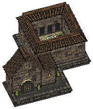
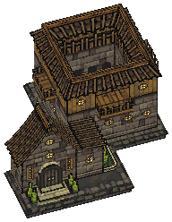

# 修道院（Abbey）

增加经验值的收益。

[原文与贡献者记录](https://ballxpit.wiki.gg/wiki/Abbey) · [修订 3372](https://ballxpit.wiki.gg/index.php?oldid=3372) · [返回目录](../%E7%90%83%E6%AF%94%E4%BC%A6%E6%88%98%E8%AE%B0%20Wiki.md)

#### 信息（Information）

##### 分类（Category）

战争

##### 子类（Subcategory）

总

##### 蓝图位置（Blueprint location）

[FUNGALxFOREST](The_FUNGALxFOREST.md)

##### 基础资源消耗（Base resource cost）

 300  10

##### 建造点消耗（Build point cost）

5

构建修道院时允许增加在水平运行期间获得的经验值数量，而随着水平升级，其数量可以进一步增加。 {? TODO: 这个经验值奖金是否既适用于中流水平，也适用于永久字符水平? 这是否增加了经验值每颗宝石获得的经验值， 还是从敌人那里减少的经验值宝石数量/大小?}

被动效果与升级

| 等级 | 图片 | 描述 | 资源消耗 | 建造点消耗 | 拆除 |
| --- | --- | --- | --- | --- | --- |
| 1 |  | 增加了5%的经验值 |  300  10 | 5 |  300  10 |
| 2 |  | 增加10%的经验值 |  400  15 | 5 |  700  25 |
| 3 |  | 增加15%的经验值 |  600  22 | 15 |  1,300  47 |

[共享导航](../navigation/nav-d4956b01aa56.md)

**分类**　[分类 · 建筑](../categories/Buildings.md) · [分类 · 战争](../categories/Warfare.md) · [分类 · 总](../categories/General.md) · [分类 · 页面有导航框](../categories/Pages_with_navboxes.md)

[返回总入口](../%E7%90%83%E6%AF%94%E4%BC%A6%E6%88%98%E8%AE%B0%20Wiki.md) · [返回本分目录](%E7%9B%AE%E5%BD%95.md)
