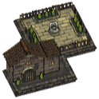
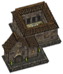
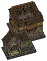

# 修道院（Abbey）

增加获得的经验值。

[原文与贡献者记录](https://ballxpit.wiki.gg/wiki/Abbey) · [修订 3372](https://ballxpit.wiki.gg/index.php?oldid=3372) · [返回目录](../%E7%90%83%E6%AF%94%E4%BC%A6%E6%88%98%E8%AE%B0%20Wiki.md)

## 信息（Information）

### 分类（Category）

战争

### 子类（Subcategory）

将军

### 蓝图位置（Blueprint location）

[FUNGALxFOREST](The_FUNGALxFOREST.md)

### 基础资源消耗（Base resource cost）

 300  10

### 建造点消耗（Build point cost）

5

建造修道院会增加等级提升过程中获得的经验值，该增加量还可以通过升级来进一步提升。{?待办事项：这种经验值加成是否适用于中途的关卡以及永久角色等级？，并且这是会增加从敌人身上掉落的宝石所增加的经验值，还是会增加宝石的数量或大小？}

被动效果与升级

| 等级 | 图片 | 说明 | 资源消耗 | 建造点消耗 | 拆除 |
| --- | --- | --- | --- | --- | --- |
| 1 |  | 经验值增加5% |  300  10 | 5 |  300  10 |
| 2 |  | 经验值增加 10% |  400  15 | 5 |  700  25 |
| 3 |  | 经验值增加15% |  600  22 | 15 |  1,300  47 |

[共享导航](../navigation/nav-d4956b01aa56.md)

**分类**　[分类 · 建筑](../categories/Buildings.md) · [分类 · 战争](../categories/Warfare.md) · [分类 · 通用](../categories/General.md) · [分类 · 带有导航框的页面](../categories/Pages_with_navboxes.md)

[返回总入口](../%E7%90%83%E6%AF%94%E4%BC%A6%E6%88%98%E8%AE%B0%20Wiki.md) · [返回本分目录](%E7%9B%AE%E5%BD%95.md)
