# 成就（Achievements）

[原文与贡献者记录](https://ballxpit.wiki.gg/wiki/Achievements) · [修订 4263](https://ballxpit.wiki.gg/index.php?oldid=4263) · [返回目录](../%E7%90%83%E6%AF%94%E4%BC%A6%E6%88%98%E8%AE%B0%20Wiki.md)

*[球比伦战记](Ball_x_Pit.md)* 目前，在所有支持系统层面的平台上可获得82项成就，其中19项仅通过 [重生球比伦](https://ballxpit.wiki.gg/wiki/Risen_Ballbylon?action=edit&redlink=1) 在线观看

| 成就 | 图片 | 描述 | 需要游戏内容 |
| --- | --- | --- | --- |
| BONExYARD | [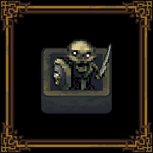](../files/Achievements_BONExYARD.jpg.md) | 完成骨院 | 基本游戏 |
| SNOWYxSHORES | [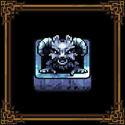](../files/Achievements_SNOWYxSHORES.jpg.md) | 完成 Snowyx 学校 | 基本游戏 |
| LIMINALxDESERT | [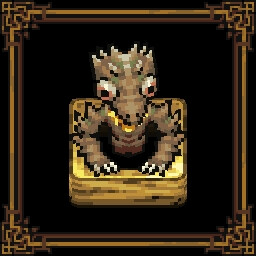](../files/Achievements_LIMINALxDESERT.jpg.md) | 完成LIMINALxDESERT | 基本游戏 |
| GORYxGRASSLANDS | [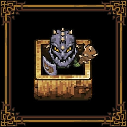](../files/Achievements_GORYxGRASSLANDS.jpg.md) | 完成GORYxGRASSLANDS | 基本游戏 |
| FUNGALxFOREST | [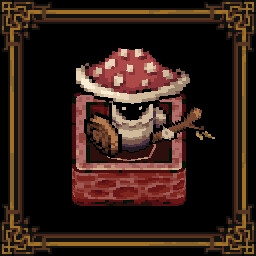](../files/Achievements_FUNGALxFOREST.jpg.md) | 完成FUNGALxFOREST | 基本游戏 |
| SMOLDERINGxDEPTHS | [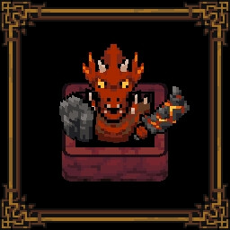](../files/Achievements_SMOLDERINGxDEPTHS.jpg.md) | 填写SMOOLDERINGxDEPT | 基本游戏 |
| HEAVENLYxGATES | [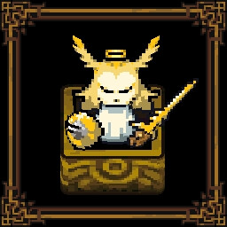](../files/Achievements_HEAVENLYxGATES.jpg.md) | 完成天空之门 | 基本游戏 |
| VASTxVOID | [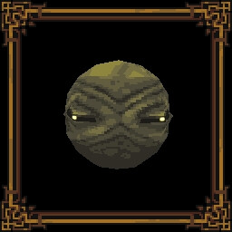](../files/Achievements_VASTxVOID.jpg.md) | 填写VASTxVOID | 基本游戏 |
| 骨院被征服 | [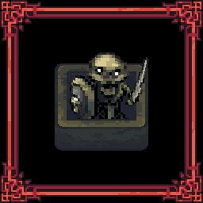](../files/Achievements_BONExYARD_Conquered.jpg.md) | 填写BONExYARD以10个不同的字符 | 基本游戏 |
| 雪上海被征服 | [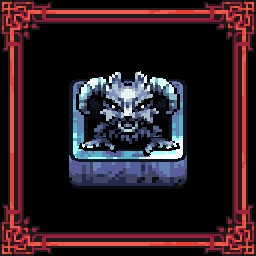](../files/Achievements_SNOWYxSHORES_Conquered.jpg.md) | 完成SNOWYxSHORES以10个不同的字符 | 基本游戏 |
| 战胜了。 | [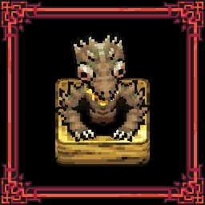](../files/Achievements_LIMINALxDESERT_Conquered.jpg.md) | 填写LIMINALxDESERT以10个不同的字符 | 基本游戏 |
| 戈里克斯格拉斯兰德被征服 |  | 用10个不同的字符填写GORYxGRASSLAND | 基本游戏 |
| 被征服的FUNGALxforforest | [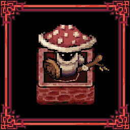](../files/Achievements_FUNGALxFOREST_Conquered.jpg.md) | 填写FUNGALxFOREST以10个不同的字符 | 基本游戏 |
| 爆炸性毒杀 | [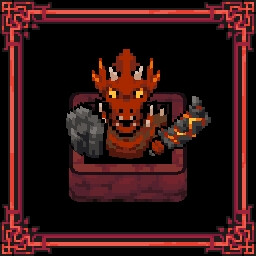](../files/Achievements_SMOLDERINGxDEPTHS_Conquered.jpg.md) | 用10个不同的字符完成SMOLDERINGxDEPTHS | 基本游戏 |
| 天空之门被征服 | [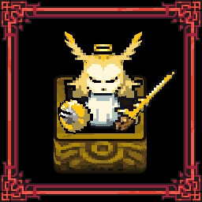](../files/Achievements_HEAVENLYxGATES_Conquered.jpg.md) | 填写天空之门10个不同的字符 | 基本游戏 |
| 瓦斯特斯维多被征服 | [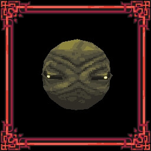](../files/Achievements_VASTxVOID_Conquered.jpg.md) | 填写VASTxVOID以10个不同的字符 | 基本游戏 |
| 真正的战士 | [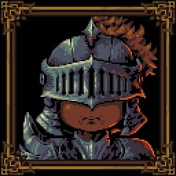](../files/Achievements_True_Warrior.jpg.md) | 完成每一个级别与战士 | 基本游戏 |
| 悔改 |  | 在每一个层面，都要与"悔改者"一起完成。 | 基本游戏 |
| 缩缩的 Itch 缩缩 | [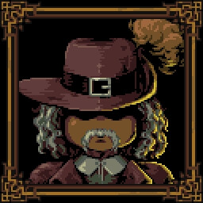](../files/Achievements_Itch_Scratched.jpg.md) | 完成每一个级别，用"刺痛手指" | 基本游戏 |
| 结合 | [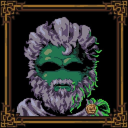](../files/Achievements_Cogitated.jpg.md) | 完成每一个级别，用"认知器" | 基本游戏 |
| 总督 | [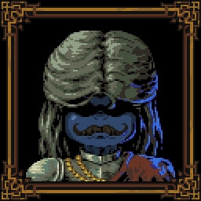](../files/Achievements_Master_General.jpg.md) | 完成每一个层次的战术师 | 基本游戏 |
| 所有花费 | [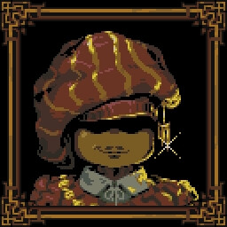](../files/Achievements_All_Spent.jpg.md) | 完成每一个级别的费用节省 | 基本游戏 |
| 嵌入器 | [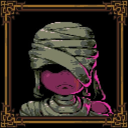](../files/Achievements_Embedder.jpg.md) | 完成每个级别的嵌入式 | 基本游戏 |
| 激进化 | [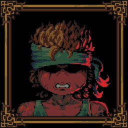](../files/Achievements_Radicalized.jpg.md) | 完成每个级别的激进者 | 基本游戏 |
| 黄金年代 | [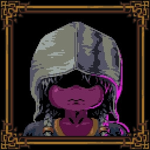](../files/Achievements_Golden_Years.jpg.md) | 完成每一个层次的空巢 | 基本游戏 |
| 长阴影 | [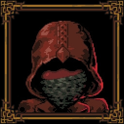](../files/Achievements_Long_Shadow.jpg.md) | 完成每一个层次的影子 | 基本游戏 |
| 没有包装 | [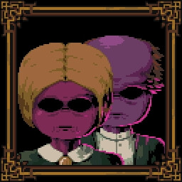](../files/Achievements_Unpacked.jpg.md) | 在"同居者"中完成每一个级别。 | 基本游戏 |
| 重力彩虹 | [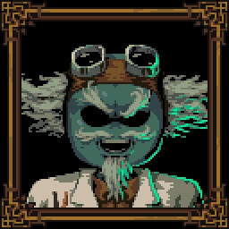](../files/Achievements_Gravitys_Rainbow.jpg.md) | 完成每一个级别的物理学家 | 基本游戏 |
| 打砖高手 | [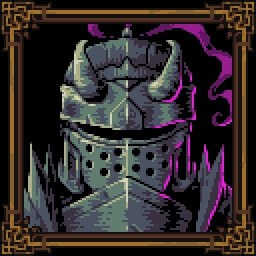](../files/Achievements_Brick_Breaker.jpg.md) | 完成每一个层次的与盾牌携手 | 基本游戏 |
| 赫尔库尔人 | [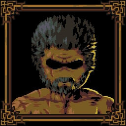](../files/Achievements_Herculean.jpg.md) | 完成每一个层次的临时西西弗 | 基本游戏 |
| 马索赫主义者 | [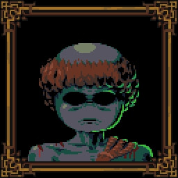](../files/Achievements_Masochist.jpg.md) | 与旗星一起完成每个级别 | 基本游戏 |
| 演员 |  | 完成每个关卡与 Juggler 完成 | 基本游戏 |
| 进化 | [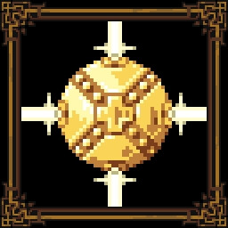](../files/Achievements_Evolution.jpg.md) | 创造你的第一个进化 | 基本游戏 |
| 融合 | [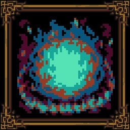](../files/Achievements_Fusion.jpg.md) | 第一次将两个球合并 | 基本游戏 |
| 诺斯法拉图 | [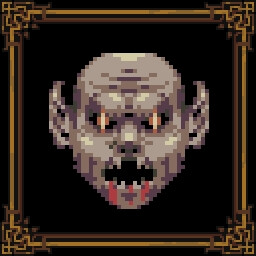](../files/Achievements_Nosferatu.jpg.md) | 创建诺斯法拉图 | 基本游戏 |
| 核弹 | [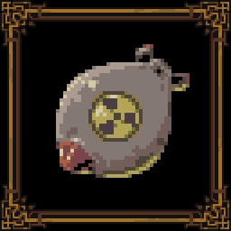](../files/Achievements_Nuclear_Bomb.jpg.md) | 制造核弹 | 基本游戏 |
| 撒旦 | [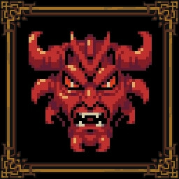](../files/Achievements_Satan.jpg.md) | 创造撒旦 | 基本游戏 |
| 灵魂收获者 | [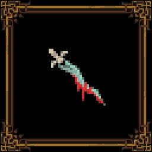](../files/Achievements_Soul_Reaver.jpg.md) | 创造一个灵魂收获者 | 基本游戏 |
| "死眼之十字架" | [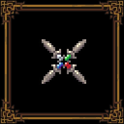](../files/Achievements_Deadeyes_Cross.jpg.md) | 创建死眼的十字架 | 基本游戏 |
| 军团杀手 |  | 击败 100,000 名敌人 | 基本游戏 |
| 财富 | [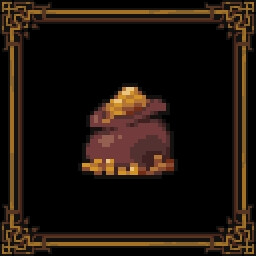](../files/Achievements_Riches.jpg.md) | 总共收集5000枚黄金 | 基本游戏 |
| 麦农 | [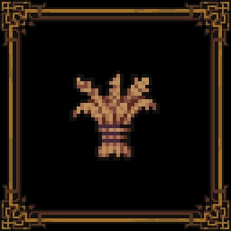](../files/Achievements_Wheat_Farmer.jpg.md) | 收集总计1000粒小麦 | 基本游戏 |
| 伐木师 | [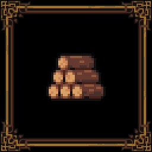](../files/Achievements_Woodcutter.jpg.md) | 总共收集1000个木材 | 基本游戏 |
| 石矿工 | [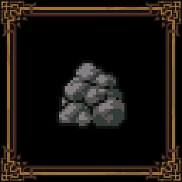](../files/Achievements_Stone_Miner.jpg.md) | 收集1000块石头。 | 基本游戏 |
| 金矿机 |  | 在一个收获中挖1000枚黄金 | 基本游戏 |
| 丰富的收获 | [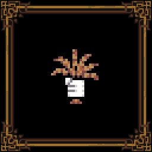](../files/Achievements_Bountiful_Harvest.jpg.md) | 一次收获100粒小麦 | 基本游戏 |
| 森林砍伐 | [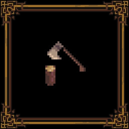](../files/Achievements_Deforestation.jpg.md) | 在一个收获中收集100棵木头 | 基本游戏 |
| 石头破碎器 | [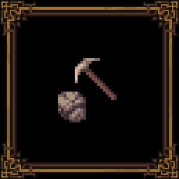](../files/Achievements_Boulder_Breaker.jpg.md) | 在一个收获中收集100块石头 | 基本游戏 |
| 城市规划者 |  | 收集50个蓝图 | 基本游戏 |
| 奖杯 | [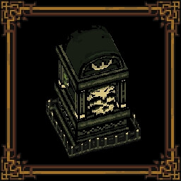](../files/Achievements_Trophy.jpg.md) | 建立一个奖杯 | 基本游戏 |
| 纪念碑 | [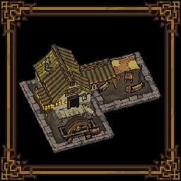](../files/Achievements_Monument.jpg.md) | 构建一个无限的升级建筑 | 基本游戏 |
| 工人协会 |  | 建立工人协会 | 基本游戏 |
| 进化室 | [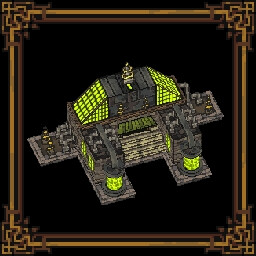](../files/Achievements_Evolution_Chamber.jpg.md) | 构建进化室 | 基本游戏 |
| 遗物收藏家 | [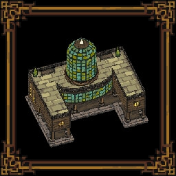](../files/Achievements_Relic_Collector.jpg.md) | 建造遗物收藏器 | 基本游戏 |
| 包装机器 | [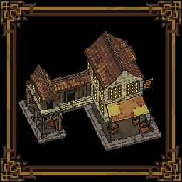](../files/Achievements_Bag_Maker.jpg.md) | 打造包装机 | 基本游戏 |
| 木匠 | [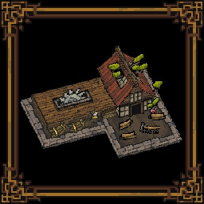](../files/Achievements_Carpenter.jpg.md) | 建造木匠 | 基本游戏 |
| 土地抢占者 | [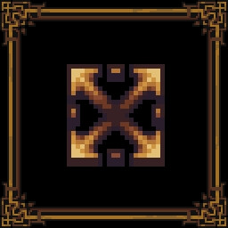](../files/Achievements_Land_Grabber.jpg.md) | 扩大你的基地5次 | 基本游戏 |
| 结构性力量 |  | 在任何建筑物属性中获得+5奖金 | 基本游戏 |
| 级别 |  | 在任何属性中达到 S stat 扩展 | 基本游戏 |
| 邻居 |  | 建造15个住房结构 | 基本游戏 |
| 融合进化 |  | 结合两个进化的球 | 基本游戏 |
| 学者 |  | 解锁百科全书中的每一个条目 | 基本游戏 |
| 芭比隆已经升起 |  | 完成游戏 | 基本游戏 |
| FLOODEDxSEWERS |  | 完成 FLOODEDxSEWERS 完成 | [重生球比伦（Risen Ballbylon）](https://ballxpit.wiki.gg/wiki/Risen_Ballbylon?action=edit&redlink=1) |
| FLOODEDx碎片 |  | 填写FLOODEDxSEWERS以30个字符 | [重生球比伦（Risen Ballbylon）](https://ballxpit.wiki.gg/wiki/Risen_Ballbylon?action=edit&redlink=1) |
| SHADOWEDxALLEYS |  | 完成 SHADED 轴 | [重生球比伦（Risen Ballbylon）](https://ballxpit.wiki.gg/wiki/Risen_Ballbylon?action=edit&redlink=1) |
| 被施用 |  | 填写30个字符的 ShadowWEDxALLYS | [重生球比伦（Risen Ballbylon）](https://ballxpit.wiki.gg/wiki/Risen_Ballbylon?action=edit&redlink=1) |
| CASTLExRAMPARTS |  | 填写CASTLExRAMPARTS | [重生球比伦（Risen Ballbylon）](https://ballxpit.wiki.gg/wiki/Risen_Ballbylon?action=edit&redlink=1) |
| 化学发射体 |  | 填写CASTLExRAMPARTS的30个字符 | [重生球比伦（Risen Ballbylon）](https://ballxpit.wiki.gg/wiki/Risen_Ballbylon?action=edit&redlink=1) |
| OUTSTRETCHEDxSPIRE |  | 完成排出完成 | [重生球比伦（Risen Ballbylon）](https://ballxpit.wiki.gg/wiki/Risen_Ballbylon?action=edit&redlink=1) |
| 被淘汰的 |  | 完成OUTSTRETCHEDxSPIRE的30个字符 | [重生球比伦（Risen Ballbylon）](https://ballxpit.wiki.gg/wiki/Risen_Ballbylon?action=edit&redlink=1) |
| 骨院被统治 |  | 填写BONExYARD30个字符 | [重生球比伦（Risen Ballbylon）](https://ballxpit.wiki.gg/wiki/Risen_Ballbylon?action=edit&redlink=1) |
| 雪上海地区占据主导地位 |  | 完成30个字符的SNOWYxSHORES | [重生球比伦（Risen Ballbylon）](https://ballxpit.wiki.gg/wiki/Risen_Ballbylon?action=edit&redlink=1) |
| 马里纳克谢德 |  | 完成LIMINALxDESERT以30个字符 | [重生球比伦（Risen Ballbylon）](https://ballxpit.wiki.gg/wiki/Risen_Ballbylon?action=edit&redlink=1) |
| 毒性毒性毒性施用 |  | 完成FUNGALxFOREST的30个字符 | [重生球比伦（Risen Ballbylon）](https://ballxpit.wiki.gg/wiki/Risen_Ballbylon?action=edit&redlink=1) |
| 格鲁吉亚地区占据主导地位 |  | 填写GORYxGRASSLANDS的30个字符 | [重生球比伦（Risen Ballbylon）](https://ballxpit.wiki.gg/wiki/Risen_Ballbylon?action=edit&redlink=1) |
| 甲苯甲苯甲酯 |  | 填写30个字符的 SMOLDERINGxDEPTHS | [重生球比伦（Risen Ballbylon）](https://ballxpit.wiki.gg/wiki/Risen_Ballbylon?action=edit&redlink=1) |
| 天空之门被统治 |  | 完成 HEAVENLYxGATES以30个字符 | [重生球比伦（Risen Ballbylon）](https://ballxpit.wiki.gg/wiki/Risen_Ballbylon?action=edit&redlink=1) |
| 瓦斯特斯沃伊德统治 |  | 填写VASTxVOID以30个字符 | [重生球比伦（Risen Ballbylon）](https://ballxpit.wiki.gg/wiki/Risen_Ballbylon?action=edit&redlink=1) |
| 晶体质 |  | 收集1000个晶体 | [重生球比伦（Risen Ballbylon）](https://ballxpit.wiki.gg/wiki/Risen_Ballbylon?action=edit&redlink=1) |
| 复活的学者 |  | 解锁百科全书中的每一个Risen 球比伦条目 | [重生球比伦（Risen Ballbylon）](https://ballxpit.wiki.gg/wiki/Risen_Ballbylon?action=edit&redlink=1) |
| 球比伦瀑布再次 |  | 完成Risen 球比伦 DLC | [重生球比伦（Risen Ballbylon）](https://ballxpit.wiki.gg/wiki/Risen_Ballbylon?action=edit&redlink=1) |

[返回总入口](../%E7%90%83%E6%AF%94%E4%BC%A6%E6%88%98%E8%AE%B0%20Wiki.md) · [返回本分目录](%E7%9B%AE%E5%BD%95.md)
