# 成就（Achievements）

[原文与贡献者记录](https://ballxpit.wiki.gg/wiki/Achievements) · [修订 4263](https://ballxpit.wiki.gg/index.php?oldid=4263) · [返回目录](../%E7%90%83%E6%AF%94%E4%BC%A6%E6%88%98%E8%AE%B0%20Wiki.md)

*[球比伦战记](Ball_x_Pit.md)* 目前在所有支持的系统级平台上拥有 82 项成就，其中 19 项只能通过 [重生球比伦](https://ballxpit.wiki.gg/wiki/Risen_Ballbylon?action=edit&redlink=1) DLC 获得。

| 成就 | 图片 | 说明 | 需要游戏内容 |
| --- | --- | --- | --- |
| BONExYARD | [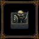](../files/Achievements_BONExYARD.jpg.md) | 完成 BONExYARD 任务 | 基础游戏 |
| SNOWYxSHORES | [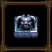](../files/Achievements_SNOWYxSHORES.jpg.md) | 通关白雪海岸 | 基础游戏 |
| LIMINALxDESERT | [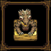](../files/Achievements_LIMINALxDESERT.jpg.md) | 完成 LIMINALxDESERT 任务 | 基础游戏 |
| GORYxGRASSLANDS | [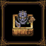](../files/Achievements_GORYxGRASSLANDS.jpg.md) | 通关血腥草原 | 基础游戏 |
| FUNGALxFOREST |  | 完成 FUNGALxFOREST 游戏百科 | 基础游戏 |
| SMOLDERINGxDEPTHS | [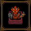](../files/Achievements_SMOLDERINGxDEPTHS.jpg.md) | 完成 SMOLDERINGxDEPTHS | 基础游戏 |
| HEAVENLYxGATES |  | 完成《球比伦战记》游戏百科任务 | 基础游戏 |
| VASTxVOID | [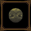](../files/Achievements_VASTxVOID.jpg.md) | 完成 VASTxVOID | 基础游戏 |
| BONExYARD 征服成功 | [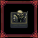](../files/Achievements_BONExYARD_Conquered.jpg.md) | 使用10个不同的角色完成BONExYARD任务 | 基础游戏 |
| SNOWYxSHORES 征服之战 | [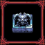](../files/Achievements_SNOWYxSHORES_Conquered.jpg.md) | 使用10个不同的角色完成《球比伦战记》的SNOWYxSHORES篇章 | 基础游戏 |
| LIMINALxDESERT 征服者 | [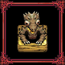](../files/Achievements_LIMINALxDESERT_Conquered.jpg.md) | 使用10个不同的角色完成LIMINALxDESERT | 基础游戏 |
| GORYxGRASSLANDS 被征服 |  | 使用10个不同的角色完成《GORYxGRASSLANDS》游戏。 | 基础游戏 |
| FUNGALxFOREST 征服之战 |  | 使用10个不同的角色完成《球比伦战记》的FUNGALxFOREST游戏内容 | 基础游戏 |
| SMOLDERINGxDEPTHS 被征服 | [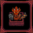](../files/Achievements_SMOLDERINGxDEPTHS_Conquered.jpg.md) | 使用10个不同的角色完成《球比伦战记》的SMOLDERINGxDEPTHS | 基础游戏 |
| HEAVENLYxGATES 征服 |  | 使用10个不同的角色完成《球比伦战记》的HEAVENLYxGATES | 基础游戏 |
| VASTxVOID 征服成功 |  | 使用10个不同的角色完成VASTxVOID | 基础游戏 |
| 真正的战士 | [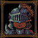](../files/Achievements_True_Warrior.jpg.md) | 以战士身份完成每一关 | 基础游戏 |
| 悔改 |  | 完成所有关卡，包括“悔悟者”关卡。 | 基础游戏 |
| 痒痒的划痕 |  | 通过《球比伦战记》游戏的每一关 | 基础游戏 |
| 思考了 | [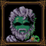](../files/Achievements_Cogitated.jpg.md) | 用思考者完成每一关 | 基础游戏 |
| 总司令 | [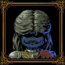](../files/Achievements_Master_General.jpg.md) | 以战术家身份完成所有关卡 | 基础游戏 |
| 所有资源已使用 | [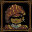](../files/Achievements_All_Spent.jpg.md) | 完成每一关，由挥霍者担任角色。 | 基础游戏 |
| 嵌入者 | [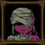](../files/Achievements_Embedder.jpg.md) | 完成每个关卡，包括“The Embedded”关卡。 | 基础游戏 |
| 激进化 | [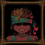](../files/Achievements_Radicalized.jpg.md) | 完成所有关卡，使用“The Radical”技能。 | 基础游戏 |
| 黄金岁月 |  | 完成每一关的“空巢者”挑战 | 基础游戏 |
| 长影 | [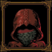](../files/Achievements_Long_Shadow.jpg.md) | 完成每一关，由“阴影”引导。 | 基础游戏 |
| 解压 |  | 完成所有与The Cohabitants相关的关卡 | 基础游戏 |
| 《重力彩虹》 |  | 完成所有关卡，由“物理学家”担任主角。 | 基础游戏 |
| 打砖高手 |  | 完成每一关，并拥有持盾者 | 基础游戏 |
| 赫丘勒式的 | [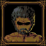](../files/Achievements_Herculean.jpg.md) | 完成每一关的“临时西西弗斯”挑战。 | 基础游戏 |
| 受虐狂 | [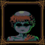](../files/Achievements_Masochist.jpg.md) | 完成每一关，并携带旗帜鞭。 | 基础游戏 |
| 艺人 | [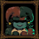](../files/Achievements_Entertainer.jpg.md) | 完成所有由“变戏法者”带来的关卡 | 基础游戏 |
| 进化 |  | 创建你的第一个进化版本 | 基础游戏 |
| 融合 |  | 首次将两个球融合在一起 | 基础游戏 |
| 诺斯费拉图 | [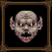](../files/Achievements_Nosferatu.jpg.md) | 创建诺斯费拉图 | 基础游戏 |
| 核弹 | [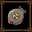](../files/Achievements_Nuclear_Bomb.jpg.md) | 制造一枚核弹 | 基础游戏 |
| 撒旦 |  | 创造撒旦 | 基础游戏 |
| 灵魂掠夺者 | [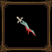](../files/Achievements_Soul_Reaver.jpg.md) | 创建一名灵魂掠夺者 | 基础游戏 |
| 神射手十字架 | [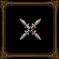](../files/Achievements_Deadeyes_Cross.jpg.md) | 创建死神之十字 | 基础游戏 |
| Legion Slayer |  | 击败 100,000 名敌人 | 基础游戏 |
| 财富 | [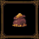](../files/Achievements_Riches.jpg.md) | 总共收集5000金币 | 基础游戏 |
| 小麦农民 |  | 总共收集1000小麦 | 基础游戏 |
| 伐木者 | [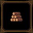](../files/Achievements_Woodcutter.jpg.md) | 总共收集1000块木材 | 基础游戏 |
| 石矿工 | [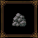](../files/Achievements_Stone_Miner.jpg.md) | 总共收集1000块石头 | 基础游戏 |
| 金矿开采 | [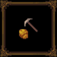](../files/Achievements_Gold_Miner.jpg.md) | 一次收获就能收获1000金币 | 基础游戏 |
| 丰饶收获 |  | 一次收获中收集100小麦 | 基础游戏 |
| 森林砍伐 | [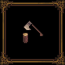](../files/Achievements_Deforestation.jpg.md) | 一次收获收集100块木材 | 基础游戏 |
| Boulder Breaker | [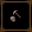](../files/Achievements_Boulder_Breaker.jpg.md) | 一次收获收集100块石头 | 基础游戏 |
| 城市规划者 | [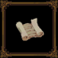](../files/Achievements_City_Planner.jpg.md) | 收集50个建筑蓝图 | 基础游戏 |
| 奖杯 | [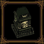](../files/Achievements_Trophy.jpg.md) | 制作一个奖杯 | 基础游戏 |
| 纪念碑 | [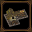](../files/Achievements_Monument.jpg.md) | 建造一座可无限升级的建筑 | 基础游戏 |
| 工人工会 | [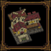](../files/Achievements_Workers_Guild.jpg.md) | 建造工人工会 | 基础游戏 |
| 进化舱 | [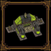](../files/Achievements_Evolution_Chamber.jpg.md) | 构建进化舱 | 基础游戏 |
| 遗物收集者 | [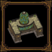](../files/Achievements_Relic_Collector.jpg.md) | 建造遗物收集者 | 基础游戏 |
| 包制师 | [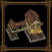](../files/Achievements_Bag_Maker.jpg.md) | 建造包袋制造者 | 基础游戏 |
| 木匠 | [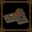](../files/Achievements_Carpenter.jpg.md) | 建造木匠 | 基础游戏 |
| 霸占土地者 |  | 将你的基地展开5倍 | 基础游戏 |
| 结构力量 | [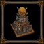](../files/Achievements_Structural_Power.jpg.md) | 从建筑中获取任何属性加值 +5 的加成 | 基础游戏 |
| S级 | [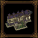](../files/Achievements_S_Rank.jpg.md) | 任何属性中的 Reach S 属性成长值 | 基础游戏 |
| 邻域 | [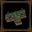](../files/Achievements_Neighborhood.jpg.md) | 构筑15座住房建筑 | 基础游戏 |
| 融合进化 | [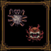](../files/Achievements_Fusion_Evolution.jpg.md) | 融合两个进化圆球 | 基础游戏 |
| 学者 | [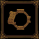](../files/Achievements_Scholar.jpg.md) | 解锁百科全书的每一条目 | 基础游戏 |
| 球比伦崛起 |  | 完成游戏 | 基础游戏 |
| FLOODEDxSEWERS | [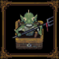](../files/Achievements_RB_FLOODEDxSEWERS.jpg.md) | 通关积水下水道 | [重生球比伦（Risen Ballbylon）](https://ballxpit.wiki.gg/wiki/Risen_Ballbylon?action=edit&redlink=1) |
| FLOODEDxSEWERS 占据主导地位 | [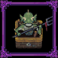](../files/Achievements_RB_FLOODEDxSEWERS_Dominated.jpg.md) | 使用30个角色完成《球比伦战记》的FLOODEDxSEWERS | [重生球比伦（Risen Ballbylon）](https://ballxpit.wiki.gg/wiki/Risen_Ballbylon?action=edit&redlink=1) |
| SHADOWEDxALLEYS | [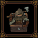](../files/Achievements_RB_SHADOWEDxALLEYS.jpg.md) | 通关暗影小巷 | [重生球比伦（Risen Ballbylon）](https://ballxpit.wiki.gg/wiki/Risen_Ballbylon?action=edit&redlink=1) |
| SHADOWEDxALLEYS 占据主导地位 | [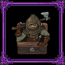](../files/Achievements_RB_SHADOWEDxALLEYS_Dominated.jpg.md) | 使用30个角色完成《球比伦战记》的SHADOWEDxALLEYS | [重生球比伦（Risen Ballbylon）](https://ballxpit.wiki.gg/wiki/Risen_Ballbylon?action=edit&redlink=1) |
| CASTLExRAMPARTS | [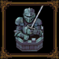](../files/Achievements_RB_CASTLExRAMPARTS.jpg.md) | 完成CASTLExRAMPARTS | [重生球比伦（Risen Ballbylon）](https://ballxpit.wiki.gg/wiki/Risen_Ballbylon?action=edit&redlink=1) |
| CASTLExRAMPARTS 占优 | [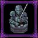](../files/Achievements_RB_CASTLExRAMPARTS_Dominated.jpg.md) | 使用30个角色完成CASTLExRAMPARTS | [重生球比伦（Risen Ballbylon）](https://ballxpit.wiki.gg/wiki/Risen_Ballbylon?action=edit&redlink=1) |
| OUTSTRETCHEDxSPIRE | [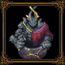](../files/Achievements_RB_OUTSTRETCHEDxSPIRE.jpg.md) | 完成 OUTSTRETCHEDxSPIRE | [重生球比伦（Risen Ballbylon）](https://ballxpit.wiki.gg/wiki/Risen_Ballbylon?action=edit&redlink=1) |
| OUTSTRETCHEDxSPIRE 主宰 |  | 用30个角色完成“OUTSTRETCHEDxSPIRE”任务 | [重生球比伦（Risen Ballbylon）](https://ballxpit.wiki.gg/wiki/Risen_Ballbylon?action=edit&redlink=1) |
| BONExYARD 占据优势 |  | 用30个角色完成BONExYARD | [重生球比伦（Risen Ballbylon）](https://ballxpit.wiki.gg/wiki/Risen_Ballbylon?action=edit&redlink=1) |
| SNOWYxSHORES 占据主导地位 |  | 使用30个角色完成《球比伦战记》的SNOWYxSHORES篇章 | [重生球比伦（Risen Ballbylon）](https://ballxpit.wiki.gg/wiki/Risen_Ballbylon?action=edit&redlink=1) |
| LIMINALxDESERT 占据优势 |  | 用30个角色完成LIMINALxDESERT | [重生球比伦（Risen Ballbylon）](https://ballxpit.wiki.gg/wiki/Risen_Ballbylon?action=edit&redlink=1) |
| FUNGALxFOREST 占据主导地位 |  | 使用30个角色完成《球比伦战记》的FUNGALxFOREST | [重生球比伦（Risen Ballbylon）](https://ballxpit.wiki.gg/wiki/Risen_Ballbylon?action=edit&redlink=1) |
| GORYxGRASSLANDS 占据主导地位 |  | 使用30个角色完成《球比伦战记》的GORYxGRASSLANDS | [重生球比伦（Risen Ballbylon）](https://ballxpit.wiki.gg/wiki/Risen_Ballbylon?action=edit&redlink=1) |
| SMOLDERINGxDEPTHS 占据主导地位 |  | 使用30个角色完成《球比伦战记》的SMOLDERINGxDEPTHS | [重生球比伦（Risen Ballbylon）](https://ballxpit.wiki.gg/wiki/Risen_Ballbylon?action=edit&redlink=1) |
| HEAVENLYxGATES 占据主导地位 |  | 使用30个角色完成《球比伦战记》的HEAVENLYxGATES | [重生球比伦（Risen Ballbylon）](https://ballxpit.wiki.gg/wiki/Risen_Ballbylon?action=edit&redlink=1) |
| VASTxVOID 占据主导地位 |  | 用30个角色完成VASTxVOID | [重生球比伦（Risen Ballbylon）](https://ballxpit.wiki.gg/wiki/Risen_Ballbylon?action=edit&redlink=1) |
| 晶质 |  | 总共收集1000个水晶 | [重生球比伦（Risen Ballbylon）](https://ballxpit.wiki.gg/wiki/Risen_Ballbylon?action=edit&redlink=1) |
| Risen Scholar |  | 解锁百科全书中所有“崛起的球比伦”条目 | [重生球比伦（Risen Ballbylon）](https://ballxpit.wiki.gg/wiki/Risen_Ballbylon?action=edit&redlink=1) |
| 球比伦再次坠落 |  | 完成《球比伦战记》Risen Ballbylon扩展包 | [重生球比伦（Risen Ballbylon）](https://ballxpit.wiki.gg/wiki/Risen_Ballbylon?action=edit&redlink=1) |

[返回总入口](../%E7%90%83%E6%AF%94%E4%BC%A6%E6%88%98%E8%AE%B0%20Wiki.md) · [返回本分目录](%E7%9B%AE%E5%BD%95.md)
