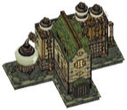

# 炼金术士（Alchemist）

提高耐力的属性系数等级。

[原文与贡献者记录](https://ballxpit.wiki.gg/wiki/Alchemist) · [修订 3360](https://ballxpit.wiki.gg/index.php?oldid=3360) · [返回目录](../%E7%90%83%E6%AF%94%E4%BC%A6%E6%88%98%E8%AE%B0%20Wiki.md)

## 信息（Information）

### 分类（Category）

战争

### 子类（Subcategory）

属性成长

### 蓝图位置（Blueprint location）

[SNOWYxSHORES](The_SNOWYxSHORES.md)

### 基础资源消耗（Base resource cost）

 100  15  5

### 建造点消耗（Build point cost）

8

炼金术士是六座提高属性系数的建筑之一，可提高所有角色的耐力系数等级。建成后从基础 E 级提升到 D 级，升级最高可达 S 级。系数等级越高，每点耐力给相关能力带来的加成越大。建筑升至 5 级可解锁「S 级」（S Rank）成就。

被动效果与升级

| 等级 | 图片 | 说明 | 资源消耗 | 建造点消耗 | 拆除 |
| --- | --- | --- | --- | --- | --- |
| 1 |  | 将耐力的属性系数提升至 D 级。随着耐力提高，生命值等相关数值获得的改善也会更大。 |  100  15  5 | 8 |  100  15  5 |
| 2 |  | 将耐力的属性系数提升至 C 级。随着耐力提高，生命值等相关数值获得的改善也会更大。 |  150  20  5 | 8 |  250  35  10 |
| 3 |  | 将耐力的属性系数提升至 B 级。随着耐力提高，生命值等相关数值获得的改善也会更大。 |  300  40  10 | 24 |  550  75  20 |
| 4 |  | 将耐力的属性系数提升至 A 级。随着耐力提高，生命值等相关数值获得的改善也会更大。 |  750  100  25 | 40 |  1,300  175  45 |
| 5 |  | 将耐力的属性系数提升至 S 级。随着耐力提高，生命值等相关数值获得的改善也会更大。 |  1,500  200  50 | 56 |  2,800  375  95 |

[共享导航](../navigation/nav-d4956b01aa56.md)

**分类**　[分类 · 建筑](../categories/Buildings.md) · [分类 · 战争](../categories/Warfare.md) · [分类 · 属性成长](../categories/Stat_Scaling.md) · [分类 · 带有导航框的页面](../categories/Pages_with_navboxes.md)

[返回总入口](../%E7%90%83%E6%AF%94%E4%BC%A6%E6%88%98%E8%AE%B0%20Wiki.md) · [返回本分目录](%E7%9B%AE%E5%BD%95.md)
