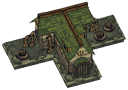
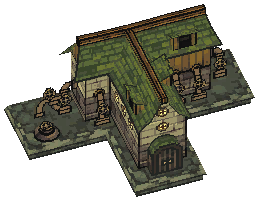

# 化学家（Alchemist）

增加 <stat\_endurance.png> 耐力扩展等级。

[原文与贡献者记录](https://ballxpit.wiki.gg/wiki/Alchemist) · [修订 3360](https://ballxpit.wiki.gg/index.php?oldid=3360) · [返回目录](../%E7%90%83%E6%AF%94%E4%BC%A6%E6%88%98%E8%AE%B0%20Wiki.md)

#### 信息（Information）

##### 分类（Category）

战争

##### 子类（Subcategory）

统计规模

##### 蓝图位置（Blueprint location）

[SNOWYxSHORES](The_SNOWYxSHORES.md)

##### 基础资源消耗（Base resource cost）

 100  15  5

##### 建造点消耗（Build point cost）

8

在六个尺度尺度建筑中， 炼金术士增加了所有字符的尺度尺度级别。这种数字扩展奖励从基层E级增加到D级，但随着建筑升级，可进一步增加到最高的S级。每个增加的统计规模级别都相当于对该统计中的每个点所应用的相关能力的比例奖励的增加。将这栋大楼全面升级为5级，从而获得了SRAK的成绩。

被动效果与升级

| 等级 | 图片 | 描述 | 资源消耗 | 建造点消耗 | 拆除 |
| --- | --- | --- | --- | --- | --- |
| 1 |  | 提高 \<stat\_endurance.png\> 耐力规模到D (随着你的 \<stat\_endurance.png\> 耐力变得更高，像生命值这样的相关统计数据将更快地改善) |  100  15  5 | 8 |  100  15  5 |
| 2 |  | 提高 \<stat\_endurance.png\> 耐力规模到C (随着你的 \<stat\_endurance.png\> 耐力变得更高，像生命值这样的相关统计数据将更快地改善) |  150  20  5 | 8 |  250  35  10 |
| 3 |  | 提高 \<stat\_endurance.png\> 耐力规模到B (随着你的 \<stat\_endurance.png\> 耐力变得更高，像生命值这样的相关统计数据将更快地改善) |  300  40  10 | 24 |  550  75  20 |
| 4 |  | 提高 \<stat\_endurance.png\> 耐力规模到A (随着你的 \<stat\_endurance.png\> 耐力变得更高，像生命值这样的相关统计数据将更快地改善) |  750  100  25 | 40 |  1,300  175  45 |
| 5 |  | 提高 \<stat\_endurance.png\> 耐力规模到 S (随着你的 \<stat\_endurance.png\> 耐力变得更高，像生命值这样的相关统计数据将更快地改善) |  1,500  200  50 | 56 |  2,800  375  95 |

[共享导航](../navigation/nav-d4956b01aa56.md)

**分类**　[分类 · 建筑](../categories/Buildings.md) · [分类 · 战争](../categories/Warfare.md) · [分类 · 统计规模](../categories/Stat_Scaling.md) · [分类 · 页面有导航框](../categories/Pages_with_navboxes.md)

[返回总入口](../%E7%90%83%E6%AF%94%E4%BC%A6%E6%88%98%E8%AE%B0%20Wiki.md) · [返回本分目录](%E7%9B%AE%E5%BD%95.md)
