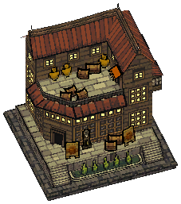

# 古董店（Antique Shop）

开始每一次战斗，选择一个被动的。

[原文与贡献者记录](https://ballxpit.wiki.gg/wiki/Antique_Shop) · [修订 3385](https://ballxpit.wiki.gg/index.php?oldid=3385) · [返回目录](../%E7%90%83%E6%AF%94%E4%BC%A6%E6%88%98%E8%AE%B0%20Wiki.md)

#### 信息（Information）

##### 分类（Category）

战争

##### 子类（Subcategory）

总

##### 蓝图位置（Blueprint location）

[GORYxGRASSLANDS](The_GORYxGRASSLANDS.md)

##### 基础资源消耗（Base resource cost）

 1,000  40

##### 建造点消耗（Build point cost）

40

构建古董店让玩家在每个级别运行开始时可以选择额外的被动。此奖励被动从1级开始，但通过建筑升级可以增加起始水平。请注意，这个被动的起始水平是 **NOT** 受到从 [遗物收藏家](Relic_Collector_Building.md)然而，通过下列办法仍然可以增加从中选择的被动者的数目: [冥想帐篷](Meditation_Tent.md).

被动效果与升级

| 等级 | 图片 | 描述 | 资源消耗 | 建造点消耗 | 拆除 |
| --- | --- | --- | --- | --- | --- |
| 1 |  | 开始每一次战斗，选择一个被动的战斗。 |  1,000  40 | 40 |  1,000  40 |
| 2 |  | 开始每一次战斗，选择一个被动的战斗。 奖金被动从2级开始 |  1,500  80 | 40 |  2,500  120 |
| 3 |  | 开始每一次战斗，选择一个被动的战斗。 奖金被动从3级开始 |  2,250  120 | 120 |  4,750  240 |

[共享导航](../navigation/nav-d4956b01aa56.md)

**分类**　[分类 · 建筑](../categories/Buildings.md) · [分类 · 战争](../categories/Warfare.md) · [分类 · 总](../categories/General.md) · [分类 · 页面有导航框](../categories/Pages_with_navboxes.md)

[返回总入口](../%E7%90%83%E6%AF%94%E4%BC%A6%E6%88%98%E8%AE%B0%20Wiki.md) · [返回本分目录](%E7%9B%AE%E5%BD%95.md)
