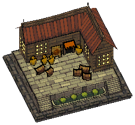
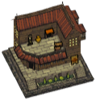

# 古董店（Antique Shop）

每场战斗开始时，可选择一种被动技能。

[原文与贡献者记录](https://ballxpit.wiki.gg/wiki/Antique_Shop) · [修订 3385](https://ballxpit.wiki.gg/index.php?oldid=3385) · [返回目录](../%E7%90%83%E6%AF%94%E4%BC%A6%E6%88%98%E8%AE%B0%20Wiki.md)

## 信息（Information）

### 分类（Category）

战争

### 子类（Subcategory）

将军

### 蓝图位置（Blueprint location）

[GORYxGRASSLANDS](The_GORYxGRASSLANDS.md)

### 基础资源消耗（Base resource cost）

 1,000  40

### 建造点消耗（Build point cost）

40

建造古董店功能让玩家在每级游戏开始时可以选择一个额外的被动技能。这个额外被动技能从1级开始生效，但可以通过建造升级来提升其初始等级。请注意，该被动技能的初始等级是 **NOT** 受起始等级加成的影响，由……提供。 [遗物收集者](Relic_Collector_Building.md)不过，可选择的被动道具数量仍可以通过增加来提升。 [冥想帐篷](Meditation_Tent.md).

被动效果与升级

| 等级 | 图片 | 说明 | 资源消耗 | 建造点消耗 | 拆除 |
| --- | --- | --- | --- | --- | --- |
| 1 |  | 每场战斗都从选择一个被动技能开始。 |  1,000  40 | 40 |  1,000  40 |
| 2 |  | 每场战斗都从选择一个被动技能开始。 奖励被动效果从 2 级开始生效 |  1,500  80 | 40 |  2,500  120 |
| 3 |  | 每场战斗都从选择一个被动技能开始。 奖励被动效果从 3 级开始生效 |  2,250  120 | 120 |  4,750  240 |

[共享导航](../navigation/nav-d4956b01aa56.md)

**分类**　[分类 · 建筑](../categories/Buildings.md) · [分类 · 战争](../categories/Warfare.md) · [分类 · 通用](../categories/General.md) · [分类 · 带有导航框的页面](../categories/Pages_with_navboxes.md)

[返回总入口](../%E7%90%83%E6%AF%94%E4%BC%A6%E6%88%98%E8%AE%B0%20Wiki.md) · [返回本分目录](%E7%9B%AE%E5%BD%95.md)
