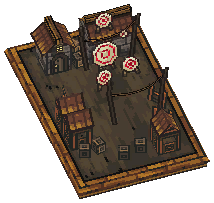
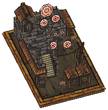
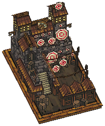

# 射箭射击范围（Archery Range）

增加 <stat\_ dexterity. png> 的 Dexterity 缩放等级。

[原文与贡献者记录](https://ballxpit.wiki.gg/wiki/Archery_Range) · [修订 3362](https://ballxpit.wiki.gg/index.php?oldid=3362) · [返回目录](../%E7%90%83%E6%AF%94%E4%BC%A6%E6%88%98%E8%AE%B0%20Wiki.md)

#### 信息（Information）

##### 分类（Category）

战争

##### 子类（Subcategory）

统计规模

##### 蓝图位置（Blueprint location）

[LIMINALxDESERT](The_LIMINALxDESERT.md)

##### 基础资源消耗（Base resource cost）

 12  12

##### 建造点消耗（Build point cost）

8

射箭范围是六个数据尺寸建筑之一，增加了所有字符的数据尺寸级别 <stat\_dexterity.png> Dexterity.这种数字扩展奖励从基层E级增加到D级，但随着建筑升级，可进一步增加到最高的S级。每个增加的统计规模级别都相当于对该统计中的每个点所应用的相关能力的比例奖励的增加。将这栋大楼全面升级为5级，从而获得了SRAK的成绩。

被动效果与升级

| 等级 | 图片 | 描述 | 资源消耗 | 建造点消耗 | 拆除 |
| --- | --- | --- | --- | --- | --- |
| 1 |  | 将 \< stat\_ dexterity. png\> 的变异性缩放到 D( 随着您的 \< stat\_dexterity.png\> 变高， 重装入长度等相关数据将更快提高) |  12  12 | 8 |  12  12 |
| 2 |  | 将 \< stat\_ dexterity. png\> 的变异性缩放到 C (随着您的 \< stat\_dexterity.png\> 变高， 重装入长度等相关数据将更快提高) |  200  15  15 | 8 |  200  27  27 |
| 3 |  | 将 \< stat\_ dexterity. png\> 的 Dextity 缩放升为 B( 随着您的 \< stat\_dexterity.png\> 变高， 再加长等相关数据将更快提高) |  400  30  30 | 24 |  600  57  57 |
| 4 |  | 将 \< stat\_ dexterity. png\> 的变异度缩放到 A (随着您的 \< stat\_dexterity.png\> 变高， 重装入长度等相关数据将更快提高) |  1,000  75  75 | 40 |  1,600  132  132 |
| 5 |  | 将 \<stat\_ dexterity.png\> 的变异性缩放到 S (随着您的 \<stat\_dexterity. png\> 变高， 重装入长度等相关数据将更快提高) |  2,000  150  150 | 56 |  3,600  282  282 |

[共享导航](../navigation/nav-d4956b01aa56.md)

**分类**　[分类 · 建筑](../categories/Buildings.md) · [分类 · 战争](../categories/Warfare.md) · [分类 · 统计规模](../categories/Stat_Scaling.md) · [分类 · 页面有导航框](../categories/Pages_with_navboxes.md)

[返回总入口](../%E7%90%83%E6%AF%94%E4%BC%A6%E6%88%98%E8%AE%B0%20Wiki.md) · [返回本分目录](%E7%9B%AE%E5%BD%95.md)
