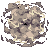

# 亚马格登（Armageddon）

陨石雨持续5秒 30 - 50/40 - 60/50 - 70的伤害 / 在3瓦半径内的敌人中,

[原文与贡献者记录](https://ballxpit.wiki.gg/wiki/Armageddon) · [修订 4074](https://ballxpit.wiki.gg/index.php?oldid=4074) · [返回目录](../%E7%90%83%E6%AF%94%E4%BC%A6%E6%88%98%E8%AE%B0%20Wiki.md)

#### 一般信息

##### 由

[在地狱里](Inferno.md)  + [风暴](Storm.md) 

##### 开始的性格

-

##### 命中效果（On-Hit Effects）

自杀

##### 状态效果（Status Effects）

[气象雨](https://ballxpit.wiki.gg/wiki/Status_Effects?action=edit&redlink=1)

##### 由于状态影响

热点，范围效果

#### 进化配方

|  |  |  |  |  |  |  |  |  |  |  |  |  |  |  |
| --- | --- | --- | --- | --- | --- | --- | --- | --- | --- | --- | --- | --- | --- | --- |
|  |  |  |  |  |  |  |  |  |  |  |  |  |  |  |
| [灼烧（Burn）](Burn.md)  |  |  |  | [时间（Time）](Time.md)  清除 SmolederingxDEPTHS 代码 或是 [风（Wind）](Wind.md)  |  |  |  | [闪电（Lightning）](Lightning.md)  |  |  |  | [风（Wind）](Wind.md)  |  |  |
|  |  |  |  |  |  |  |  |  |  |  |  |  |  |  |
|  |  | [在地狱里（Inferno）](Inferno.md)  |  |  |  |  |  |  |  | [风暴（Storm）](Storm.md)  |  |  |  |  |
|  |  |  |  |  |  |  |  |  |  |  |  |  |  |  |
|  |  |  |  |  |  | 亚马格登（Armageddon） |  |  |  |  |  |  |  |  |

#### 关卡

| 等级 | 伤害 | 影响 |
| --- | --- | --- |
| 1 |  x(4.8至9.2) | 陨石雨持续了5秒 3瓦半径内的敌人会遭受30到50次伤害 ／ |
| 2 |  x(4.8至9.2) | 陨石雨持续5秒，在3瓦半径内的敌人中造成40-60个伤害/次于敌人。 ／ |
| 3 |  x(4.8至9.2) | 陨石雨持续5秒，在3瓦半径内，敌人遭受50-70次伤害/次于敌人。 ／ |

#### 发展情况

*这个球不能进一步发展。*

#### 策略

#### 更新记录

#### 冷知识

#### 图片库

[共享导航](../navigation/nav-63012059ef49.md)

**分类**　[分类 · 进化圆球](../categories/Evolved_Balls.md) · [分类 · 圆球](../categories/Balls.md) · [分类 · 页面有导航框](../categories/Pages_with_navboxes.md)

[返回总入口](../%E7%90%83%E6%AF%94%E4%BC%A6%E6%88%98%E8%AE%B0%20Wiki.md) · [返回本分目录](%E7%9B%AE%E5%BD%95.md)
