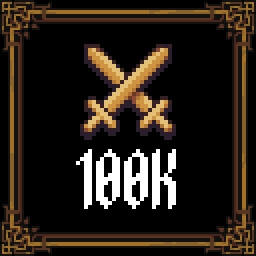

# 球比伦战记（BALL x PIT）百科

[原文与贡献者记录](https://ballxpit.wiki.gg/) · [修订 2344](https://ballxpit.wiki.gg/index.php?oldid=2344) · [返回目录](../%E7%90%83%E6%AF%94%E4%BC%A6%E6%88%98%E8%AE%B0%20Wiki.md)

#### 欢迎来到《球比伦战记》百科！

我们目前保留了[380条](%E7%9B%AE%E5%BD%95.md),请随意通过创建新条款或扩大现有条款作出贡献。

#### 关于《球比伦战记》

***[球比伦战记](Ball_x_Pit.md)*** 是一款快节奏的奇幻 Roguelite 游戏，由 ***[Kenny Sun](https://kennysun.com/)* 和伙伴们** 开发，发行商为 ***[Devolver Digital](https://www.devolverdigital.com/)***。游戏已登陆 *[PC](https://store.steampowered.com/app/2062430/BALL_x_PIT)*、 *[Nintendo Switch](https://www.nintendo.com/us/store/products/ball-x-pit-switch)* 及 *[Nintendo Switch 2](https://www.nintendo.com/us/store/products/ball-x-pit-nintendo-switch-2-edition-switch-2/)*、 *[Xbox Series S 与 X](https://www.xbox.com/en-US/games/store/ball-x-pit/9MWXF3SRD7QN/0010)*和 *[Sony PlayStation 5](https://store.playstation.com/en-us/concept/10016190)*。手机版可通过 *[Google Play 商店](https://play.google.com/store/apps/details?id=com.devolverdigital.ballxpit)* 和 *[iOS App Store](https://apps.apple.com/us/app/ball-x-pit/id6738703497)*下载。由 ***[Amos Roddy](https://www.amosroddy.com/)*** 创作的游戏原声可在 *[Steam](https://store.steampowered.com/app/4091070/BALL_x_PIT_Soundtrack/)* 和其他音乐下载平台购买，也可在 *[Devolver Digital 官方商店购买豪华双碟黑胶版](https://merch.devolverdigital.com/products/ball-x-pit-double-vinyl)*.

游戏的核心玩法结合了类似 *[《吸血鬼幸存者》（Vampire Survivors）](https://vampire.survivors.wiki/w/Vampire_Survivors)*的生存 Roguelite，以及类似 *[《打砖块》（Arkanoid）](https://en.wikipedia.org/wiki/Arkanoid)*的经典打砖块。玩家控制一名冒险者，深入怪物横行的无底深坑，即昔日城市 **球比伦**的废墟。玩家可在局内使用和升级超过 20 名可玩 [角色](Characters.md)。每名角色都有独特能力，并可用注入魔力的 [**圆球**](Balls.md)击退成群敌人。利用游戏独有的 [融合系统](Fusion_Reactor.md) 可以混合超过 80 种圆球，形成越来越强力、变化繁多的组合，再搭配超过 60 种 [被动饰品](Passives.md)的强化效果，形成数千种可相互配合的构筑。

在一次次危险的深坑探险之间，玩家可以在地面建设城镇 **新球比伦**. [资源](Resources.md) 及 [建筑蓝图](Blueprints.md) 来自深坑，可用于建造和升级超过 70 种各具特色的 [建筑](Buildings.md)。建筑能解锁新的可玩角色，并提供永久加成。紧张的战斗为长期的城镇建设积累资源，这一循环鼓励玩家不断尝试新的武器组合，积累重建巨城所需的财富。

#### 常用百科页面

* [圆球（Balls）](Balls.md) 
* [角色（Characters）](Characters.md) 
* [被动道具（Passives）](Passives.md) 
* [成就（Achievements）](Achievements.md) 

* [建筑（Buildings）](Buildings.md) 
* [敌人（Enemies）](Enemies.md) 
* [关卡（Levels）](Levels.md) 
* [更新（Updates）](Game_Updates.md) 

#### 参与百科编辑

《球比伦战记》百科由社区共同维护，任何人都可以参与编辑。编辑大多数页面无需特殊权限。你的贡献可以完善百科，也能帮助其他玩家。

添加内容
:   * 找到起点的最佳方法就是加入 [百科 Discord](https://discord.gg/ugEsySqTkZ) 或查看侧边栏链接的任何主页的讨论标签。
    * 如果你不确定要做什么或怎样创建页面，可以找几篇相同主题的条目作为参考。也可以查看 Wiki 源代码，了解其他编辑者的写法。
    * 编辑可以从小处着手。若不想新建完整条目，修正拼写错误和失效链接也能帮上忙。
    * 根据 wiki.gg 的 [AI 使用政策（AI policy）](https://support.wiki.gg/wiki/AI_policy)， **本百科严禁用生成式 AI 撰写内容。**

#### 外部链接

* [官方网站（Official Site）](https://www.ballxpit.com/) 
* [官方 Discord（Official Discord）](https://discord.gg/BALLxPIT) 
* [《球比伦战记》Reddit 社区（BALL X PIT Subreddit）](https://reddit.com/r/BALLxPIT/) 
* [《球比伦战记》Bluesky 账号（BALL X PIT Bluesky）](https://bsky.app/profile/ballxpit.com) 
* [《球比伦战记》X 账号（BALL X PIT X）](https://x.com/ballxpit) 
* [《球比伦战记》TikTok 账号（BALL X PIT TikTok）](https://www.tiktok.com/%40ballxpit) 

**分类**　[分类 · 球比伦战记（BALL x PIT）百科](../categories/BALL_x_PIT_Wiki.md) · [分类 · 使用IMP的页面](../categories/Pages_using_IMP.md)

[返回总入口](../%E7%90%83%E6%AF%94%E4%BC%A6%E6%88%98%E8%AE%B0%20Wiki.md) · [返回本分目录](%E7%9B%AE%E5%BD%95.md)
