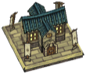
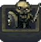
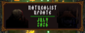

# 球比伦战记（BALL x PIT）百科

[原文与贡献者记录](https://ballxpit.wiki.gg/) · [修订 2344](https://ballxpit.wiki.gg/index.php?oldid=2344) · [返回目录](../%E7%90%83%E6%AF%94%E4%BC%A6%E6%88%98%E8%AE%B0%20Wiki.md)

## 欢迎来到 BALL x PIT 维基！

我们目前维护着 [380篇文章](%E7%9B%AE%E5%BD%95.md)。欢迎您通过创建新文章或扩展现有文章来贡献内容。

## 关于《球比伦战记》

***[球比伦战记](Ball_x_Pit.md)*** 是一款快节奏的奇幻 Roguelite 游戏，由 ***[Kenny Sun](https://kennysun.com/)* 和伙伴们** 开发，发行商为 ***[Devolver Digital](https://www.devolverdigital.com/)***。游戏已登陆 *[PC](https://store.steampowered.com/app/2062430/BALL_x_PIT)*、 *[Nintendo Switch](https://www.nintendo.com/us/store/products/ball-x-pit-switch)* 及 *[Nintendo Switch 2](https://www.nintendo.com/us/store/products/ball-x-pit-nintendo-switch-2-edition-switch-2/)*、 *[Xbox Series S 与 X](https://www.xbox.com/en-US/games/store/ball-x-pit/9MWXF3SRD7QN/0010)*和 *[Sony PlayStation 5](https://store.playstation.com/en-us/concept/10016190)*。手机版可通过 *[Google Play 商店](https://play.google.com/store/apps/details?id=com.devolverdigital.ballxpit)* 和 *[iOS App Store](https://apps.apple.com/us/app/ball-x-pit/id6738703497)*下载。由 ***[Amos Roddy](https://www.amosroddy.com/)*** 创作的游戏原声可在 *[Steam](https://store.steampowered.com/app/4091070/BALL_x_PIT_Soundtrack/)* 和其他音乐下载平台购买，也可在 *[Devolver Digital 官方商店购买豪华双碟黑胶版](https://merch.devolverdigital.com/products/ball-x-pit-double-vinyl)*.

其核心玩法是一种独特的生存roguelite游戏模式，类似于*[《吸血鬼幸存者》（Vampire Survivors）](https://vampire.survivors.wiki/w/Vampire_Survivors)*，同时兼具经典方块破坏游戏元素，让人联想到*[《打砖块》（Arkanoid）](https://en.wikipedia.org/wiki/Arkanoid)*。玩家将操控一名冒险者，潜入一个充满怪物的无底深渊——已沦陷的**球比伦**城市的废墟之中。游戏过程中，玩家需使用并提升20多个可操控的[角色](Characters.md)，每个角色都拥有独特的能力；同时，玩家还需利用注入魔法的[**球**](Balls.md)来击退成群结队的敌人，并运用独特的[融合系统](Fusion_Reactor.md)将80多种不同球类组合成威力越来越强且混乱不堪的武器，再加上来自60多种不同[被动饰品](Passives.md)的增强效果，创造出数千种潜在的协同组合方案。

在充满危险的坑洞潜行之间，游戏表面设有一个名为 **新球比伦**的综合性城镇建设元进程层。从坑洞中收集到的 [资源](Resources.md)和 [建筑蓝图](Blueprints.md)被用来建造和升级超过70种独特的 [建筑](Buildings.md)。这些建筑会解锁新的可玩角色并提供永久的游戏奖励。这种两部分循环——激烈的动作奔跑为持续的城镇建设提供动力——是核心的驱动机制，促使玩家不断尝试各种武器组合，以获取重建伟大城市所需的财富。

## 常用百科页面

* [圆球（Balls）](Balls.md) 
* [角色（Characters）](Characters.md) 
* [被动道具（Passives）](Passives.md) 
* [成就](Achievements.md) 

* [建筑（Buildings）](Buildings.md) 
* [敌人（Enemies）](Enemies.md) 
* [关卡（Levels）](Levels.md) 
* [更新（Updates）](Game_Updates.md) 

## 参与百科编辑

《球比伦战记》百科由社区共同维护，任何人都可以参与编辑。编辑大多数页面无需特殊权限。你的贡献可以完善百科，也能帮助其他玩家。

添加内容
:   * 确定从何处开始的最佳方式是加入 [百科 Discord](https://discord.gg/ugEsySqTkZ)，或者查看侧边栏中链接的任何主要页面下的讨论标签。
    * 如果你不确定要做什么或怎样创建页面，可以找几篇相同主题的条目作为参考。也可以查看 Wiki 源代码，了解其他编辑者的写法。
    * 编辑可以从小处着手。若不想新建完整条目，修正拼写错误和失效链接也能帮上忙。
    * 根据 wiki.gg 的 [AI 使用政策](https://support.wiki.gg/wiki/AI_policy)，需要注意的是，使用生成式 AI 在此维基上撰写内容是被 **严格禁止的。**

## 外部链接

* [官方网站](https://www.ballxpit.com/) 
* [官方 Discord](https://discord.gg/BALLxPIT) 
* [《球比伦战记》Reddit 社区](https://reddit.com/r/BALLxPIT/) 
* [《球比伦战记》Bluesky 账号（BALL X PIT Bluesky）](https://bsky.app/profile/ballxpit.com) 
* [《球比伦战记》X 账号](https://x.com/ballxpit) 
* [《球比伦战记》TikTok 账号](https://www.tiktok.com/%40ballxpit) 

**分类**　[分类 · 球比伦战记（BALL x PIT）百科](../categories/BALL_x_PIT_Wiki.md) · [分类 · 使用 IMP 的页面](../categories/Pages_using_IMP.md)

[返回总入口](../%E7%90%83%E6%AF%94%E4%BC%A6%E6%88%98%E8%AE%B0%20Wiki.md) · [返回本分目录](%E7%9B%AE%E5%BD%95.md)
