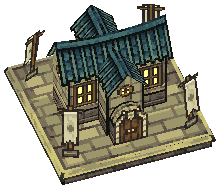

# 常用百科页面（BALL x PIT Wiki/pages）

[原文与贡献者记录](https://ballxpit.wiki.gg/wiki/BALL_x_PIT_Wiki%2Fpages) · [修订 2828](https://ballxpit.wiki.gg/index.php?oldid=2828) · [返回目录](../%E7%90%83%E6%AF%94%E4%BC%A6%E6%88%98%E8%AE%B0%20Wiki.md)

#### 常用百科页面

* [圆球（Balls）](Balls.md) 
* [角色（Characters）](Characters.md) 
* [被动道具（Passives）](Passives.md) 
* [成就（Achievements）](Achievements.md) 

* [建筑（Buildings）](Buildings.md) 
* [敌人（Enemies）](Enemies.md) 
* [关卡（Levels）](Levels.md) 
* [更新（Updates）](Game_Updates.md) 

**分类**　[分类 · 主页框](../categories/Main_page_boxes.md)

[返回总入口](../%E7%90%83%E6%AF%94%E4%BC%A6%E6%88%98%E8%AE%B0%20Wiki.md) · [返回本分目录](%E7%9B%AE%E5%BD%95.md)
