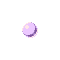

# 小球（Baby Ball）

基础攻击球，无特殊能力。

[原文与贡献者记录](https://ballxpit.wiki.gg/wiki/Baby_Ball) · [修订 4330](https://ballxpit.wiki.gg/index.php?oldid=4330) · [返回目录](../%E7%90%83%E6%AF%94%E4%BC%A6%E6%88%98%E8%AE%B0%20Wiki.md)

## 基本信息

### 初始角色（Starting Character）

-

### 状态效果（Status Effects）

-

## 策略

## 更新记录

## 冷知识

## 图片库

[共享导航](../navigation/nav-63012059ef49.md)

**分类**　[分类 · 小球](../categories/Baby_Balls.md) · [分类 · 圆球](../categories/Balls.md) · [分类 · 带有导航框的页面](../categories/Pages_with_navboxes.md)

[返回总入口](../%E7%90%83%E6%AF%94%E4%BC%A6%E6%88%98%E8%AE%B0%20Wiki.md) · [返回本分目录](%E7%9B%AE%E5%BD%95.md)
