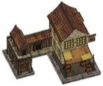

# 制袋师（建筑）（Bag Maker (Building)）

[原文与贡献者记录](https://ballxpit.wiki.gg/wiki/Bag_Maker_%28Building%29) · [修订 3388](https://ballxpit.wiki.gg/index.php?oldid=3388) · [返回目录](../%E7%90%83%E6%AF%94%E4%BC%A6%E6%88%98%E8%AE%B0%20Wiki.md)

## 包制师

增加1个球槽

## 信息（Information）

### 分类（Category）

战争

### 子类（Subcategory）

将军

### 蓝图位置（Blueprint location）

[HEAVENLYxGATES](The_HEAVENLYxGATES.md)

### 基础资源消耗（Base resource cost）

 5,000  100  30

### 建造点消耗（Build point cost）

120

建造制袋者建筑可在等级提升过程中为玩家额外增加1个球槽。请注意，此建筑/能力不可升级。建造此建筑可获得制袋者成就。

被动效果与升级

| 等级 | 图片 | 说明 | 资源消耗 | 建造点消耗 | 拆除 |
| --- | --- | --- | --- | --- | --- |
| 1 |  | 增加1个球槽 |  5,000  100  30 | 120 |  5,000  100  30 |

[共享导航](../navigation/nav-d4956b01aa56.md)

**分类**　[分类 · 建筑](../categories/Buildings.md) · [分类 · 战争](../categories/Warfare.md) · [分类 · 通用](../categories/General.md) · [分类 · 带有导航框的页面](../categories/Pages_with_navboxes.md)

[返回总入口](../%E7%90%83%E6%AF%94%E4%BC%A6%E6%88%98%E8%AE%B0%20Wiki.md) · [返回本分目录](%E7%9B%AE%E5%BD%95.md)
