# 圆球（Balls）

[原文与贡献者记录](https://ballxpit.wiki.gg/wiki/Balls) · [修订 4307](https://ballxpit.wiki.gg/index.php?oldid=4307) · [返回目录](../%E7%90%83%E6%AF%94%E4%BC%A6%E6%88%98%E8%AE%B0%20Wiki.md)

待完善

*此条目为 [待完善](../categories/Stubs.md). 你可以通过帮助 BALL x PIT 维基贡献一份力量。 [补充内容](https://ballxpit.wiki.gg/wiki/Balls?action=edit).*

**圆球**是《球比伦战记》中击败敌人、完成关卡的主要武器。

圆球分为 2 类：**特殊圆球（Special Balls）**和**小球（Baby Balls）**。每种圆球可造成一种或多种类型的[伤害](Damage.md)，也可能施加[状态效果](https://ballxpit.wiki.gg/wiki/Status_Effects?action=edit&redlink=1)或具有其他特殊能力。[被动道具](Passives.md)也会影响这些能力。本页列出的伤害和能力数值还受到角色基础[属性](Attributes.md)、[奖杯](Buildings.md#%E9%80%9A%E5%85%B3%E5%A5%96%E5%8A%B1)和其他[建筑](Buildings.md)的加成影响。

待确认：伤害类型和状态效果，尤其是被动道具带来的效果。

## 小球

小球是普通的白色圆球，基础伤害一致，本身没有独特能力。除了**[空巢者](The_Empty_Nester.md) **和**[临时西西弗斯](The_Makeshift_Sisyphus.md) **，所有[角色](Characters.md)开局都会携带几颗小球。一些[被动道具](Passives.md)也能生成小球。小球的[属性](Attributes.md)，包括数量（Baby Ball Count）和伤害（Baby Ball Damage），受领导力（Leadership）这项[属性](Attributes.md)影响。某些特殊圆球，尤其是融合圆球，可以生成继承自身能力的小球。这类小球和角色开局携带的普通小球不同。

| 名称 | 图标 | 说明 |
| --- | --- | --- |
| [小球（Baby Ball）](Baby_Ball.md) |  | 基础攻击球，无特殊能力。 |

## 特殊圆球

每颗特殊圆球都有独特的被动能力，在单局中可以升级，也可以与其他特殊圆球组合。有些默认解锁，其余需要到达特定关卡解锁。每局最高可升至 3 级，升级会提高伤害并强化能力。

能力的触发规则见下表。

如何触发技能？

| 能力类型 | 能力 | 触发条件 |
| --- | --- | --- |
| 命中效果 | 销毁、穿透、范围效果、生成 | 仅在命中时触发 |
| 状态效果 | 中毒、灼烧、冻结等 | 命中、造成伤害、定时、发射、生成 |

圆球的能力分为三个部分：

命中效果只有击中目标时触发，包括销毁、穿透、范围效果和生成。

状态触发条件决定何时施加状态效果，包括命中、造成范围伤害、定时、发射和生成。

状态效果可由命中、范围效果、定时、发射或生成触发，例如立即死亡（由黑洞触发）、中毒、灼烧和冻结。

命中效果共有4种类型：

穿透：圆球会穿过目标，适合同时击中多个目标。

销毁：圆球在命中后销毁。虽然这一类型相对不受欢迎，但这类圆球通常有强力能力。融合两颗命中后销毁的圆球时，可能丢失其中一个能力。

范围效果：例如核弹造成的辐射。

生成：产生分身、小球或召唤物。

共有 5 个状态触发条件：

命中时：圆球击中目标时触发。

范围效果：圆球造成伤害时触发。核弹的辐射属于范围效果，可以触发状态效果。

定时：按固定时间间隔触发。

发射时：发射圆球时触发。由能力生成的圆球不计为发射。

生成：分身、小球或召唤物生成时触发。生成物还能带来额外触发。

特殊圆球分为 3 种，分别是**基础圆球**、**融合圆球**和**进化圆球**。

### 基础圆球

基础圆球属于特殊圆球。解锁后，它们可能在单局升级时出现在可选项中。游戏目前有 21 种基础圆球，每个角色开局会携带一种指定的基础圆球。部分基础圆球起初不可用，需要通关特定[深坑关卡](Levels.md)才能解锁。

| 名称 | 图标 | 说明 | 角色 | 解锁条件 | 命中效果 | 状态触发条件 | 状态效果 |
| --- | --- | --- | --- | --- | --- | --- | --- |
| [流血（Bleed）](Bleed.md) |  | 施加2层流血效果。被球击中的敌人每层会遭受1点伤害（最多8层）。 | [战士（The Warrior）](The_Warrior.md)  [伪救世主](The_False_Messiah.md)  | 不适用 默认解锁 | 不适用 | 命中时 | 流血 |
| [育巢母体（Brood Mother）](Brood_Mother.md) |  | 每次命中敌人时，有 25% 的概率产生一个小球。 | [同居者（The Cohabitants）](The_Cohabitants.md)  | 不适用 默认解锁 | 生成 | 命中时 生成 | 生成小球 |
| [灼烧（Burn）](Burn.md) |  | 命中时添加1层灼烧效果，持续3秒（最多3层）。被灼烧的单位每秒每层会受到4-8点伤害。 | [快枪手（The Itchy Finger）](The_Itchy_Finger.md) [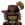](The_Itchy_Finger.md) | 不适用 默认解锁 | 不适用 | 命中时 | 灼烧 |
| [细胞（Cell）](Cell.md) |  | 命中时分裂出一个分身，最多触发 2 次。 | 不适用 | 通关 [真菌森林（The FUNGALxFOREST）](The_FUNGALxFOREST.md)  | 生成 | 命中时 克隆 | 克隆 |
| [魅惑（Charm）](Charm.md) |  | 每次命中有4%的概率使敌人魅惑5秒。被魅惑的单位会沿棋盘移动并攻击敌人。 | [畅饮者（The Carouser）](The_Carouser.md)  | 通关 [天堂之门（The HEAVENLYxGATES）](The_HEAVENLYxGATES.md)  | 不适用 | 命中时 | 魅惑 |
| [黑暗（Dark）](Dark.md) |  | 造成 3.0 倍伤害，命中敌人后销毁。再次发射前有 3 秒冷却时间。 | [暗影（The Shade）](The_Shade.md)  | 通关 [骸骨墓园（The BONExYARD）](The_BONExYARD.md)  | 销毁 | 命中时 | 不适用 |
| [地震（Earthquake）](Earthquake.md) |  | 在3x3格范围内对附近的单位造成5-13点伤害。 | [临时西西弗斯（The Makeshift Sisyphus）](The_Makeshift_Sisyphus.md)  [掘地者](The_Tunneller.md)  | 不适用 默认解锁 | 范围效果 | 命中时 范围效果 | 不适用 |
| [卵囊（Egg Sac）](Egg_Sac.md) | [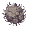](Egg_Sac.md) | 击中敌人后，会爆炸成2-4个小球。再次射击前需等待3秒的冷却时间。 | [自笞者（The Flagellant）](The_Flagellant.md)  | 不适用 默认解锁 | 销毁 生成 | 命中时 小球 | 生成小球 |
| [肉身（Flesh）](Flesh.md) |  | 每次反弹，速度增加25%。 | 不适用 | 通关 [血腥草原（The GORYxGRASSLANDS）](The_GORYxGRASSLANDS.md)  | 不适用 | 命中时 | 不适用 |
| [冻结（Freeze）](Freeze.md) |  | 有4%的概率使敌人冻结5.0秒。被冻结的敌人将受到额外25%的伤害。 | [忏悔者（The Repentant）](The_Repentant.md)  | 不适用 默认解锁 | 不适用 | 命中时 | 冻结 |
| [幽灵（Ghost）](Ghost.md) |  | 穿过敌人。 | [空巢者（The Empty Nester）](The_Empty_Nester.md)  | 不适用 默认解锁 | 穿透 | 命中时 | 不适用 |
| [铁（Iron）](Iron.md) |  | 造成双倍伤害，但移动速度慢40%。 | [持盾者（The Shieldbearer）](The_Shieldbearer.md)  [战术家](The_Tactician.md)  | 不适用 默认解锁 | 不适用 | 命中时 | 不适用 |
| [激光（水平）（Laser (Horizontal)）](Laser_Horizontal.md) |  | 对同一行中的所有敌人造成9-18点伤害。 | [蹑足者（The Tiptoer）](The_Tiptoer.md)  | 不适用 默认解锁 | 范围效果 | 命中时 范围效果 | 不适用 |
| [激光（垂直）（Laser (Vertical)）](Laser_Vertical.md) |  | 对同一列的所有敌人造成9-18点伤害。 | [沉思者（The Cogitator）](The_Cogitator.md)  | 不适用 默认解锁 | 范围效果 | 命中时 范围效果 | 不适用 |
| [光（Light）](Light.md) |  | 命中时使敌人失明3秒。失明的单位难以感知你的位置，在攻击时有50%的概率落空。 | [物理学家（The Physicist）](The_Physicist.md)  | 通关 [边境沙漠（The LIMINALxDESERT）](The_LIMINALxDESERT.md)  | 不适用 | 命中时 | 盲视 |
| [闪电（Lightning）](Lightning.md) |  | 对最多3个附近的敌人造成1-20点伤害。 | [杂耍者（The Juggler）](The_Juggler.md)  [驯鹰人](The_Falconer.md)  | 不适用 默认解锁 | 范围效果 | 命中时 范围效果 | 不适用 |
| [石头（Stone）](Stone.md) |  | 初始造成300%的伤害。每次击中敌人，伤害减少40%（下限为50%）。 | 不适用 | 通关 [白雪海岸（The SNOWYxSHORES）](The_SNOWYxSHORES.md)  | 不适用 | 命中时 | 不适用 |
| [中毒（Poison）](Poison.md) |  | 命中时施加1层中毒效果（最多5层）。中毒持续6秒，每层每秒造成1-4点伤害。 | [潜伏者（The Embedded）](The_Embedded.md)  | 不适用 默认解锁 | 不适用 | 命中时 | 中毒 |
| [时间（Time）](Time.md) |  | 击中敌人后，会触发时间陷阱，该陷阱会在场上停留 20 秒，并将敌人冻结在其中。 | 不适用 | 通关 [阴燃深渊（The SMOLDERINGxDEPTHS）](The_SMOLDERINGxDEPTHS.md)  | 销毁 | 命中时 范围效果 | 时间陷阱 |
| [吸血鬼（Vampire）](Vampire.md) |  | 每次命中有 4.5% 的概率恢复 1 点生命值。 | [挥霍者（The Spendthrift）](The_Spendthrift.md)  | 不适用 默认解锁 | 不适用 | 命中时 | 治疗 |
| [风（Wind）](Wind.md) |  | 穿过敌人，使其减速 30% 持续 5 秒，但造成的伤害减少 25%。 | [激进者（The Radical）](The_Radical.md)  | 不适用 默认解锁 | 穿透 | 命中时 | 减速 |

### 融合圆球

主条目：[融合机制](Fusion_Mechanics.md)

在融合球之前，请考虑以下因素：

技能通用规则

| 方面/视角 | 能力类型 |
| --- | --- |
| 命中效果 | 穿透/销毁，范围效果，生成 |
| 状态触发条件 | 命中时，范围效果，定时，发射时，生成 |
| 状态效果 | 即时死亡、出血等效果。 |

生成可以说是最好的能力。它可以抵消销毁的效果。例如，Cell（Clone） x Bomb（Destroy） 就是一个“不可摧毁”的炸弹，因为炸弹在生成的同时就被销毁了。

全屏触发是触发状态效果的最佳选择。

融合流血球和冻结球的示例

融合圆球由两颗尚未融合的 3 级特殊圆球通过[融合反应堆](Fusion_Reactor.md)合成。可以使用两颗基础圆球、两颗进化圆球，或者各用一颗。圆球不能与自身融合。如果两颗圆球能够直接进化成一种圆球，它们只能用于该进化。若共同进化还需要 3 颗或更多圆球，这两颗仍可彼此融合，例如[诺斯费拉图（Nosferatu）](Nosferatu.md) [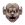](Nosferatu.md)和[元素（Elemental）](Elemental.md) 的配方中的材料。按本页原文，潜在融合组合数为 `90 × 89 − 89 = 7,921`。

融合圆球会组合两颗材料球的名称、效果与图标。例如，将**流血**和**冻结**融合为**流血 × 冻结（Bleed × Freeze）**，结果同时具有**流血**和**冻结**的能力。效果与数值如何合并，取决于参与融合的圆球。与进化不同，**融合材料的次序不影响最终数值和能力**，但会改变名称，也*可能*改变外观。比如**卵囊 × 中毒**和**中毒 × 卵囊**外观相同，**蜘蛛女王 × 吸血鬼领主**和**吸血鬼领主 × 蜘蛛女王**则使用不同的精灵图。融合次序由材料球的取得顺序决定，融合时无法手动调整。

* 卵囊 X 中毒

  [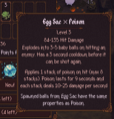](../files/Fusion_Example_Egg_Sac_x_Poison.jpg.md)
* 中毒 X 卵囊

  
* 蜘蛛女王 X 吸血鬼领主

  [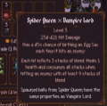](../files/Fusion_Example_Spider_Queen_x_Vampire_Lord.jpg.md)
* 吸血鬼领主 X 蜘蛛女王

  

### 进化圆球

在**[融合反应堆](Fusion_Reactor.md)**中，将 2 颗或更多指定的 3 级基础圆球或进化圆球组合，即可得到进化圆球。进化圆球各有独特的名称和能力，此后仍可与其他圆球融合，部分还能再次进化。某些进化圆球有多种配方，例如**刺客（Assassin）**可由*铁球＋幽灵*或*铁球＋黑暗*得到。材料球的顺序**不影响**进化结果。

目前游戏中共有69个进化圆球。

| 名称 | 图标 | 说明 | 组合 | 命中效果 | 状态触发条件 | 状态效果 | 可以进一步进化 |
| --- | --- | --- | --- | --- | --- | --- | --- |
| [末日审判（Armageddon）](Armageddon.md) |  | 击中敌人后会产生流星雨。流星雨持续5秒，并在半径3格内的敌人每秒造成30-50点伤害。 | [炼狱（Inferno）](Inferno.md)  + [风暴（Storm）](Storm.md)  | 销毁 范围效果 | 命中时 范围效果 | 不适用 | 否 |
| [刺客（Assassin）](Assassin.md) |  | 可以穿过敌人的正面，但无法穿过背面。刺击会额外造成30%的伤害。 | [铁（Iron）](Iron.md)  + ([幽灵（Ghost）](Ghost.md)  或 [黑暗（Dark）](Dark.md) ) | 穿透 | 命中时 | 不适用 | 是，选择 [狙击手（Sniper）](Sniper.md) ，搭配 [霰弹枪（Shotgun）](Shotgun.md)  |
| [放逐之焰（Banished Flame）](Banished_Flame.md) |  | 命中时添加1层暗焰，持续2秒（最多6层）。每层暗焰每秒对敌人造成1-30点伤害。当暗焰熄灭时，会对敌人造成1-100点伤害。 | [黑暗（Dark）](Dark.md)  + [灼烧（Burn）](Burn.md)  | 不适用 | 命中时 | 暗焰 | 否 |
| [女妖（Banshee）](Banshee.md) |  | 启动后，所有敌人进入场上时都会受到诅咒。被命中6次的被诅咒敌人将受到150-300点的伤害。 | [幻影（Phantom）](Phantom.md)  + [怨灵（Wraith）](Wraith.md) [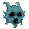](Wraith.md) | 不适用 | 命中时 发射时 | 诅咒 | 否 |
| [狂暴（Berserk）](Berserk.md) |  | 每次命中有 30% 的概率使敌人狂暴 6 秒。狂暴的敌人每秒对邻近敌人造成 15-24 点伤害。 | [魅惑（Charm）](Charm.md)  + ([流血（Bleed）](Bleed.md)  或 [灼烧（Burn）](Burn.md) ) | 不适用 | 命中时 | 狂暴 | 否 |
| [黑洞（Black Hole）](Black_Hole.md) |  | 会立即击杀它击中的第一个非首领敌人，随后会自毁。再次射击前需等待7秒的冷却时间。 | [太阳（Sun）](Sun.md)  + ([黑暗（Dark）](Dark.md)  或 [时间（Time）](Time.md) ) | 销毁 | 命中时 | 即时杀戮 | 否 |
| [暴风雪（Blizzard）](Blizzard.md) |  | 使半径2格内的所有敌人冻结0.8秒，造成1-50点伤害 | [冻结（Freeze）](Freeze.md)  + ([风（Wind）](Wind.md)  或 [闪电（Lightning）](Lightning.md) ) | 不适用 | 命中时 范围效果 | 冻结 | 否 |
| [炸弹（Bomb）](Bomb.md) |  | 击中敌人时爆炸，对附近的敌人造成150-300点伤害。再次射击前需等待3秒的冷却时间。 | [灼烧（Burn）](Burn.md)  + [铁（Iron）](Iron.md)  | 销毁 | 命中时 范围效果 | 不适用 | 是，选择 [核弹（Nuclear Bomb）](Nuclear_Bomb.md)  搭配 [中毒（Poison）](Poison.md) 。或者放入 [时间炸弹（Time Bomb）](Time_Bomb.md)  搭配 [时间（Time）](Time.md) 。 |
| [硫磺（Brimstone）](Brimstone.md) |  | 每秒对2格半径内的所有敌人施加1层灼烧和中毒效果（最多4层）。每层灼烧效果每秒造成1-4点伤害，每层中毒效果每秒造成2-3点伤害。 | ([石头（Stone）](Stone.md)  或 [中毒（Poison）](Poison.md) ) + [灼烧（Burn）](Burn.md)  | 不适用 | 命中时 定时 | 灼烧，中毒 | 否 |
| [投石机（Catapult）](Catapult.md) | [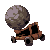](Catapult.md) | 每1.5秒发射3-5个石头小球，这些小球碰到任何物体后就会被摧毁。 | [石头（Stone）](Stone.md)  + [卵囊（Egg Sac）](Egg_Sac.md)  | 不适用 | 命中时 生成 | 生成小球 | 否 |
| [钻头（Drill）](Drill.md) |  | 穿透敌人，并在到达场地后方之前持续造成50%的额外伤害。 | [地震（Earthquake）](Earthquake.md)  + [铁（Iron）](Iron.md)  | 穿透 | 命中时 | 不适用 | 否 |
| [元素（Elemental）](Elemental.md) |  | 命中时，对附近的敌人施加随机状态效果（灼烧、减速或冻结）。 | [灼烧（Burn）](Burn.md)  + [风（Wind）](Wind.md)  + [冻结（Freeze）](Freeze.md)  + [地震（Earthquake）](Earthquake.md)  | 不适用 | 命中时 | 灼烧，减速，冻结 | 否 |
| [侵蚀（Erosion）](Erosion.md) |  | 穿透敌人。命中时造成相当于敌人当前生命值3%的额外伤害。 | [时间（Time）](Time.md)  + [风（Wind）](Wind.md)  | 穿透 | 命中时 | ? | 否 |
| [烟花（Fireworks）](Fireworks.md) |  | 会爆炸成3-6个烟花。烟花会击中随机敌人，造成20-30点伤害，并施加1层灼烧效果。被灼烧的单位每秒会遭受每层7-11点伤害。 | [灼烧（Burn）](Burn.md)  + [卵囊（Egg Sac）](Egg_Sac.md)  | 销毁 | 命中时 生成 | 烟花生成，灼烧 | 否 |
| [闪光（Flash）](Flash.md) |  | 击中屏幕上的所有敌人后，可造成1-3点伤害，并使敌人失明2秒 | [闪电（Lightning）](Lightning.md)  + [光（Light）](Light.md)  | 不适用 | 命中时 全屏范围效果 | 盲视 | 否 |
| [肉丘（Flesh Mound）](Flesh_Mound.md) | [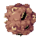](Flesh_Mound.md) | 每1.0秒向随机方向发射一个肉质的小球。 | [育巢母体（Brood Mother）](Brood_Mother.md)  + [肉身（Flesh）](Flesh.md)  | 不适用 | 命中时 定时生成 | 肉质小球生成 | 否 |
| [闪烁（Flicker）](Flicker.md) |  | 每1.4秒对屏幕上的每个敌人造成1-7点伤害 | [光（Light）](Light.md)  + [黑暗（Dark）](Dark.md)  | 不适用 | 命中时 定时 | 不适用 | 否 |
| [冰冻射线（Freeze Ray）](Freeze_Ray.md) |  | 击中敌人时发射冰冻射线，对路径上的所有敌人造成20-50点伤害，并有10%的概率使它们冻结10.0秒。 | [冻结（Freeze）](Freeze.md)  + ([激光（水平）（Laser (Horizontal)）](Laser_Horizontal.md)  或 [激光（垂直）（Laser (Vertical)）](Laser_Vertical.md) ) | 不适用 | 命中时 范围效果 | 冻结 | 否 |
| [冰冻火焰（Frozen Flame）](Frozen_Flame.md) |  | 每次命中增加1层霜灼，持续20秒（最多4层）。受到霜灼攻击的单位每秒每层会受到8-12点伤害，并因其他来源额外承受25%的伤害。 | [灼烧（Burn）](Burn.md)  + [冻结（Freeze）](Freeze.md)  | 不适用 | 命中时 | 霜灼 | 否 |
| [冰川（Glacier）](Glacier.md) |  | 随时间释放冰刺，对触碰到冰刺的敌人造成15-30点伤害，并冻结2.0秒。这个球及其冰刺还会对附近的单位造成6-12点伤害。 | [冻结（Freeze）](Freeze.md)  + ([地震（Earthquake）](Earthquake.md)  或 [石头（Stone）](Stone.md) ) | 不适用 | 命中时 范围效果 定时 | 冻结 | 否 |
| [吞心者（Heart Swallower）](Heart_Swallower.md) |  | 命中时使敌人虚弱，有 40% 的概率偷取 1 点生命值，并将他们的攻击伤害降低 20%。生命偷取效果每个敌人仅适用一次。 | [流血（Bleed）](Bleed.md)  + [幽灵（Ghost）](Ghost.md)  | 不适用 | 命中时 | 生命偷取，攻击下降 | 是，选择 [死神（Reaper）](Reaper.md) ，搭配 [吸魂者（Soul Sucker）](Soul_Sucker.md)  |
| [大出血（Hemorrhage）](Hemorrhage.md) |  | 施加3层流血效果。当对拥有12层或更多流血效果的敌人造成伤害时，将消耗所有流血效果，使其当前生命值减少20%。 | [流血（Bleed）](Bleed.md)  + ([铁（Iron）](Iron.md)  或 [肉身（Flesh）](Flesh.md) ) | 不适用 | 命中时 | 流血 | 否 |
| [圣光激光（Holy Laser）](Holy_Laser.md) |  | 对同一行和同一列的所有敌人造成 24-36 点伤害 | [激光（水平）（Laser (Horizontal)）](Laser_Horizontal.md)  + [激光（垂直）（Laser (Vertical)）](Laser_Vertical.md)  | 不适用 | 命中时 范围效果 | 不适用 | 是，进入 [X 射线（X Ray）](X_Ray.md) ，搭配 [激光束（Laser Beam）](Laser_Beam.md)  |
| [梦魔（Incubus）](Incubus.md) | [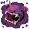](Incubus.md) | 每次命中有4%的概率使敌人魅惑9秒。被魅惑的敌人会对附近的敌人施咒。被施咒的敌人受到5次攻击后将受到100-200点的伤害。 | [魅惑（Charm）](Charm.md)  + [黑暗（Dark）](Dark.md)  | 不适用 | 命中时 ? | 魅惑，诅咒 | 是，进入 [撒旦（Satan）](Satan.md) ，搭配 [魅魔（Succubus）](Succubus.md)  |
| [炼狱（Inferno）](Inferno.md) |  | 每秒对2格半径内的所有敌人施加1层灼烧效果。灼烧持续6秒，每层每秒造成3-7点伤害。 | [灼烧（Burn）](Burn.md)  + ([风（Wind）](Wind.md)  或 [时间（Time）](Time.md) ) | 不适用 | 命中时 定时 | 灼烧 | 是，进入 [末日审判（Armageddon）](Armageddon.md) ，搭配 [风暴（Storm）](Storm.md)  |
| [山崩（Landslide）](Landslide.md) |  | 击中敌人后引发山崩，并自我毁灭。山崩持续5秒，并在半径2格范围内对敌人每秒造成20-30点伤害。 | [石头（Stone）](Stone.md)  + [地震（Earthquake）](Earthquake.md)  | 销毁 | 命中时 范围效果 | 山崩 | 否 |
| [激光束（Laser Beam）](Laser_Beam.md) |  | 命中时发射激光束，造成30-42点伤害，并使敌人失明8秒。 | [光（Light）](Light.md)  + ([激光（水平）（Laser (Horizontal)）](Laser_Horizontal.md)  或 [激光（垂直）（Laser (Vertical)）](Laser_Vertical.md) ) | 不适用 | 命中时 范围效果 | 盲视 | 是，进入 [X 射线（X Ray）](X_Ray.md) ，搭配 [圣光激光（Holy Laser）](Holy_Laser.md)  |
| [激光切割机（Laser Cutter）](Laser_Cutter.md) |  | 在其前方持续发射激光，每秒造成100-150点伤害。 | ([激光（水平）（Laser (Horizontal)）](Laser_Horizontal.md)  或 [激光（垂直）（Laser (Vertical)）](Laser_Vertical.md) ) + [钢铁（Steel）](Steel.md) [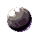](Steel.md) | ? | ? | 不适用 | 否 |
| [水蛭（Leech）](Leech.md) |  | 最多可附着1只水蛭到其攻击的敌人身上，每秒增加2层流血（最多24层） | [育巢母体（Brood Mother）](Brood_Mother.md)  + [流血（Bleed）](Bleed.md)  | 不适用 | 命中时 | Leech，流血 | 否 |
| [闪电虫（Lightning Bug）](Lightning_Bug.md) | [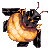](Lightning_Bug.md) | 每次命中敌人时，会生成一只闪电虫。闪电虫会攻击随机的敌人，对最多3个附近的敌人造成1-80的伤害。 | [闪电（Lightning）](Lightning.md)  + [育巢母体（Brood Mother）](Brood_Mother.md)  | 不适用 | 命中时 生成 | 闪电虫生成 | 否 |
| [避雷针（Lightning Rod）](Lightning_Rod.md) |  | 它会在攻击的敌人身上安装避雷针。这些敌人每3.0秒会被雷击一次，对最多8个附近的敌人造成1-30点伤害。 | [闪电（Lightning）](Lightning.md)  + [铁（Iron）](Iron.md)  | 不适用 | 命中时 范围效果 | 避雷针 | 否 |
| [迷恋（Lovestruck）](Lovestruck.md) |  | 命中使敌人陷入迷恋，持续 20 秒。陷入迷恋的单位攻击时有 50% 的概率为你恢复 5 点生命值。 | [魅惑（Charm）](Charm.md)  + ([光（Light）](Light.md)  或 [闪电（Lightning）](Lightning.md)  或 [时间（Time）](Time.md) ) | 不适用 | 命中时 | 迷恋 | 否 |
| [蛆虫（Maggot）](Maggot.md) | [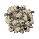](Maggot.md) | 命中时，感染敌人会感染蛆虫。当它们死亡时，会爆炸成1-2个小球。 | [育巢母体（Brood Mother）](Brood_Mother.md)  + [细胞（Cell）](Cell.md)  | 不适用 | 命中时 生成 | 感染，小球生成 | 否 |
| [岩浆（Magma）](Magma.md) |  | 会随时间发射熔岩团块。走进熔岩团块的敌人将受到15-30点伤害，并获得1层灼烧（最多3层）。灼烧持续3秒，每层每秒造成3-8点伤害。这个球及其产生的熔岩团块还会对附近的单位造成6-12点伤害。 | [灼烧（Burn）](Burn.md)  + [地震（Earthquake）](Earthquake.md)  | 不适用 | 命中时 定时 | 灼烧 | 否 |
| [蚊王（Mosquito King）](Mosquito_King.md) |  | 每次命中敌人时，会生成一只蚊子。蚊子会攻击随机的敌人，每次造成80-120点伤害。如果蚊子杀死了敌人，它们会窃取1点生命值。 | [吸血鬼（Vampire）](Vampire.md)  + [育巢母体（Brood Mother）](Brood_Mother.md)  | 不适用 | 命中时 生成 | Mosquito Spawn，生命偷取 | 是，选择 [诺斯费拉图（Nosferatu）](Nosferatu.md) ，连同 [吸血鬼领主（Vampire Lord）](Vampire_Lord.md)  及 [蜘蛛女王（Spider Queen）](Spider_Queen.md) 。或者选择 [蚊子王国（Mosquito Kingdom）](Mosquito_Kingdom.md) ，搭配 [蚊群（Mosquito Swarm）](Mosquito_Swarm.md)  |
| [蚊子王国（Mosquito Kingdom）](Mosquito_Kingdom.md) |  | 每次命中敌人时，会生成1-2只蚊子。蚊子会随机攻击一个敌人，每次造成100-150点伤害。如果蚊子杀死了敌人，它们会窃取2点生命值。 | [蚊王（Mosquito King）](Mosquito_King.md)  + [蚊群（Mosquito Swarm）](Mosquito_Swarm.md)  | 不适用 | 命中时 生成 | Mosquito Spawn，生命偷取 | 否 |
| [蚊群（Mosquito Swarm）](Mosquito_Swarm.md) |  | 爆裂后产生 3–6 只蚊子。蚊子随机攻击敌人，每只造成 80–120 点伤害。蚊子击杀敌人时窃取 1 点生命值。 | [吸血鬼（Vampire）](Vampire.md)  + [卵囊（Egg Sac）](Egg_Sac.md)  | 销毁 | 命中时 生成 | Mosquito Spawn，生命偷取 | 是，选择 [蚊子王国（Mosquito Kingdom）](Mosquito_Kingdom.md) ，搭配 [蚊王（Mosquito King）](Mosquito_King.md)  |
| [诺斯费拉图（Nosferatu）](Nosferatu.md) |  | 每次反弹都会生成一个吸血蝙蝠。吸血蝙蝠会飞向随机的敌人，命中时造成132-176点伤害，并转化为吸血鬼领主。 | [吸血鬼领主（Vampire Lord）](Vampire_Lord.md)  + [蜘蛛女王（Spider Queen）](Spider_Queen.md)  + [蚊王（Mosquito King）](Mosquito_King.md)  | 不适用 | 命中时 生成 | 吸血蝙蝠生成 | 否 |
| [毒雾（Noxious）](Noxious.md) |  | 穿透敌人，对半径2格内的附近敌人施加3层中毒效果。中毒持续4秒，每层每秒造成1-3点伤害。 | [风（Wind）](Wind.md)  + ([中毒（Poison）](Poison.md)  或 [黑暗（Dark）](Dark.md) ) | 穿透 | 命中时 范围效果 | 中毒 | 否 |
| [核弹（Nuclear Bomb）](Nuclear_Bomb.md) |  | 击中敌人时会爆炸，对附近的敌人造成 300-500 点伤害，并无限期地向场上所有敌人施加1层辐射（最多 5 层）。每层辐射会使受到的伤害增加 10%。冷却时间为 3 秒。 | [炸弹（Bomb）](Bomb.md)  + [中毒（Poison）](Poison.md)  | 销毁 | 命中时 范围效果 范围效果（全屏） | 否 | 否 |
| [后代（Offspring）](Offspring.md) |  | 命中时分裂出一个分身，最多触发 4 次。 | [细胞（Cell）](Cell.md)  + [肉身（Flesh）](Flesh.md)  | 不适用 | 命中时 生成 | 克隆 | 否 |
| [疯长（Overgrowth）](Overgrowth.md) |  | 施加1层疯长效果。当达到3层时，消耗所有层，并对3x3格范围内的所有敌人造成150-200点伤害。 | [地震（Earthquake）](Earthquake.md)  + [细胞（Cell）](Cell.md)  | 不适用 | 命中时 范围伤害？ | 疯长 | 否 |
| [石化（Petrify）](Petrify.md) |  | 首次发射时，使视野内的所有敌人石化1.5秒，并造成50-120点伤害。 | [石头（Stone）](Stone.md)  + [肉身（Flesh）](Flesh.md)  | 不适用 | 命中时 发射时 | 石化 | 否 |
| [幻影（Phantom）](Phantom.md) |  | 命中时诅咒敌人。被命中5次的被诅咒敌人将受到100-200点伤害。 | [黑暗（Dark）](Dark.md)  + [幽灵（Ghost）](Ghost.md)  | 不适用 | 命中时 | 诅咒 | 是，选择 [女妖（Banshee）](Banshee.md)  搭配 [怨灵（Wraith）](Wraith.md) 。 |
| [辐射束（Radiation Beam）](Radiation_Beam.md) |  | 命中时发射一道辐射光束，造成 24-48 点伤害，并施加 1 层辐射（最多 5 层）。辐射持续 15 秒，每层会使敌人从所有来源受到的伤害增加 10%。 | ([激光（水平）（Laser (Horizontal)）](Laser_Horizontal.md)  或 [激光（垂直）（Laser (Vertical)）](Laser_Vertical.md) ) + ([中毒（Poison）](Poison.md)  或 [细胞（Cell）](Cell.md) ) | 不适用 | 命中时 范围效果 | 辐射 | 是，进入 [肿瘤（Tumor）](Tumor.md) ，搭配 [肉身（Flesh）](Flesh.md)  |
| [死神（Reaper）](Reaper.md) |  | 有 10% 的概率在撞击敌人时将其击杀，并恢复 5 点生命值。 | [吸魂者（Soul Sucker）](Soul_Sucker.md)  + [吞心者（Heart Swallower）](Heart_Swallower.md)  | 不适用 | 命中时 | 即时杀戮 | 否 |
| [献祭（Sacrifice）](Sacrifice.md) |  | 施加4层流血效果（最高15层），并对命中敌人施加诅咒。被击中5次的被诅咒敌人将受到50-100点的伤害。 | [流血（Bleed）](Bleed.md)  + [黑暗（Dark）](Dark.md)  | 不适用 | 命中时 | 流血，诅咒 | 否 |
| [沙暴（Sandstorm）](Sandstorm.md) |  | 穿过敌人，被猛烈的风暴包围，每秒造成10-20点伤害，并使附近的敌人失明3秒。 | ([地震（Earthquake）](Earthquake.md)  或 [石头（Stone）](Stone.md) ) + [风（Wind）](Wind.md)  | 穿透 | 命中时 定时 | 盲视 | 否 |
| [撒旦（Satan）](Satan.md) |  | 激活时，每秒对所有处于激活状态的敌人增加1层灼烧效果（最多5层），每层每秒造成10-20点伤害，并使其陷入狂暴状态，每秒对邻近敌人造成15-24点伤害。 | [梦魔（Incubus）](Incubus.md)  + [魅魔（Succubus）](Succubus.md)  | 不适用 | 命中时 定时 | 灼烧，狂暴 | 否 |
| [霰弹枪（Shotgun）](Shotgun.md) |  | 击打墙壁后，发射3-7个铁球小球。铁球小球以200%的速度移动，但一旦碰到任何物体就会被摧毁。 | [铁（Iron）](Iron.md)  + [卵囊（Egg Sac）](Egg_Sac.md)  | 不适用 | 命中时 生成 | 生成小球 | 是，选择 [狙击手（Sniper）](Sniper.md) ，搭配 [刺客（Assassin）](Assassin.md)  |
| [狙击手（Sniper）](Sniper.md) |  | 击中墙壁后会穿透敌人并发射3-7个狙击小球。狙击小球虽能穿透敌人，但击中墙壁后会被摧毁。 | [霰弹枪（Shotgun）](Shotgun.md)  + [刺客（Assassin）](Assassin.md)  | 穿透 | 命中时 生成 | 狙击手小球生成 | 否 |
| [吸魂者（Soul Sucker）](Soul_Sucker.md) |  | 穿过敌人并吸取其生命值，有30%的概率偷取1点生命值，并使它们的攻击伤害降低20%。生命窃取效果对每个敌人仅适用一次。 | [吸血鬼（Vampire）](Vampire.md)  + [幽灵（Ghost）](Ghost.md)  | 穿透 | 命中时 | 生命偷取，攻击下降 | 是，进入 [死神（Reaper）](Reaper.md) ，搭配 [吞心者（Heart Swallower）](Heart_Swallower.md)  |
| [蜘蛛女王（Spider Queen）](Spider_Queen.md) |  | 每次命中敌人时，有 25% 的概率产下一个卵囊 | [育巢母体（Brood Mother）](Brood_Mother.md)  + [卵囊（Egg Sac）](Egg_Sac.md)  | 不适用 | 命中时 生成 | 生成小球 | 是，选择 [诺斯费拉图（Nosferatu）](Nosferatu.md) ，需同时搭配 [吸血鬼领主（Vampire Lord）](Vampire_Lord.md)  和 [蚊王（Mosquito King）](Mosquito_King.md) 。 |
| [钢铁（Steel）](Steel.md) |  | 初始造成双倍伤害，但移动速度降低50%。每次命中敌人时，伤害增加10%（最高可达300%）。 | [铁（Iron）](Iron.md)  + [石头（Stone）](Stone.md)  | 不适用 | 命中时 | 不适用 | 是，选择进入 [激光切割机（Laser Cutter）](Laser_Cutter.md) ，配备 [激光（水平）（Laser (Horizontal)）](Laser_Horizontal.md)  或 [激光（垂直）（Laser (Vertical)）](Laser_Vertical.md)  |
| [风暴（Storm）](Storm.md) |  | 每秒发射闪电攻击附近的敌人，造成1-40点伤害 | [闪电（Lightning）](Lightning.md)  + [风（Wind）](Wind.md)  | 不适用 | 命中时 定时 | 不适用 | 是，进入 [末日审判（Armageddon）](Armageddon.md) ，搭配 [炼狱（Inferno）](Inferno.md)  |
| [魅魔（Succubus）](Succubus.md) |  | 每次命中有 4% 的概率魅惑敌人 9 秒。击中被魅惑的敌人时恢复 1 点生命值。 | [魅惑（Charm）](Charm.md)  + [吸血鬼（Vampire）](Vampire.md)  | 不适用 | 命中时 | 魅惑 | 是，进入 [撒旦（Satan）](Satan.md) ，搭配 [梦魔（Incubus）](Incubus.md) 。 |
| [太阳（Sun）](Sun.md) |  | 使视野内的所有敌人失明，并每秒增加1层灼烧效果（最多5层）。灼烧效果持续6秒，且每层每秒造成6-12点伤害。 | [灼烧（Burn）](Burn.md)  + [光（Light）](Light.md)  | 不适用 | 命中时 定时 | 盲目，灼烧 | 是，进入 [黑洞（Black Hole）](Black_Hole.md) ，与 [黑暗（Dark）](Dark.md)  或 [时间（Time）](Time.md)  |
| [沼泽（Swamp）](Swamp.md) |  | 这种球会随时间留下焦油团。踏入焦油团的敌人将受到15-30点伤害，速度减缓50%持续7秒，并获得1层中毒（最多8层）。每层中毒每秒造成1-3点伤害。这种球及其产生的焦油团还会对附近的单位造成6-12点伤害。 | [中毒（Poison）](Poison.md)  + [地震（Earthquake）](Earthquake.md)  | 不适用 | 命中时 定时 | 速度慢，中毒 | 否 |
| [时间炸弹（Time Bomb）](Time_Bomb.md) |  | 每隔几秒发射一个定时炸弹，延迟后爆炸，对附近的敌人造成80-120点伤害。 | [时间（Time）](Time.md)  + [炸弹（Bomb）](Bomb.md)  | 不适用 | 命中时 定时 | 时间炸弹生成，时间陷阱 | 否 |
| [时间停止（Timestop）](Timestop.md) |  | 将场上所有目标冻结5.0秒，但击中敌人后会自毁。再次射击前需等待30秒的冷却时间。 | [时间（Time）](Time.md)  + [冻结（Freeze）](Freeze.md)  | 销毁 | 命中时 发射时（全屏） | 时间停止 | 否 |
| [肿瘤（Tumor）](Tumor.md) |  | 命中时施加肿瘤，带有肿瘤的敌人将在 40 秒后死亡（首领除外）。 | [辐射束（Radiation Beam）](Radiation_Beam.md)  + [肉身（Flesh）](Flesh.md)  | 不适用 | 命中时 | 肿瘤 | 否 |
| [吸血鬼领主（Vampire Lord）](Vampire_Lord.md) |  | 每次命中都会施加3层流血。当命中至少具有10层流血的敌人时，会恢复1点生命值并消耗所有层数。 | [吸血鬼（Vampire）](Vampire.md)  + ([流血（Bleed）](Bleed.md)  或 [黑暗（Dark）](Dark.md) ) | 不适用 | 命中时 | 流血，恢复 | 是，选择 [诺斯费拉图（Nosferatu）](Nosferatu.md) ，需同时搭配 [蜘蛛女王（Spider Queen）](Spider_Queen.md)  和 [蚊王（Mosquito King）](Mosquito_King.md)  |
| [毒液（Venom）](Venom.md) |  | 命中时施加1层毒液（最多8层）。每层每秒造成3-6点伤害，并使敌人减速。 | [中毒（Poison）](Poison.md)  + [冻结（Freeze）](Freeze.md)  | 不适用 | 命中时 | 毒液，减速 | 否 |
| [病毒（Virus）](Virus.md) |  | 对命中的单位施加 1 层疾病，最多叠加 8 层。疾病持续 6 秒，每层每秒造成 3–6 点伤害。患病单位每秒有 15% 的概率向附近未患病的敌人传播一层。 | [中毒（Poison）](Poison.md)  + ([流血（Bleed）](Bleed.md)  或 [幽灵（Ghost）](Ghost.md)  或 [细胞（Cell）](Cell.md) ) | 不适用 | 命中时 范围效果 | 疾病 | 否 |
| [丰满的卵囊（Voluptuous Egg Sac）](Voluptuous_Egg_Sac.md) |  | 击中敌人后，会爆炸成2-3个卵囊。再次射击前需等待3秒的冷却时间。 | [卵囊（Egg Sac）](Egg_Sac.md)  + [细胞（Cell）](Cell.md)  | 销毁 | 命中时 生成 | 生成小球 | 否 |
| [扭曲（Warp）](Warp.md) |  | 每次命中后，会随机移动到场地上的某个位置，并加速5%。 | [时间（Time）](Time.md)  + [光（Light）](Light.md)  | 不适用 | 不适用 | 不适用 | 否 |
| [怨灵（Wraith）](Wraith.md) |  | 经过其路径上的所有敌人，使其冻结0.8秒 | [冻结（Freeze）](Freeze.md)  + [幽灵（Ghost）](Ghost.md)  | 穿透 | 命中时 | 冻结 | 是，选择 [女妖（Banshee）](Banshee.md)  搭配 [幻影（Phantom）](Phantom.md)  |
| [X 射线（X Ray）](X_Ray.md) |  | 命中时发射X形激光，对敌人造成50-75点伤害，并施加1层辐射效果（最多5层）。每层辐射会使敌人从所有来源受到的伤害增加10%。 | [圣光激光（Holy Laser）](Holy_Laser.md)  + [激光束（Laser Beam）](Laser_Beam.md)  | 不适用 | 命中时 范围效果 | 辐射 | 否 |
| [僵尸（Zombie）](Zombie.md) |  | 命中时感染敌人，使其死亡时有 40% 的概率变成友方僵尸 | [吸血鬼（Vampire）](Vampire.md)  + [肉身（Flesh）](Flesh.md)  | 不适用 | 命中时 | 僵尸感染，僵尸生成 | 否 |

**分类**　[分类 · 待完善](../categories/Stubs.md) · [分类 · 解锁内容](../categories/Unlocks.md)

[返回总入口](../%E7%90%83%E6%AF%94%E4%BC%A6%E6%88%98%E8%AE%B0%20Wiki.md) · [返回本分目录](%E7%9B%AE%E5%BD%95.md)
