# 圆球（Balls）

[原文与贡献者记录](https://ballxpit.wiki.gg/wiki/Balls) · [修订 4307](https://ballxpit.wiki.gg/index.php?oldid=4307) · [返回目录](../%E7%90%83%E6%AF%94%E4%BC%A6%E6%88%98%E8%AE%B0%20Wiki.md)

待补充条目

*这是一个 [待补充条目](../categories/Stubs.md)你可以帮助BALL xPIT Wiki通过 [补充此条目](https://ballxpit.wiki.gg/wiki/Balls?action=edit).*

**圆球**是《球比伦战记》中击败敌人、完成关卡的主要武器。

圆球分为两类： **特殊圆球** 及 **小球**。每种圆球会造成特定 [伤害](Damage.md) 类型的伤害，还能附加特定 [状态效果](https://ballxpit.wiki.gg/wiki/Status_Effects?action=edit&redlink=1) 或拥有其他特殊能力。这些效果还可能受到各种 [被动道具](Passives.md)影响。此外，本页列出的伤害和能力数值也会受角色的基础 [属性](Attributes.md) 及其从 [奖杯](Buildings.md#%E9%80%9A%E5%85%B3%E5%A5%96%E5%8A%B1) 或其他 [建筑](Buildings.md).

待确认：伤害类型和状态效果，尤其是被动道具带来的效果。

#### 小球

婴儿球是正常的，白色的球，它们都有相同的伤害, [角色](Characters.md) 开始每次运行，只要有几个 (除了 **[空巢者](The_Empty_Nester.md) ** 及 **[临时西西弗斯](The_Makeshift_Sisyphus.md) **) 和一些 [被动道具](Passives.md) 它们的特点是: [属性](Attributes.md) (婴儿球计数和婴儿球损伤)  领导力 [属性](Attributes.md)一些特殊的球，特别是发泡球，可以产生婴儿球，继承其邪恶，而不像角色通常的婴儿球。

| 名称 | 标志 | 描述 |
| --- | --- | --- |
| [小球（Baby Ball）](Baby_Ball.md) | [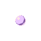](Baby_Ball.md) | 基本攻击球，没有特殊能力。 |

#### 特殊圆球

每颗特殊圆球都有独特的被动能力，在单局中可以升级，也可以与其他特殊圆球组合。有些默认解锁，其余需要到达特定关卡解锁。每局最高可升至 3 级，升级会提高伤害并强化能力。

能力的触发规则见下表。

如何激活能力?

| 能力类型 | 能力 | 触发器 |
| --- | --- | --- |
| 命中效果 | 破坏，通过， 范围效果,Spawn | 只有在线播放 |
| 状态效果 | 毒、烧、冻等等 | 在打，在损坏，在时刻，在拍摄,Spawn |

圆球的能力分为三个部分：

命中效果只有击中目标时触发，包括销毁、穿透、范围效果和生成。

状态触发条件决定何时施加状态效果，包括命中、造成范围伤害、定时、发射和生成。

状态效果可由命中、范围效果、定时、发射或生成触发，例如立即死亡（由黑洞触发）、中毒、灼烧和冻结。

命中效果分为四种：

穿透：圆球会穿过目标，适合同时击中多个目标。

销毁：圆球在命中后销毁。虽然这一类型相对不受欢迎，但这类圆球通常有强力能力。融合两颗命中后销毁的圆球时，可能丢失其中一个能力。

范围效果：例如核弹造成的辐射。

生成：产生分身、小球或召唤物。

状态触发条件有五种：

命中时：圆球击中目标时触发。

范围效果：圆球造成伤害时触发。核弹的辐射属于范围效果，可以触发状态效果。

定时：按固定时间间隔触发。

发射时：发射圆球时触发。由能力生成的圆球不计为发射。

生成：分身、小球或召唤物生成时触发。生成物还能带来额外触发。

有3种特殊球: **基础圆球**、 **融合圆球** 及 **进化圆球。**

##### 基础圆球

基本球是特殊的球，只要你开锁，你可以在跑步中升级。目前，游戏中共有21个基球，每个角色都有一个分配的基球,在游戏开始时，某些基球无法使用，只需完成某些操作才能解锁。 [坑级](Levels.md).

| 名称 | 标志 | 描述 | 性格 | 解锁状态 | 命中效果 | 状态触发器 | 状态效果 |
| --- | --- | --- | --- | --- | --- | --- | --- |
| [流血（Bleed）](Bleed.md) |  | 2堆血，流血的敌人在被球击中时每堆1个损伤(最大8个堆)。 | [战士（The Warrior）](The_Warrior.md)  [伪救世主](The_False_Messiah.md)  | 标签 默认解锁 | 标签 | 命中时 | 流血 |
| [育巢母体（Brood Mother）](Brood_Mother.md) |  | 每当它击中敌人时，有25%的机会生出宝贝球。 | [同居者（The Cohabitants）](The_Cohabitants.md)  | 标签 默认解锁 | 生成 | 命中时 生成 | 生成小球 |
| [灼烧（Burn）](Burn.md) |  | 在击中时添加1堆燃烧3秒 (最高3堆)。烧毁的单元每堆损坏4-8秒。 | [快枪手（The Itchy Finger）](The_Itchy_Finger.md)  | 标签 默认解锁 | 标签 | 命中时 | 灼烧 |
| [细胞（Cell）](Cell.md) |  | 在命中2次时被分成克隆人。 | 标签 | 清晰 [真菌森林（The FUNGALxFOREST）](The_FUNGALxFOREST.md)  | 生成 | 命中时 克隆 | 克隆 |
| [迷人（Charm）](Charm.md) |  | 每一次命中都有4%的机率给敌人带来5秒的魅力，魅力部队走上棋盘攻击敌人。 | [畅饮者（The Carouser）](The_Carouser.md)  | 清晰 [天堂之门（The HEAVENLYxGATES）](The_HEAVENLYxGATES.md)  | 标签 | 命中时 | 迷人 |
| [黑暗（Dark）](Dark.md) |  | 造成 3.0 倍伤害，命中敌人后销毁。再次发射前有 3 秒冷却时间。 | [暗影（The Shade）](The_Shade.md)  | 清晰 [骸骨墓园（The BONExYARD）](The_BONExYARD.md)  | 销毁 | 命中时 | 标签 |
| [地震（Earthquake）](Earthquake.md) |  | 附近3x3瓷砖方块内的单位伤害5-13件。 | [临时西西弗斯（The Makeshift Sisyphus）](The_Makeshift_Sisyphus.md)  [掘地者](The_Tunneller.md)  | 标签 默认解锁 | 范围效果 | 命中时 范围效果 | 标签 |
| [蛋袋（Egg Sac）](Egg_Sac.md) |  | 在击中敌人时爆炸到2到4个婴儿球，在再次射击之前，它会冷却3秒钟。 | [自笞者（The Flagellant）](The_Flagellant.md)  | 标签 默认解锁 | 销毁 生成 | 命中时 小球 | 生成小球 |
| [肉类（Flesh）](Flesh.md) |  | 每次跳动的速度增加25%。 | 标签 | 清晰 [血腥草原（The GORYxGRASSLANDS）](The_GORYxGRASSLANDS.md)  | 标签 | 命中时 | 标签 |
| [冻结（Freeze）](Freeze.md) |  | 有4%的机会冻结敌人5.0秒冻结敌人得到25%的伤害 | [忏悔者（The Repentant）](The_Repentant.md)  | 标签 默认解锁 | 标签 | 命中时 | 冻结 |
| [鬼魂（Ghost）](Ghost.md) |  | 通过敌人。 | [空巢者（The Empty Nester）](The_Empty_Nester.md)  | 标签 默认解锁 | 穿透 | 命中时 | 标签 |
| [铁（Iron）](Iron.md) |  | 造成的伤害是两倍，但速度更慢40%。 | [持盾者（The Shieldbearer）](The_Shieldbearer.md)  [战术家](The_Tactician.md) [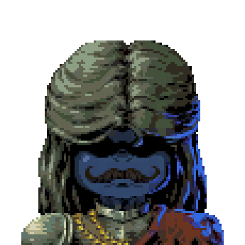](The_Tactician.md) | 标签 默认解锁 | 标签 | 命中时 | 标签 |
| [激光 (水平)（Laser (Horizontal)）](Laser_Horizontal.md) |  | 给所有敌人造成9-18的伤害。 | [蹑足者（The Tiptoer）](The_Tiptoer.md)  | 标签 默认解锁 | 范围效果 | 命中时 范围效果 | 标签 |
| [激光 (垂直)（Laser (Vertical)）](Laser_Vertical.md) |  | 在同一列中的所有敌人都受到9-18的伤害。 | [沉思者（The Cogitator）](The_Cogitator.md) [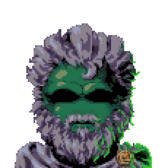](The_Cogitator.md) | 标签 默认解锁 | 范围效果 | 命中时 范围效果 | 标签 |
| [光（Light）](Light.md) |  | 盲目敌人在3秒内被击中盲目部队很难发现你并且有50%的机会在攻击时失踪 | [物理学家（The Physicist）](The_Physicist.md)  | 清晰 [边境沙漠（The LIMINALxDESERT）](The_LIMINALxDESERT.md)  | 标签 | 命中时 | 盲人 |
| [闪电（Lightning）](Lightning.md) |  | 给最多3个敌人造成1-20的伤害。 | [杂耍者（The Juggler）](The_Juggler.md)  [驯鹰人](The_Falconer.md) [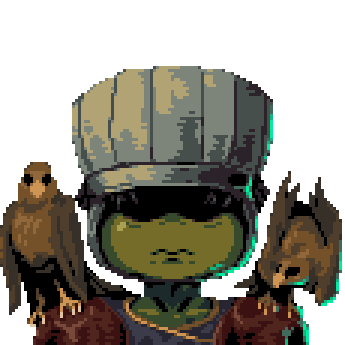](The_Falconer.md) | 标签 默认解锁 | 范围效果 | 命中时 范围效果 | 标签 |
| [石头（Stone）](Stone.md) |  | 首先造成300%的伤害。每次击中敌人时损伤减少40% (最低50%)。 | 标签 | 清晰 [白雪海岸（The SNOWYxSHORES）](The_SNOWYxSHORES.md)  | 标签 | 命中时 | 标签 |
| [中毒（Poison）](Poison.md) |  | 在命中时应用1堆毒药(最大5堆)，毒药持续6秒，每堆处理1-4个损坏每秒。 | [潜伏者（The Embedded）](The_Embedded.md)  | 标签 默认解锁 | 标签 | 命中时 | 中毒 |
| [时间（Time）](Time.md) |  | 敌人在战场上停留了20秒里面冻结了敌人 | 标签 | 清晰 [阴燃深渊（The SMOLDERINGxDEPTHS）](The_SMOLDERINGxDEPTHS.md)  | 销毁 | 命中时 范围效果 | 时间陷阱 |
| [吸血鬼（Vampire）](Vampire.md) |  | 每次击中就有4.5%的机会治愈1个健康。 | [挥霍者（The Spendthrift）](The_Spendthrift.md)  | 标签 默认解锁 | 标签 | 命中时 | 治疗 |
| [风（Wind）](Wind.md) |  | 穿过敌人，在5秒内减速30%，但减少25%的破坏。 | [激进者（The Radical）](The_Radical.md)  | 标签 默认解锁 | 穿透 | 命中时 | 减速 |

##### 融合圆球

主题: [融合机制](Fusion_Mechanics.md)

在将球合并之前，请考虑到:

能力的一般规则

| 面貌 | 能力类型 |
| --- | --- |
| 命中效果 | 通过/破坏，范围效果,Spawn |
| 状态触发条件 | On-Hit, 范围效果, On-Timer, On-Shoot, Spawn (英语)。 |
| 状态效果 | 快速杀死，流血等等。 |

例如,Cell（Clone） x Bomb（Destroy） 是一个"不可摧毁"的炸弹，因为炸弹同时被克隆和摧毁。

全屏幕触发器是触发状态效果的最佳选择。

[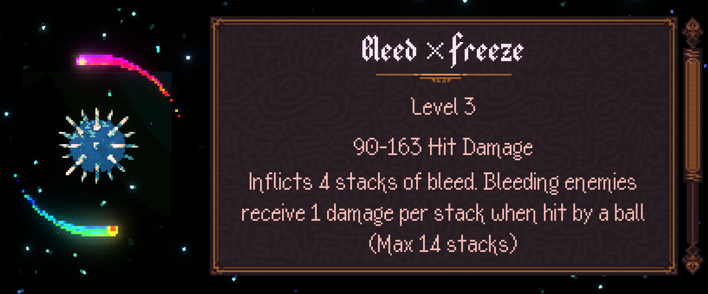](../files/BleedXFreeze.png.md)

引信弹泡和冻结球示例

合并球是通过合并其他2个球的球 *"未合并"* 3级特殊球，使用 [**聚合反应堆**](Fusion_Reactor.md)。可以将2个基球,2个进化球，甚至1个基球和1个进化球，但同一球不能与自身结合，如果2个球可以结合成一个进化球，那么你就可以 **我不能把它们合并。** 并且只能发展它们 (尽管这不适用于特殊球的对，其唯一的共同演变需要同时使用3个或更多的特殊球，如 [诺斯法拉图](Nosferatu.md)  或是 [基本](Elemental.md) ) 因此，有 `(90*89) {Special Ball Combos} - 89 {Evolution Combos} = 7921` 潜在的功能不同的融合球。

合并球将将合并它们的合并球的名称和效果，并且他们的图标也将被更新以匹配合并。例如，合并 **流血** 及 **冻结** 这将导致 **流血 × 冻结**, 具有两个能力, **流血** 及 **冻结**效果和统计的优先级取决于所涉及的组件球。 **合并球的顺序不会改变结果球的功能统计/能力**它的名称和外观将是不同的。 *五月* 视引信具体球(例如: **蛋袋X毒** 看起来就像 **毒 X蛋袋**然而, **蜘蛛女王X吸血鬼主** 完全不同于 **吸血鬼王 X 蜘蛛女王**注意，改变引信球顺序的唯一途径是改变它们获得的顺序， 此时不能手动选择核聚变的球顺序,

* 蛋袋X毒

  [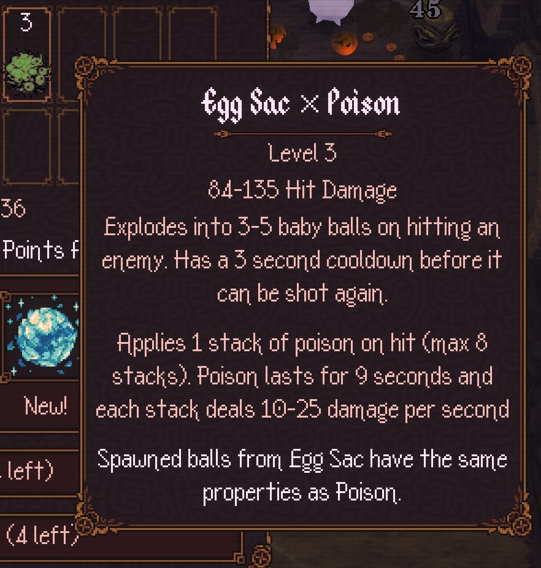](../files/Fusion_Example_Egg_Sac_x_Poison.jpg.md)
* 毒 X蛋袋

  [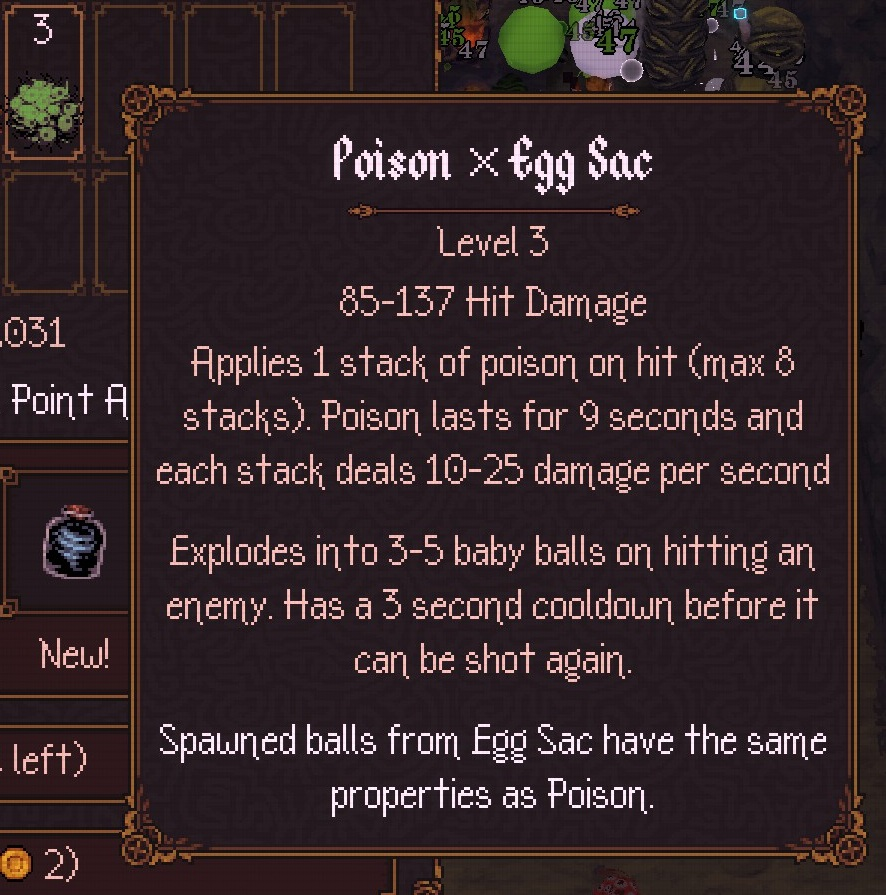](../files/Fusion_Example_Poison_x_Egg_Sac.jpg.md)
* 蜘蛛女王X吸血鬼主

  [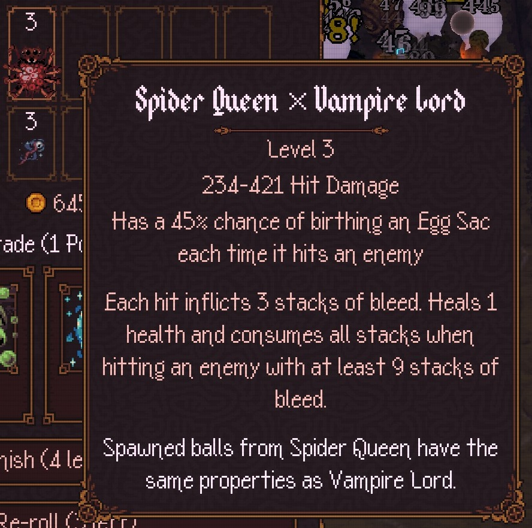](../files/Fusion_Example_Spider_Queen_x_Vampire_Lord.jpg.md)
* 吸血鬼王 X 蜘蛛女王

  [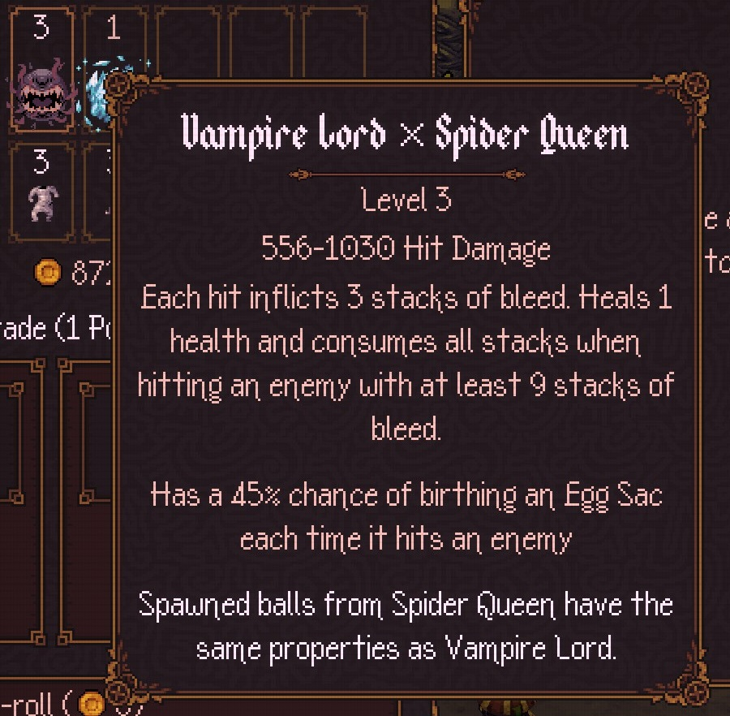](../files/Fusion_Example_Vampire_Lord_x_Spider_Queen.jpg.md)

##### 进化圆球

进化球是由2个或更多的特定3级基或进化球一起使用的球 **[聚合反应堆](Fusion_Reactor.md)**。这些圆球具有独特名称和能力，还可以继续与其他圆球融合或再次进化。有些进化圆球可以由不止 1 种特定组合制成，例如 **凶手** 可以通过结合创建 *铁 + 鬼* ***OR*** *铁 + 黑暗*)，并注意球的顺序 **没有** 影响结果的发育球。

目前，游戏中共有69个进化球。

| 名称 | 标志 | 描述 | 组合 | 命中效果 | 状态触发器 | 状态效果 | 可以进一步发展 |
| --- | --- | --- | --- | --- | --- | --- | --- |
| [亚马格登（Armageddon）](Armageddon.md) |  | 陨石雨持续了5秒 3瓦半径内的敌人会遭受30到50次伤害 | [在地狱里（Inferno）](Inferno.md)  + [风暴（Storm）](Storm.md)  | 销毁 范围效果 | 命中时 范围效果 | 标签 | 没有。 |
| [凶手（Assassin）](Assassin.md) |  | 穿过敌人的正面，但不是后背，后背刺伤了30%的奖金。 | [铁（Iron）](Iron.md)  + ([鬼魂（Ghost）](Ghost.md)  或是 [黑暗（Dark）](Dark.md) ) | 穿透 | 命中时 | 标签 | 是的，进去 [狙击手（Sniper）](Sniper.md)  在 [枪枪（Shotgun）](Shotgun.md)  |
| [驱逐的火焰（Banished Flame）](Banished_Flame.md) |  | 在命中时加1堆暗火(最大6堆)2秒。 暗火每秒处理1~30个损坏，当暗火熄灭时，它会给敌人1~100个。 | [黑暗（Dark）](Dark.md)  + [灼烧（Burn）](Burn.md)  | 标签 | 命中时 | 黑暗火焰 | 没有。 |
| [班西（Banshee）](Banshee.md) |  | 在发射时，在战场上诅咒所有敌人。在被击中6次后，诅咒敌人被处理150-300次。 | [幽灵（Phantom）](Phantom.md)  + [灵魂（Wraith）](Wraith.md)  | 标签 | 命中时 发射时 | 诅咒 | 没有。 |
| [贝尔塞克（Berserk）](Berserk.md) |  | 每一次命中都有30%的几率导致敌人发狂6秒。 伯瑟克敌人每秒处理15-24次对相邻敌人的伤害。 | [迷人（Charm）](Charm.md)  + ([流血（Bleed）](Bleed.md)  或是 [灼烧（Burn）](Burn.md) ) | 标签 | 命中时 | 贝尔塞克 | 没有。 |
| [黑洞（Black Hole）](Black_Hole.md) |  | 立即杀死它所击中的第一个非霸主敌人，但随后会摧毁自己。在再次被击中之前，先冷却7秒。 | [太阳（Sun）](Sun.md)  + ([黑暗（Dark）](Dark.md)  或是 [时间（Time）](Time.md) ) | 销毁 | 命中时 | 立即杀死 | 没有。 |
| [雪风（Blizzard）](Blizzard.md) |  | 将敌人冻结在 2瓦半径内 0.8秒内， 造成1 - 50伤害 | [冻结（Freeze）](Freeze.md)  + ([风（Wind）](Wind.md)  或是 [闪电（Lightning）](Lightning.md) ) | 标签 | 命中时 范围效果 | 冻结 | 没有。 |
| [炸弹（Bomb）](Bomb.md) |  | 击中敌人时爆炸，对附近的敌人造成150-300的破坏。在3秒冷却后才能再次被击中。 | [灼烧（Burn）](Burn.md)  + [铁（Iron）](Iron.md)  | 销毁 | 命中时 范围效果 | 标签 | 是的, [核弹（Nuclear Bomb）](Nuclear_Bomb.md)  在 [中毒（Poison）](Poison.md)  或进入 [时间炸弹（Time Bomb）](Time_Bomb.md)  在 [时间（Time）](Time.md)  |
| [硫磺（Brimstone）](Brimstone.md) |  | 每秒对所有在2瓦半径(最大4个堆)内的敌人适用1堆烧伤和毒害。每秒烧伤1-4个堆，每秒毒害2-3个堆。 | ([石头（Stone）](Stone.md)  或是 [中毒（Poison）](Poison.md) ) + [灼烧（Burn）](Burn.md)  | 标签 | 命中时 定时触发 | 燃烧，毒 | 没有。 |
| [投石机（Catapult）](Catapult.md) |  | 每1.5秒发射3-5颗石头宝贝球，它们在碰到任何东西后被摧毁。 | [石头（Stone）](Stone.md)  + [蛋袋（Egg Sac）](Egg_Sac.md)  | 标签 | 命中时 生成 | 生成小球 | 没有。 |
| [钻头（Drill）](Drill.md) |  | 打破敌人，并将50%的奖金损失交付到达后面的场地。 | [地震（Earthquake）](Earthquake.md)  + [铁（Iron）](Iron.md)  | 穿透 | 命中时 | 标签 | 没有。 |
| [基本（Elemental）](Elemental.md) |  | 将随机状态效果(烧伤、慢速或冻结)应用到附近敌人被击中时。 | [灼烧（Burn）](Burn.md)  + [风（Wind）](Wind.md)  + [冻结（Freeze）](Freeze.md)  + [地震（Earthquake）](Earthquake.md)  | 标签 | 命中时 | 烧烧，慢慢，冻结 | 没有。 |
| [侵蚀（Erosion）](Erosion.md) |  | 通过敌人，将敌人的3%，作为额外的伤害。 | [时间（Time）](Time.md)  + [风（Wind）](Wind.md)  | 穿透 | 命中时 | ? | 没有。 |
| [烟花（Fireworks）](Fireworks.md) |  | 爆发3-6炮火。烟火针对随机敌人，造成20-30伤害，并使用1堆烧伤。烧伤的单位每秒每堆损伤7-11伤害。 | [灼烧（Burn）](Burn.md)  + [蛋袋（Egg Sac）](Egg_Sac.md)  | 销毁 | 命中时 生成 | 烟火， 烧伤， 烧伤 | 没有。 |
| [闪光（Flash）](Flash.md) |  | 在击中敌人后，损坏屏幕上的所有敌人1到3次，然后将他们盲视2秒。 | [闪电（Lightning）](Lightning.md)  + [光（Light）](Light.md)  | 标签 | 命中时 全屏范围效果 | 盲人 | 没有。 |
| [肉山（Flesh Mound）](Flesh_Mound.md) |  | 每1.0秒就随机向着一个方向亲热的婴儿球 | [育巢母体（Brood Mother）](Brood_Mother.md)  + [肉类（Flesh）](Flesh.md)  | 标签 | 命中时 定时生成 | 易碎婴儿球义体 | 没有。 |
| [闪烁（Flicker）](Flicker.md) |  | 每隔1.4秒就会给每个敌人造成1-7的伤害。 | [光（Light）](Light.md)  + [黑暗（Dark）](Dark.md)  | 标签 | 命中时 定时触发 | 标签 | 没有。 |
| [冰冻射线（Freeze Ray）](Freeze_Ray.md) |  | 击中敌人时发出冷冻射线，在敌人行进的路上处理20-50个敌人,10%的机率将其冻结10.0秒 | [冻结（Freeze）](Freeze.md)  + ([激光 (水平)（Laser (Horizontal)）](Laser_Horizontal.md)  或是 [激光 (垂直)（Laser (Vertical)）](Laser_Vertical.md) ) | 标签 | 命中时 范围效果 | 冻结 | 没有。 |
| [冰冻火焰（Frozen Flame）](Frozen_Flame.md) |  | 20秒内增加1堆霜烧(最大4堆) 。 Frostburnt 单元每秒处理8-12个伤害，并从其他来源得到25%的伤害。 | [灼烧（Burn）](Burn.md)  + [冻结（Freeze）](Freeze.md)  | 标签 | 命中时 | 冰烧 | 没有。 |
| [冰川（Glacier）](Glacier.md) |  | 将冰川的钉子释放出来，这些钉子会让15-30的敌人接触它们，并冻结它们2.0秒。这个球及其冰川钉子也会对附近的单位造成6-12的破坏。 | [冻结（Freeze）](Freeze.md)  + ([地震（Earthquake）](Earthquake.md)  或是 [石头（Stone）](Stone.md) ) | 标签 | 命中时 范围效果定时时间 | 冻结 | 没有。 |
| [吞心者（Heart Swallower）](Heart_Swallower.md) |  | 击中敌人，有40%的机会窃取1人的健康，减少20%的攻击伤害。 | [流血（Bleed）](Bleed.md)  + [鬼魂（Ghost）](Ghost.md)  | 标签 | 命中时 | 抢劫生命，袭击 | 是的，进去 [收获者（Reaper）](Reaper.md)  在 [吸血鬼（Soul Sucker）](Soul_Sucker.md)  |
| [输血（Hemorrhage）](Hemorrhage.md) |  | 3堆血。 当用 12堆血或更多击打敌人时， 消耗所有堆血处理当前20%的健康 | [流血（Bleed）](Bleed.md)  + ([铁（Iron）](Iron.md)  或是 [肉类（Flesh）](Flesh.md) ) | 标签 | 命中时 | 流血 | 没有。 |
| [圣激光（Holy Laser）](Holy_Laser.md) |  | 处理24-36伤害所有敌人在同一行和列 | [激光 (水平)（Laser (Horizontal)）](Laser_Horizontal.md)  + [激光 (垂直)（Laser (Vertical)）](Laser_Vertical.md)  | 标签 | 命中时 范围效果 | 标签 | 是的，进去 [X 射线（X Ray）](X_Ray.md)  在 [激光束（Laser Beam）](Laser_Beam.md)  |
| [梦魔（Incubus）](Incubus.md) |  | 每次击中就有4%的机会，在9秒钟内吸引敌人。被咒诅的敌人诅咒附近的敌人。被击中5次后，被诅咒的敌人被处理100-200 | [迷人（Charm）](Charm.md)  + [黑暗（Dark）](Dark.md)  | 标签 | 命中时 ? | 迷人，诅咒 | 是的，进去 [撒旦（Satan）](Satan.md)  在 [魅魔（Succubus）](Succubus.md)  |
| [在地狱里（Inferno）](Inferno.md) |  | 每秒对 2张半径范围内的所有敌人使用1堆燃烧。 燃烧持续6秒， 每秒处理 3 - 7个伤害。 | [灼烧（Burn）](Burn.md)  + ([风（Wind）](Wind.md)  或是 [时间（Time）](Time.md) ) | 标签 | 命中时 定时触发 | 灼烧 | 是的，进去 [亚马格登（Armageddon）](Armageddon.md)  在 [风暴（Storm）](Storm.md)  |
| [地滑坡（Landslide）](Landslide.md) |  | 造成滑坡，并在击中敌人时破坏自己。滑坡持续5秒，在2瓦半径范围内每秒对敌人进行20-30次破坏。 | [石头（Stone）](Stone.md)  + [地震（Earthquake）](Earthquake.md)  | 销毁 | 命中时 范围效果 | 地滑坡 | 没有。 |
| [激光束（Laser Beam）](Laser_Beam.md) |  | 发射激光射线，造成30-42次伤害，并使敌人失明8秒钟。 | [光（Light）](Light.md)  + ([激光 (水平)（Laser (Horizontal)）](Laser_Horizontal.md)  或是 [激光 (垂直)（Laser (Vertical)）](Laser_Vertical.md) ) | 标签 | 命中时 范围效果 | 盲人 | 是的，进去 [X 射线（X Ray）](X_Ray.md)  在 [圣激光（Holy Laser）](Holy_Laser.md)  |
| [激光切割机（Laser Cutter）](Laser_Cutter.md) | [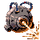](Laser_Cutter.md) | 在它面前不断发射激光，每秒造成100-150的伤害。 | ([激光 (水平)（Laser (Horizontal)）](Laser_Horizontal.md)  或是 [激光 (垂直)（Laser (Vertical)）](Laser_Vertical.md) ) + [钢铁（Steel）](Steel.md)  | ? | ? | 标签 | 没有。 |
| [李克（Leech）](Leech.md) | [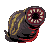](Leech.md) | 连接到1个吸血液到击中的敌人，每秒增加2堆血量 (最高24堆血量) | [育巢母体（Brood Mother）](Brood_Mother.md)  + [流血（Bleed）](Bleed.md)  | 标签 | 命中时 | 李克，流血 | 没有。 |
| [闪电虫（Lightning Bug）](Lightning_Bug.md) |  | 每当它击中敌人时都会产生闪电虫。闪电虫攻击一个随机敌人，给最多的3个敌人造成1-80的伤害。 | [闪电（Lightning）](Lightning.md)  + [育巢母体（Brood Mother）](Brood_Mother.md)  | 标签 | 命中时 生成 | 闪电虫生育 | 没有。 |
| [闪电棒（Lightning Rod）](Lightning_Rod.md) |  | 这些敌人每3.0秒就会被闪电击中，对附近多达8个敌人造成1-30的破坏。 | [闪电（Lightning）](Lightning.md)  + [铁（Iron）](Iron.md)  | 标签 | 命中时 范围效果 | 闪电棒 | 没有。 |
| [爱情者（Lovestruck）](Lovestruck.md) |  | 命中使敌人陷入迷恋，持续 20 秒。陷入迷恋的单位攻击时有 50% 的概率为你恢复 5 点生命值。 | [迷人（Charm）](Charm.md)  + ([光（Light）](Light.md)  或是 [闪电（Lightning）](Lightning.md)  或是 [时间（Time）](Time.md) ) | 标签 | 命中时 | 恋童癖 | 没有。 |
| [蛆虫（Maggot）](Maggot.md) |  | 当他们死亡时，他们会爆炸成1-2个婴儿球。 | [育巢母体（Brood Mother）](Brood_Mother.md)  + [细胞（Cell）](Cell.md)  | 标签 | 命中时 生成 | 狂风，婴儿球自养婴儿球 | 没有。 |
| [马格玛（Magma）](Magma.md) |  | 进入熔岩浮囊的敌人被处理15-30次伤害，并获得1堆烧伤(最大3堆) 。 燃烧持续3秒钟， 每堆3-8次伤害每秒。 这个球及其熔岩浮囊也给附近的单位造成6-12次伤害。 | [灼烧（Burn）](Burn.md)  + [地震（Earthquake）](Earthquake.md)  | 标签 | 命中时 定时触发 | 灼烧 | 没有。 |
| [蚊子王（Mosquito King）](Mosquito_King.md) |  | 蚊子每次击中敌人都会喷出蚊子，蚊子会攻击随机的敌人，每只可处理80-120个损伤，如果蚊子杀死敌人，它们会偷走1个健康 | [吸血鬼（Vampire）](Vampire.md)  + [育巢母体（Brood Mother）](Brood_Mother.md)  | 标签 | 命中时 生成 | 蚊鱼、救生船 | 是的, [诺斯法拉图（Nosferatu）](Nosferatu.md)  与两者一起 [吸血鬼主（Vampire Lord）](Vampire_Lord.md)  及 [蜘蛛女王（Spider Queen）](Spider_Queen.md)  在 [蚊子王国（Mosquito Kingdom）](Mosquito_Kingdom.md)  与 [蚊子群（Mosquito Swarm）](Mosquito_Swarm.md)  |
| [蚊子王国（Mosquito Kingdom）](Mosquito_Kingdom.md) |  | 每当它击中敌人时，它会产生1-2个蚊子。 蚊子攻击一个随机的敌人，每一个造成100-150个伤害。 如果一个蚊子杀死了敌人，他们就会偷走2个健康。 | [蚊子王（Mosquito King）](Mosquito_King.md)  + [蚊子群（Mosquito Swarm）](Mosquito_Swarm.md)  | 标签 | 命中时 生成 | 蚊鱼、救生船 | 没有。 |
| [蚊子群（Mosquito Swarm）](Mosquito_Swarm.md) |  | 爆裂后产生 3–6 只蚊子。蚊子随机攻击敌人，每只造成 80–120 点伤害。蚊子击杀敌人时窃取 1 点生命值。 | [吸血鬼（Vampire）](Vampire.md)  + [蛋袋（Egg Sac）](Egg_Sac.md)  | 销毁 | 命中时 生成 | 蚊鱼、救生船 | 是的, [蚊子王国（Mosquito Kingdom）](Mosquito_Kingdom.md)  与 [蚊子王（Mosquito King）](Mosquito_King.md)  |
| [诺斯法拉图（Nosferatu）](Nosferatu.md) |  | 吸血鬼蝙蝠飞向一个随机敌人，在击中时造成132-176伤害，变成吸血鬼主 | [吸血鬼主（Vampire Lord）](Vampire_Lord.md)  + [蜘蛛女王（Spider Queen）](Spider_Queen.md)  + [蚊子王（Mosquito King）](Mosquito_King.md)  | 标签 | 命中时 生成 | Vampi Bat Spawn 蝙蝠自食其力 | 没有。 |
| [危害性（Noxious）](Noxious.md) |  | 穿过敌人，在2瓦半径范围内向附近的敌人施用3堆毒药。毒药持续4秒，每堆毒药每秒处理1-3个损伤。 | [风（Wind）](Wind.md)  + ([中毒（Poison）](Poison.md)  或是 [黑暗（Dark）](Dark.md) ) | 穿透 | 命中时 范围效果 | 中毒 | 没有。 |
| [核弹（Nuclear Bomb）](Nuclear_Bomb.md) |  | 在击中敌人时爆炸，对附近的敌人造成300-500的伤害，并将1堆辐射用于无限时间 (最高5堆)。每堆辐射增加收到的伤害10%。有3秒的冷却。 | [炸弹（Bomb）](Bomb.md)  + [中毒（Poison）](Poison.md)  | 销毁 | 命中时 范围效果范围效果(全屏幕) | 没有。 | 没有。 |
| [后代（Offspring）](Offspring.md) |  | 在击中4次时分为克隆。 | [细胞（Cell）](Cell.md)  + [肉类（Flesh）](Flesh.md)  | 标签 | 命中时 生成 | 克隆 | 没有。 |
| [过度增长（Overgrowth）](Overgrowth.md) |  | 应用 1堆积的过度生长。 到达 3时， 消耗所有堆积， 在 3x3瓦片平方中处理 150- 200个敌人的损坏。 | [地震（Earthquake）](Earthquake.md)  + [细胞（Cell）](Cell.md)  | 标签 | 命中时 没有什么。 | 过度增长 | 没有。 |
| [石化（Petrify）](Petrify.md) | [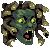](Petrify.md) | 在首次发射时，它将在视线内的所有敌人石化为1.5秒，交易50-120。 | [石头（Stone）](Stone.md)  + [肉类（Flesh）](Flesh.md)  | 标签 | 命中时 发射时 | 石化 | 没有。 |
| [幽灵（Phantom）](Phantom.md) |  | 在5次击中后，被诅咒的敌人遭受100-200次伤害。 | [黑暗（Dark）](Dark.md)  + [鬼魂（Ghost）](Ghost.md)  | 标签 | 命中时 | 诅咒 | 是的, [班西（Banshee）](Banshee.md)  与 [灵魂（Wraith）](Wraith.md)  |
| [辐射束（Radiation Beam）](Radiation_Beam.md) |  | 撞击时发射辐射束，处理24-48的损伤，并施放1堆辐射(最大5堆)。 辐射持续15秒，导致敌人每堆所有来源的损伤增加10%。 | ([激光 (水平)（Laser (Horizontal)）](Laser_Horizontal.md)  或是 [激光 (垂直)（Laser (Vertical)）](Laser_Vertical.md) ) + ([中毒（Poison）](Poison.md)  或是 [细胞（Cell）](Cell.md) ) | 标签 | 命中时 范围效果 | 辐射 | 是的，进去 [肿瘤（Tumor）](Tumor.md)  在 [肉类（Flesh）](Flesh.md)  |
| [收获者（Reaper）](Reaper.md) |  | 有10%的机会在撞击时杀死敌人， 治愈你为5个健康。 | [吸血鬼（Soul Sucker）](Soul_Sucker.md)  + [吞心者（Heart Swallower）](Heart_Swallower.md)  | 标签 | 命中时 | 立即杀死 | 没有。 |
| [牺牲（Sacrifice）](Sacrifice.md) | [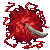](Sacrifice.md) | 施加4堆血 (最多15堆血) 并施加诅咒击杀敌人。在被击杀5次后，诅咒的敌人被处理50-100次 | [流血（Bleed）](Bleed.md)  + [黑暗（Dark）](Dark.md)  | 标签 | 命中时 | 流血，诅咒 | 没有。 |
| [沙风（Sandstorm）](Sandstorm.md) |  | 穿越敌人，被激烈的风暴包围，每秒造成10到20次破坏，并使附近的敌人3秒失明。 | ([地震（Earthquake）](Earthquake.md)  或是 [石头（Stone）](Stone.md) ) + [风（Wind）](Wind.md)  | 穿透 | 命中时 定时触发 | 盲人 | 没有。 |
| [撒旦（Satan）](Satan.md) |  | 在活跃时，每秒给所有活跃的敌人添加1堆燃烧 (最多5堆燃烧)，每秒给每堆损坏10-20个，让他们疯狂，每秒给邻近的敌人造成15-24个损伤 | [梦魔（Incubus）](Incubus.md)  + [魅魔（Succubus）](Succubus.md)  | 标签 | 命中时 定时触发 | 烧掉，伯塞克 | 没有。 |
| [枪枪（Shotgun）](Shotgun.md) |  | 击墙后射出3-7个铁质婴儿球，铁质婴儿球以200%的速度运动，但在击中任何东西时被摧毁 | [铁（Iron）](Iron.md)  + [蛋袋（Egg Sac）](Egg_Sac.md)  | 标签 | 命中时 生成 | 生成小球 | 是的，进去 [狙击手（Sniper）](Sniper.md)  在 [凶手（Assassin）](Assassin.md)  |
| [狙击手（Sniper）](Sniper.md) |  | 射击后射击敌人，射击3-7个狙击手婴儿球。 射击手婴儿球射击敌人，但在撞击墙时被摧毁。 | [枪枪（Shotgun）](Shotgun.md)  + [凶手（Assassin）](Assassin.md)  | 穿透 | 命中时 生成 | 狙击手婴儿球球 | 没有。 |
| [吸血鬼（Soul Sucker）](Soul_Sucker.md) |  | 通过敌人并击败他们，有30%的机会窃取1个健康和减少他们的攻击伤害20%。 | [吸血鬼（Vampire）](Vampire.md)  + [鬼魂（Ghost）](Ghost.md)  | 穿透 | 命中时 | 抢劫生命，袭击 | 是的，进去 [收获者（Reaper）](Reaper.md)  在 [吞心者（Heart Swallower）](Heart_Swallower.md)  |
| [蜘蛛女王（Spider Queen）](Spider_Queen.md) |  | 每次击中敌人时都有25%的产卵卵沙克的机率 | [育巢母体（Brood Mother）](Brood_Mother.md)  + [蛋袋（Egg Sac）](Egg_Sac.md)  | 标签 | 命中时 生成 | 生成小球 | 是的, [诺斯法拉图（Nosferatu）](Nosferatu.md)  与两者一起 [吸血鬼主（Vampire Lord）](Vampire_Lord.md)  及 [蚊子王（Mosquito King）](Mosquito_King.md)  |
| [钢铁（Steel）](Steel.md) |  | 起初造成双重伤害，但速度50%，速度较慢。每次击中敌人时伤害增加10% (最大300%)。 | [铁（Iron）](Iron.md)  + [石头（Stone）](Stone.md)  | 标签 | 命中时 | 标签 | 是的，进去 [激光切割机（Laser Cutter）](Laser_Cutter.md)  在 [激光 (水平)（Laser (Horizontal)）](Laser_Horizontal.md)  或是 [激光 (垂直)（Laser (Vertical)）](Laser_Vertical.md)  |
| [风暴（Storm）](Storm.md) |  | 每秒发出闪电击中附近的敌人，造成1-40的伤害 | [闪电（Lightning）](Lightning.md)  + [风（Wind）](Wind.md)  | 标签 | 命中时 定时触发 | 标签 | 是的，进去 [亚马格登（Armageddon）](Armageddon.md)  在 [在地狱里（Inferno）](Inferno.md)  |
| [魅魔（Succubus）](Succubus.md) |  | 每次命中有 4% 的概率魅惑敌人 9 秒。击中被魅惑的敌人时恢复 1 点生命值。 | [迷人（Charm）](Charm.md)  + [吸血鬼（Vampire）](Vampire.md)  | 标签 | 命中时 | 迷人 | 是的，进去 [撒旦（Satan）](Satan.md)  在 [梦魔（Incubus）](Incubus.md)  |
| [太阳（Sun）](Sun.md) |  | 盲目所有敌人，每秒增加1堆燃烧 (最多5堆燃烧)。燃烧持续6秒，每秒损伤6-12堆燃烧 | [灼烧（Burn）](Burn.md)  + [光（Light）](Light.md)  | 标签 | 命中时 定时触发 | 盲人，燃烧 | 是的，进去 [黑洞（Black Hole）](Black_Hole.md)  在 [黑暗（Dark）](Dark.md)  或是 [时间（Time）](Time.md)  |
| [沼泽（Swamp）](Swamp.md) |  | 随着时间推移而留下焦油块。走进焦油块的敌人被处理15-30个，在7秒内减速50%，并获得1堆毒物(最大8堆)，每堆毒物每秒1-3个损坏。这个球及其焦油块还处理附近单位的6-12个损坏。 | [中毒（Poison）](Poison.md)  + [地震（Earthquake）](Earthquake.md)  | 标签 | 命中时 定时触发 | 慢慢，毒 | 没有。 |
| [时间炸弹（Time Bomb）](Time_Bomb.md) |  | 每几秒钟就会扔一个时机炸弹，它会在延迟后爆炸，给附近的敌人造成80-120的伤害。 | [时间（Time）](Time.md)  + [炸弹（Bomb）](Bomb.md)  | 标签 | 命中时 定时触发 | 炸弹自爆器、时间自爆器 | 没有。 |
| [时间限制（Timestop）](Timestop.md) |  | 将球场上所有东西冻结5.0秒，但打中敌人后会自己毁灭。有30秒的冷却后，才能再次被射杀。 | [时间（Time）](Time.md)  + [冻结（Freeze）](Freeze.md)  | 销毁 | 命中时 在全屏幕上。 | 时间限制 | 没有。 |
| [肿瘤（Tumor）](Tumor.md) |  | 患肿瘤的敌人在40秒后死亡(老板除外)。 | [辐射束（Radiation Beam）](Radiation_Beam.md)  + [肉类（Flesh）](Flesh.md)  | 标签 | 命中时 | 肿瘤 | 没有。 |
| [吸血鬼主（Vampire Lord）](Vampire_Lord.md) |  | 每次击中都会造成3堆血，医治1个健康，并且在击中敌人时至少消耗10堆血。 | [吸血鬼（Vampire）](Vampire.md)  + ([流血（Bleed）](Bleed.md)  或是 [黑暗（Dark）](Dark.md) ) | 标签 | 命中时 | 流血，治愈 | 是的, [诺斯法拉图（Nosferatu）](Nosferatu.md)  两者 [蜘蛛女王（Spider Queen）](Spider_Queen.md)  及 [蚊子王（Mosquito King）](Mosquito_King.md)  |
| [毒药（Venom）](Venom.md) |  | 在命中时应用1堆毒液(最大8堆)，每堆处理3-6个损坏，并减慢敌人的速度。 | [中毒（Poison）](Poison.md)  + [冻结（Freeze）](Freeze.md)  | 标签 | 命中时 | 毒气，慢慢 | 没有。 |
| [病毒（Virus）](Virus.md) |  | 对被击中的单位施加 1 层疾病，最多叠加 8 层。疾病持续 6 秒，每层每秒造成 3–6 点伤害。患病单位每秒有 15% 的概率向附近未患病的敌人传播 1 层。 | [中毒（Poison）](Poison.md)  + ([流血（Bleed）](Bleed.md)  或是 [鬼魂（Ghost）](Ghost.md)  或是 [细胞（Cell）](Cell.md) ) | 标签 | 命中时 范围效果 | 疾病 | 没有。 |
| [雪茄沙卡（Voluptuous Egg Sac）](Voluptuous_Egg_Sac.md) |  | 在击中敌人时，它会爆炸到2到3个蛋袋，在再次射击之前，会冷却3秒钟。 | [蛋袋（Egg Sac）](Egg_Sac.md)  + [细胞（Cell）](Cell.md)  | 销毁 | 命中时 生成 | 生成小球 | 没有。 |
| [变形（Warp）](Warp.md) |  | 每次命中后，曲速到场上随机位置，速度加快5%。 | [时间（Time）](Time.md)  + [光（Light）](Light.md)  | 标签 | 标签 | 标签 | 没有。 |
| [灵魂（Wraith）](Wraith.md) |  | 冻结任何敌机穿过敌机0.8秒 | [冻结（Freeze）](Freeze.md)  + [鬼魂（Ghost）](Ghost.md)  | 穿透 | 命中时 | 冻结 | 是的, [班西（Banshee）](Banshee.md)  在 [幽灵（Phantom）](Phantom.md)  |
| [X 射线（X Ray）](X_Ray.md) |  | 在击中时发射X形激光，对敌人造成50-75伤害，并使用1堆辐射 (最高5堆)。辐射使敌人每堆每源获得10%更多的伤害。 | [圣激光（Holy Laser）](Holy_Laser.md)  + [激光束（Laser Beam）](Laser_Beam.md)  | 标签 | 命中时 范围效果 | 辐射 | 没有。 |
| [僵尸（Zombie）](Zombie.md) | [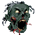](Zombie.md) | 给敌人40%的机会让他们在死后变成一个友好的僵尸 | [吸血鬼（Vampire）](Vampire.md)  + [肉类（Flesh）](Flesh.md)  | 标签 | 命中时 | 僵尸感染僵尸自救 | 没有。 |

**分类**　[分类 · 坚力](../categories/Stubs.md) · [分类 · 解锁条件](../categories/Unlocks.md)

[返回总入口](../%E7%90%83%E6%AF%94%E4%BC%A6%E6%88%98%E8%AE%B0%20Wiki.md) · [返回本分目录](%E7%9B%AE%E5%BD%95.md)
