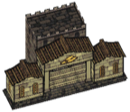
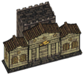

# 银行（Bank）

增加战斗中获得的金币。

[原文与贡献者记录](https://ballxpit.wiki.gg/wiki/Bank) · [修订 3375](https://ballxpit.wiki.gg/index.php?oldid=3375) · [返回目录](../%E7%90%83%E6%AF%94%E4%BC%A6%E6%88%98%E8%AE%B0%20Wiki.md)

## 信息（Information）

### 分类（Category）

战争

### 子类（Subcategory）

将军

### 蓝图位置（Blueprint location）

[LIMINALxDESERT](The_LIMINALxDESERT.md)

### 基础资源消耗（Base resource cost）

 30  20

### 建造点消耗（Build point cost）

5

建造银行会增加玩家在等级挑战中敌人掉落的金币数量，且该增加量可通过升级进一步提升。

被动效果与升级

| 等级 | 图片 | 说明 | 资源消耗 | 建造点消耗 | 拆除 |
| --- | --- | --- | --- | --- | --- |
| 1 |  | 战斗中的金币收益增加5% |  20  20 | 5 |  20  20 |
| 2 |  | 战斗中的金币获取量增加 10% |  40  30 | 5 |  60  50 |
| 3 |  | 战斗中的金币收益增加15% |  60  45 | 15 |  120  95 |

[共享导航](../navigation/nav-d4956b01aa56.md)

**分类**　[分类 · 建筑](../categories/Buildings.md) · [分类 · 战争](../categories/Warfare.md) · [分类 · 通用](../categories/General.md) · [分类 · 带有导航框的页面](../categories/Pages_with_navboxes.md)

[返回总入口](../%E7%90%83%E6%AF%94%E4%BC%A6%E6%88%98%E8%AE%B0%20Wiki.md) · [返回本分目录](%E7%9B%AE%E5%BD%95.md)
