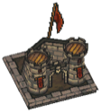
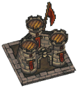
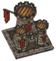
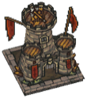
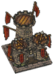

# 兵营（Barracks）

为所有角色提供力量加成。

[原文与贡献者记录](https://ballxpit.wiki.gg/wiki/Barracks) · [修订 3350](https://ballxpit.wiki.gg/index.php?oldid=3350) · [返回目录](../%E7%90%83%E6%AF%94%E4%BC%A6%E6%88%98%E8%AE%B0%20Wiki.md)

## 信息（Information）

### 分类（Category）

战争

### 子类（Subcategory）

属性加成

### 蓝图位置（Blueprint location）

[BONExYARD](The_BONExYARD.md)

### 基础资源消耗（Base resource cost）

 2  3

### 建造点消耗（Build point cost）

4

军营是六座提供基础属性加成的建筑之一。建成后为所有角色提供 +1 力量，升级后最高可提供 +5。等[战术家](The_Tactician.md) 解锁对应能力后，如果建筑位于[队长宿舍](Captain_s_Quarters.md)的效果范围内，还会多提供 +1。建筑升至 5 级可解锁「建筑之力」（Structural Power）成就。

被动效果与升级

| 等级 | 图片 | 说明 | 资源消耗 | 建造点消耗 | 拆除 |
| --- | --- | --- | --- | --- | --- |
| 1 |  | 所有角色获得 +1 力量。力量影响特殊圆球的伤害。 |  2  3 | 4 |  2  3 |
| 2 |  | 所有角色获得 +2 力量。力量影响特殊圆球的伤害。 |  20  8 | 4 |  22  11 |
| 3 |  | 所有角色获得 +3 力量。力量影响特殊圆球的伤害。 |  30  12 | 12 |  52  23 |
| 4 |  | 所有角色获得 +4 力量。力量影响特殊圆球的伤害。 |  40  16 | 20 |  92  39 |
| 5 |  | 所有角色获得 +5 力量。力量影响特殊圆球的伤害。 |  50  20 | 28 |  142  59 |

[共享导航](../navigation/nav-d4956b01aa56.md)

**分类**　[分类 · 建筑](../categories/Buildings.md) · [分类 · 战争](../categories/Warfare.md) · [分类 · 属性加成](../categories/Stat_Bonuses.md) · [分类 · 带有导航框的页面](../categories/Pages_with_navboxes.md)

[返回总入口](../%E7%90%83%E6%AF%94%E4%BC%A6%E6%88%98%E8%AE%B0%20Wiki.md) · [返回本分目录](%E7%9B%AE%E5%BD%95.md)
