# 测试版与删减内容（Beta and Cut Content）

[原文与贡献者记录](https://ballxpit.wiki.gg/wiki/Beta_and_Cut_Content) · [修订 2644](https://ballxpit.wiki.gg/index.php?oldid=2644) · [返回目录](../%E7%90%83%E6%AF%94%E4%BC%A6%E6%88%98%E8%AE%B0%20Wiki.md)

## 建筑

* 测试版及未使用的战争建筑/精灵图
* 
* 
* 
* 
* 
* 
* 
* 
* [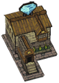](../files/Buildings_Jeweler_Level2.5_unused_.png.md)
* [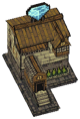](../files/Buildings_Jeweler_Level3_unused_.png.md)
* [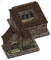](../files/Buildings_Abbey_Level2.5_unused_.png.md)
* [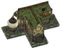](../files/Buildings_Alchemist_Level3.5_unused_.png.md)
* [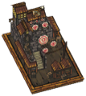](../files/Buildings_Archery_Range_Level3.5_unused_.png.md)
* [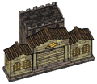](../files/Buildings_Bank_Level2.5_unused_.png.md)
* [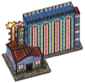](../files/Buildings_Casino_Level2.5_unused_.png.md)
* [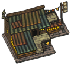](../files/Buildings_Gamblers_Den_Level2.5_unused_.png.md)
* [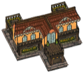](../files/Buildings_Matchmaker_Level2.5_unused_.png.md)
* [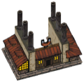](../files/Buildings_Magnet_Factory_Level2.5_unused_.png.md)
* [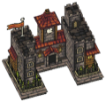](../files/Buildings_Military_Academy_Level4.5_unused_.png.md)
* [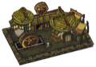](../files/Buildings_Wheelwright_Level3.5_unused_.png.md)
* [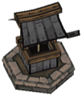](../files/Buildings_Wishing_Well_Level2.5_unused_.png.md)
* [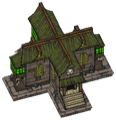](../files/Buildings_Necromancer_Level2.5_unused_.png.md)
* [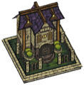](../files/Buildings_Schoolhouse_Level3.5_unused_.png.md)
* [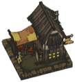](../files/Buildings_Shoemaker_Level4.5_unused_.png.md)
* [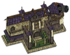](../files/Buildings_University_Level4.5_unused_.png.md)
* [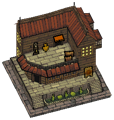](../files/Buildings_Antique_Shop_Level2.5_unused_.png.md)
* [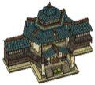](../files/Buildings_Diplomacy_Hall_Level4.5_unused_.png.md)
* [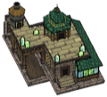](../files/Buildings_Gemsmith_Level2.5_unused_.png.md)
* 

[返回总入口](../%E7%90%83%E6%AF%94%E4%BC%A6%E6%88%98%E8%AE%B0%20Wiki.md) · [返回本分目录](%E7%9B%AE%E5%BD%95.md)
