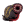

# 流血（Bleed）

施加2/4/4层流血。被球击中时，每层流血的敌人将受到1点伤害（最多8/11/14层）。

[原文与贡献者记录](https://ballxpit.wiki.gg/wiki/Bleed) · [修订 4080](https://ballxpit.wiki.gg/index.php?oldid=4080) · [返回目录](../%E7%90%83%E6%AF%94%E4%BC%A6%E6%88%98%E8%AE%B0%20Wiki.md)

## 基本信息

### 初始角色（Starting Characters）

[战士](The_Warrior.md) 
[伪救世主](The_False_Messiah.md) 

### 解锁

默认解锁

### 状态效果（Status Effects）

[流血](https://ballxpit.wiki.gg/wiki/Status_Effects?action=edit&redlink=1)

### 由状态效果触发

命中时

## 进化（Evolutions）

### 进化成

[狂暴](Berserk.md) , [吞心者](Heart_Swallower.md) , [大出血](Hemorrhage.md) , [水蛭](Leech.md) , [献祭](Sacrifice.md) , [吸血鬼领主](Vampire_Lord.md) 

**流血** 是 [战士](The_Warrior.md)  和 [伪救世主](The_False_Messiah.md)  的初始 [圆球](Balls.md)，在 *[球比伦战记](Ball_x_Pit.md)* 的每一局开始时即可使用。和大多数圆球一样，
**流血** 会撞击敌人并造成伤害；命中敌人后，还会施加 2 层 [流血](https://ballxpit.wiki.gg/wiki/Status_Effects?action=edit&redlink=1) 状态效果。

与其他球结合使用时，直接伤害会增加，且效果相互叠加。

## 关卡

| 等级 | 伤害 | 效果 |
| --- | --- | --- |
| 1 |  x(3.5 至 6.5) | 施加2层流血效果。被球击中的敌人每层会遭受1点伤害（最多8层）。 |
| 2 |  x(3.5 至 6.5) | 施加4层流血效果。被球击中时，每层流血会使敌人遭受1点伤害（最多11层）。 |
| 3 |  x(3.5 至 6.5) | 施加4层流血效果。被球击中的敌人每层会遭受1点伤害（最多14层）。 |

## 进化

| 组合 | 进化 |
| --- | --- |
|  流血（Bleed） + [魅惑（Charm）](Charm.md)  | [狂暴（Berserk）](Berserk.md)  |
|  流血（Bleed） + [幽灵（Ghost）](Ghost.md)  | [吞心者（Heart Swallower）](Heart_Swallower.md) （\*） |
|  流血（Bleed） + [肉身（Flesh）](Flesh.md)  ／  流血（Bleed） + [铁（Iron）](Iron.md)  | [大出血（Hemorrhage）](Hemorrhage.md)  |
|  流血（Bleed） + [育巢母体（Brood Mother）](Brood_Mother.md)  | [水蛭（Leech）](Leech.md)  |
|  流血（Bleed） + [黑暗（Dark）](Dark.md)  | [献祭（Sacrifice）](Sacrifice.md)  |
|  流血（Bleed） + [吸血鬼（Vampire）](Vampire.md)  | [吸血鬼领主（Vampire Lord）](Vampire_Lord.md) （\*） |

* 可以进一步进化。

## 策略

[流血](https://ballxpit.wiki.gg/wiki/Status_Effects?action=edit&redlink=1)状态效果会额外增加敌人所受的伤害。这意味着基础伤害较低的小球（如[小球](Baby_Ball.md) ）会比那些已经造成100+伤害的小球获益更大。

将 **流血**与分裂成多个球体或造成范围效果伤害的球结合使用，是扩散 [流血](https://ballxpit.wiki.gg/wiki/Status_Effects?action=edit&redlink=1)效果的好方法。

## 更新记录

## 冷知识

## 图片库

[共享导航](../navigation/nav-63012059ef49.md)

**分类**　[分类 · 基础圆球](../categories/Base_Balls.md) · [分类 · 圆球](../categories/Balls.md) · [分类 · 带有导航框的页面](../categories/Pages_with_navboxes.md)

[返回总入口](../%E7%90%83%E6%AF%94%E4%BC%A6%E6%88%98%E8%AE%B0%20Wiki.md) · [返回本分目录](%E7%9B%AE%E5%BD%95.md)
