# 建筑蓝图（Blueprints）

[原文与贡献者记录](https://ballxpit.wiki.gg/wiki/Blueprints) · [修订 2904](https://ballxpit.wiki.gg/index.php?oldid=2904) · [返回目录](../%E7%90%83%E6%AF%94%E4%BC%A6%E6%88%98%E8%AE%B0%20Wiki.md)

在《球比伦战记》中，单局击败首领有机会获得建筑蓝图。

每张蓝图都只能在指定关卡找到。关卡选择界面会显示该关卡还剩多少张蓝图。

找到蓝图后，即可在地面的基地建造对应建筑。建筑分为三类：

* **经济**与收集资源有关，包括、、以及。
* **战争**建筑在游戏过程中会提升你角色的力量。
* **住房**可解锁新的可玩角色。

## [骸骨墓园](The_BONExYARD.md) 建筑蓝图 

| 建筑名称 | 图片 | 说明 | 分类 |
| --- | --- | --- | --- |
| [警长办公室（Sheriff's Office）](Sheriff_s_Office.md) | [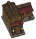](../files/Buildings_Sheriff_s_Office_Level1.png.md) | [快枪手（The Itchy Finger）](The_Itchy_Finger.md)  的房子。 | 住房 |
| [鬼屋（Haunted House）](Haunted_House.md) | [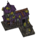](../files/Buildings_Haunted_House_Level1.png.md) | [忏悔者（The Repentant）](The_Repentant.md)  的住宅。 | 住房 |
| [领事馆（Consulate）](Consulate.md) | [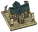](../files/Buildings_Consulate_Level1.png.md) | 所有角色均可获得  领导力加成。 | 战争 |
| [学堂（Schoolhouse）](Schoolhouse.md) | [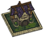](../files/Buildings_Schoolhouse_Level1.png.md) | 所有角色均可获得  智力的加成。 | 战争 |
| [鞋匠（Shoemaker）](Shoemaker.md) | [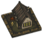](../files/Buildings_Shoemaker_Level1.png.md) | 所有角色均获得  速度的加成。 | 战争 |
| [枪匠（Gunsmith）](Gunsmith.md) | [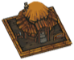](../files/Buildings_Gunsmith_Level1.png.md) | 所有角色均可获得  敏捷加值。 | 战争 |
| [兵营（Barracks）](Barracks.md) | [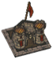](../files/Buildings_Barracks_Level1.png.md) | 所有角色均可获得  力量的加成。 | 战争 |
| [诊所（Clinic）](Clinic.md) | [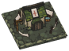](../files/Buildings_Clinic_Level1.png.md) | 所有角色均可获得  耐力的加成。 | 战争 |
| [驱魔人（Exorcist）](Exorcist.md) | [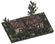](../files/Buildings_Exorcist_Level1.png.md) | 升级时会添加驱逐类升级。 | 战争 |
| [骸骨墓园奖杯（Boneyard Trophy）](Boneyard_Trophy.md) | [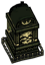](../files/Buildings_Boneyard_Trophy_Level1.png.md) | 每通关一次骸骨墓园（The BONExYARD），每位角色都会获得状态效果强度。 | 战争 |

## [白雪海岸](The_SNOWYxSHORES.md) 建筑蓝图 

| 建筑名称 | 图片 | 说明 | 分类 |
| --- | --- | --- | --- |
| [别墅（Villa）](Villa.md) | [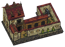](../files/Buildings_Villa_Level1.png.md) | [沉思者（The Cogitator）](The_Cogitator.md)  的住宅。 | 住房 |
| [老兵小屋（Veteran's Hut）](Veteran_s_Hut.md) | [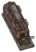](../files/Buildings_Veteran_s_Hut_Level1.png.md) | [潜伏者（The Embedded）](The_Embedded.md)  的房子。 | 住房 |
| [农场（Farm）](Farm.md) | [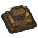](../files/Buildings_Farm_Level1.png.md) | 在此分配一个角色来收割相邻小麦田中的 。 | 经济 |
| [伐木场（Lumberyard）](Lumberyard.md) | [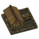](../files/Buildings_Lumberyard_Level1.png.md) | 在此分配一个角色来从相邻的森林格中收获 。 | 经济 |
| [石矿场（Stone Mine）](Stone_Mine.md) | [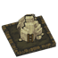](../files/Buildings_Stone_Mine_Level1.png.md) | 在此分配一个角色来从相邻的巨石中收获 。 | 经济 |
| [守望塔（Watch Tower）](Watch_Tower.md) | [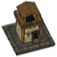](../files/Buildings_Watch_Tower_Level1.png.md) | 增加收获时钟。 | 经济 |
| [车轮匠（Wheelwright）](Wheelwright.md) | [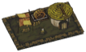](../files/Buildings_Wheelwright_Level1.png.md) | 提升  速度的属性系数等级。 | 战争 |
| [炼金术士（Alchemist）](Alchemist.md) | [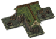](../files/Buildings_Alchemist_Level1.png.md) | 提升  耐力的属性系数等级。 | 战争 |
| [大学（University）](University.md) | [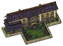](../files/Buildings_University_Level1.png.md) | 提升  智力的属性系数等级。 | 战争 |
| [冒险者公会（Adventurer's Guild）](Adventurer_s_Guild.md) | [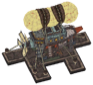](../files/Buildings_Adventurer_s_Guild_Level1.png.md) | 解锁击败首领后无限次继续探索关卡的能力。 | 战争 |
| [白雪海岸奖杯（Snowy Trophy）](Snowy_Trophy.md) | [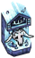](../files/Buildings_Snowy_Trophy_Level1.png.md) | 每通关一次白雪海岸（The SNOWYxSHORES），每位角色都会获得范围效果强度。 | 战争 |

## [边境沙漠](The_LIMINALxDESERT.md) 建筑蓝图 

| 建筑名称 | 图片 | 说明 | 分类 |
| --- | --- | --- | --- |
| [陵墓（Mausoleum）](Mausoleum.md) | [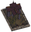](../files/Buildings_Mausoleum_Level1.png.md) | [暗影（The Shade）](The_Shade.md)  的房子。 | 住房 |
| [岩石山丘（Rocky Hill）](Rocky_Hill.md) | [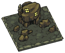](../files/Buildings_Rocky_Hill_Level1.png.md) | [临时西西弗斯（The Makeshift Sisyphus）](The_Makeshift_Sisyphus.md)  的住所。 | 住房 |
| [军事学院（Military Academy）](Military_Academy.md) | [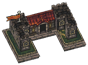](../files/Buildings_Military_Academy_Level1.png.md) | 提升  力量的属性系数等级。 | 战争 |
| [射箭场（Archery Range）](Archery_Range.md) | [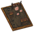](../files/Buildings_Archery_Range_Level1.png.md) | 提升  敏捷的属性系数等级。 | 战争 |
| [外交厅（Diplomacy Hall）](Diplomacy_Hall.md) | [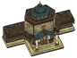](../files/Buildings_Diplomacy_Hall_Level1.png.md) | 提升  领导力的属性系数等级。 | 战争 |
| [金矿（Gold Mine）](Gold_Mine.md) | [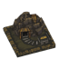](../files/Buildings_Gold_Mine_Level1.png.md) | 在此分配一名工人来开采 。当这座建筑被触发时，他们将开采 。 | 经济 |
| [公会大厅（Guild Hall）](Guild_Hall.md) | [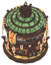](../files/Buildings_Guild_Hall_Level1.png.md) | 使用资源重新随机一名角色的收获升级。 | 经济 |
| [温泉浴场（Spa）](Spa.md) | [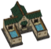](../files/Buildings_Spa_Level1.png.md) | 立即使用金币进行多次收获。 | 经济 |
| [市场（Market）](Market.md) | [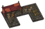](../files/Buildings_Market_Level1.png.md) | 解锁用金币兑换其他资源的功能。 | 经济 |
| [磁铁工厂（Magnet Factory）](Magnet_Factory.md) | [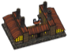](../files/Buildings_Magnet_Factory_Level1.png.md) | 增加拾取范围。 | 战争 |
| [银行（Bank）](Bank.md) | [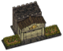](../files/Buildings_Bank_Level1.png.md) | 增加战斗中获得的金币数量。 | 战争 |
| [沙漠奖杯（Desert Trophy）](Desert_Trophy.md) | [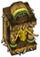](../files/Buildings_Desert_Trophy_Level1.png.md) | 每通关一次边境沙漠（The LIMINALxDESERT），每位角色都会获得更高的暴击率。 | 战争 |

## [真菌森林](The_FUNGALxFOREST.md) 建筑蓝图 

| 建筑名称 | 图片 | 说明 | 分类 |
| --- | --- | --- | --- |
| [匹配机（Matchmaker）](Matchmaker.md) | [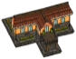](../files/Buildings_Matchmaker_Level1.png.md) | 允许你选择两名角色带入单局游戏，并融合两者的能力。 | 战争 |
| [铁堡（Iron Fortress）](Iron_Fortress.md) | [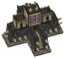](../files/Buildings_Iron_Fortress_Level1.png.md) | [持盾者（The Shieldbearer）](The_Shieldbearer.md)  的住宅。 | 住房 |
| [豪宅（Mansion）](Mansion.md) | [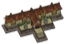](../files/Buildings_Mansion_Level1.png.md) | [挥霍者（The Spendthrift）](The_Spendthrift.md)  的房子。 | 住房 |
| [实验室（Laboratory）](Laboratory.md) | [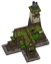](../files/Buildings_Laboratory_Level1.png.md) | [物理学家（The Physicist）](The_Physicist.md)  的房子。 | 住房 |
| [珠宝匠（Jeweler）](Jeweler.md) | [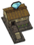](../files/Buildings_Jeweler_Level1.png.md) | 提升初始球等级。 | 战争 |
| [修道院（Abbey）](Abbey.md) | [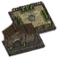](../files/Buildings_Abbey_Level1.png.md) | 增加获得的经验值。 | 战争 |
| [赌场（Casino）](Casino.md) | [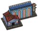](../files/Buildings_Casino_Level1.png.md) | 降低升级重投成本。 | 战争 |
| [死灵法师（Necromancer）](Necromancer.md) | [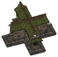](../files/Buildings_Necromancer_Level1.png.md) | 每场战斗中，当你死亡时，将以较低的生命值复活，并杀死所有附近的敌人。 | 战争 |
| [蘑菇奖杯（Shroom Trophy）](Shroom_Trophy.md) |  | 每通关一次真菌森林（The FUNGALxFOREST），所有角色都会获得生命值。 | 战争 |

## [血腥草原](The_GORYxGRASSLANDS.md) 建筑蓝图 

| 建筑名称 | 图片 | 说明 | 分类 |
| --- | --- | --- | --- |
| [密集小麦（Dense Wheat）](Dense_Wheat.md) | [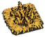](../files/Buildings_Dense_Wheat_Level1.png.md) | 密植的小麦田，资源再生更快，储量更高。 | 经济 |
| [大树（Grand Tree）](Grand_Tree.md) | [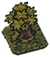](../files/Buildings_Grand_Tree_Level1.png.md) | 一棵巨大的树木，你可以从中收集生长率高、产量大的  木材。 | 经济 |
| [剧场（Theater）](Theater.md) | [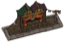](../files/Buildings_Theater_Level1.png.md) | [杂耍者（The Juggler）](The_Juggler.md)  的房子。 | 住房 |
| [修道院（Monastery）](Monastery.md) | [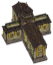](../files/Buildings_Monastery_Level1.png.md) | [自笞者（The Flagellant）](The_Flagellant.md)  的房子。 | 住房 |
| [采集者小屋（Gatherer's Hut）](Gatherer_s_Hut.md) | [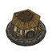](../files/Buildings_Gatherer_s_Hut_Level1.png.md) | 在此分配一个角色，使其按预设方向自动移动，每隔几分钟独立进行收获。 | 经济 |
| [赌徒巢穴（Gambler's Den）](Gambler_s_Den.md) | [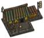](../files/Buildings_Gambler_s_Den_Level1.png.md) | 战斗中可免费重新进行升级尝试。 | 战争 |
| [宝石匠（Gemsmith）](Gemsmith.md) | [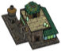](../files/Buildings_Gemsmith_Level1.png.md) | 每场战斗开始时，可以选择额外一个球。 | 战争 |
| [古董店（Antique Shop）](Antique_Shop.md) | [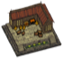](../files/Buildings_Antique_Shop_Level1.png.md) | 每场战斗都从选择一个被动技能开始。 | 战争 |
| [血腥草原奖杯（Gory Trophy）](Gory_Trophy.md) | [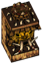](../files/Buildings_Gory_Trophy_Level1.png.md) | 每通关一次血腥草原（The GORYxGRASSLANDS），每位角色都会获得球速。 | 战争 |

## [阴燃深渊](The_SMOLDERINGxDEPTHS.md) 建筑蓝图 

| 建筑名称 | 图片 | 说明 | 分类 |
| --- | --- | --- | --- |
| [花岗岩板（Granite Slab）](Granite_Slab.md) |  | 一块巨大的花岗岩，你可以从其中收集再生率高、再生能力强的  石头。 | 经济 |
| [队长宿舍（Captain's Quarters）](Captain_s_Quarters.md) |  | [战术家（The Tactician）](The_Tactician.md)  的房子。 | 住房 |
| [石之领域（Stone Domain）](Stone_Domain.md) |  | [掘地者（The Tunneller）](The_Tunneller.md)  的住宅。 | 住房 |
| [隐秘神殿（Hidden Temple）](Hidden_Temple.md) |  | [蹑足者（The Tiptoer）](The_Tiptoer.md)  的房子。 | 住房 |
| [蜡烛作坊（Candle Maker）](Candle_Maker.md) |  | 融合反应堆所需的升级次数下限更高。 | 战争 |
| [许愿池（Wishing Well）](Wishing_Well.md) |  | 升级时会增加获得额外升级点的几率。 | 战争 |
| [作战室（War Room）](War_Room.md) |  | 派遣角色自行完成关卡。 | 战争 |
| [冥想帐篷（Meditation Tent）](Meditation_Tent.md) |  | 升级时的可选项数量增加至 4 个。 | 战争 |
| [阴燃深渊奖杯（Smoldering Trophy）](Smoldering_Trophy.md) |  | 每有一名角色通关阴燃深渊（The SMOLDERINGxDEPTHS），即可获得小球伤害。 | 战争 |

## [天堂之门](The_HEAVENLYxGATES.md) 建筑蓝图 

| 建筑名称 | 图片 | 说明 | 分类 |
| --- | --- | --- | --- |
| [不稳定塔（Unstable Tower）](Unstable_Tower.md) |  | [白发囤积者（The Hoary Hoarder）](The_Hoary_Hoarder.md)  的房子。 | 住房 |
| [露营地（Campground）](Campground.md) |  | [激进者（The Radical）](The_Radical.md)  的住宅。 | 住房 |
| [驯鹰小屋（Falconry Hut）](Falconry_Hut.md) |  | [驯鹰人（The Falconer）](The_Falconer.md)  的住宅。 | 住房 |
| [包装机](Bag_Maker_Building.md) |  | 增加1个圆球槽位。 | 战争 |
| [木匠](Carpenter_Building.md) |  | 增加1个被动技能位。 | 战争 |
| [进化舱](Evolution_Chamber_Building.md) |  | 新球都从 2 级开始。 | 战争 |
| [遗物收集者](Relic_Collector_Building.md) |  | 新被动道具均从 2 级开始生效。 | 战争 |
| [工人工会（Worker's Guild）](Worker_s_Guild_Building.md) |  | 游戏关闭期间，工人们最多可收集相当于24小时用量的资源，但速度较慢。 | 经济 |
| [天堂之门奖杯（Heavenly Trophy）](Heavenly_Trophy.md) |  | 每通关一次天堂之门（The HEAVENLYxGATES），每位角色都会获得被动效果强度。 | 战争 |

## [浩瀚虚空](The_VASTxVOID.md) 建筑蓝图 

| 建筑名称 | 图片 | 说明 | 分类 |
| --- | --- | --- | --- |
| [派对之家（Party House）](Party_House.md) |  | [畅饮者（The Carouser）](The_Carouser.md)  的住宅。 | 住房 |
| [圆球屋（Ball House）](Ball_House.md) |  | [持球者（The Ballbearer）](The_Ballbearer.md)  的房子。 | 住房 |
| [医院（Hospital）](Hospital.md) |  | 获得  耐力加成。可无限升级。 | 战争 |
| [战士公会（Warrior's Guild）](Warrior_s_Guild.md) |  | 获得  力量的加成。可无限升级。 | 战争 |
| [议事殿（Capitolium）](Capitolium.md) |  | 获得  领导力加成。可无限升级。 | 战争 |
| [马车工厂（Wagon Factory）](Wagon_Factory.md) |  | 获得  速度加成。可无限升级。 | 战争 |
| [射手公会（Marksman's Guild）](Marksman_s_Guild.md) |  | 敏捷加成 。可无限升级。 | 战争 |
| [大博物馆（Grand Museum）](Grand_Museum.md) |  | 获得  智力加成。可无限升级。 | 战争 |
| [虚空奖杯（Void Trophy）](Void_Trophy.md) |  | 每通关一次浩瀚虚空（The VASTxVOID），每位角色都会获得基础伤害。 | 战争 |

[返回总入口](../%E7%90%83%E6%AF%94%E4%BC%A6%E6%88%98%E8%AE%B0%20Wiki.md) · [返回本分目录](%E7%9B%AE%E5%BD%95.md)
