# 建筑蓝图（Blueprints）

[原文与贡献者记录](https://ballxpit.wiki.gg/wiki/Blueprints) · [修订 2904](https://ballxpit.wiki.gg/index.php?oldid=2904) · [返回目录](../%E7%90%83%E6%AF%94%E4%BC%A6%E6%88%98%E8%AE%B0%20Wiki.md)

在BALL X PIT中，可以在被击败的老板敌人下降的比赛中获得蓝图。

每个蓝图只能在特定水平上找到;当选择一个水平时，显示剩余蓝图的数量。

找到这些蓝图可以解锁新的建筑，这些建筑可以建在地面上的基座上，可分为三类:

* **经济** 是为了收集资源, 、 、 和 .
* **战争** 建筑物在运行时会提高您的性格强度。
* **家用** 解锁新可玩字符。

#### [骸骨墓园](The_BONExYARD.md) 建筑蓝图 

| 建筑名称 | 图片 | 描述 | 分类 |
| --- | --- | --- | --- |
| [警长办公室（Sheriff's Office）](Sheriff_s_Office.md) |  | 一个房子 [快枪手（The Itchy Finger）](The_Itchy_Finger.md) . | 住房 |
| [鬼鬼之家（Haunted House）](Haunted_House.md) | [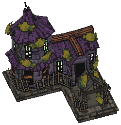](../files/Buildings_Haunted_House_Level1.png.md) | 一个房子 [忏悔者（The Repentant）](The_Repentant.md) . | 住房 |
| [领事馆（Consulate）](Consulate.md) |  | 所有角色都获得奖金  领导。 | 战争 |
| [校园（Schoolhouse）](Schoolhouse.md) |  | 所有角色都获得奖金  情报。 | 战争 |
| [鞋匠（Shoemaker）](Shoemaker.md) |  | 所有角色都获得奖金  速度。 | 战争 |
| [枪手（Gunsmith）](Gunsmith.md) | [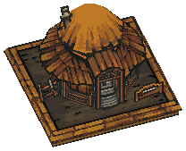](../files/Buildings_Gunsmith_Level1.png.md) | 所有角色都获得奖金  敏捷。 | 战争 |
| [兵营（Barracks）](Barracks.md) |  | 所有角色都获得奖金  力量。 | 战争 |
| [诊所（Clinic）](Clinic.md) |  | 所有角色都获得奖金  坚持。 | 战争 |
| [驱魔者（Exorcist）](Exorcist.md) |  | 在升级时，添加升级功能。 | 战争 |
| [骸骨墓园奖杯（Boneyard Trophy）](Boneyard_Trophy.md) |  | 获得状态效果功率，每一个你完成了BONExYARD的角色。 | 战争 |

#### [白雪海岸](The_SNOWYxSHORES.md) 建筑蓝图 

| 建筑名称 | 图片 | 描述 | 分类 |
| --- | --- | --- | --- |
| [别墅（Villa）](Villa.md) |  | 一个房子 [沉思者（The Cogitator）](The_Cogitator.md) . | 住房 |
| [退伍军人小屋（Veteran's Hut）](Veteran_s_Hut.md) |  | 一个房子 [潜伏者（The Embedded）](The_Embedded.md) . | 住房 |
| [农场（Farm）](Farm.md) |  | 给一个角色来收获。  来自邻近的小麦田。 | 经济 |
| [木工场（Lumberyard）](Lumberyard.md) |  | 给一个角色来收获。  取自邻近的森林瓷砖。 | 经济 |
| [石矿（Stone Mine）](Stone_Mine.md) |  | 给一个角色来收获。  从邻近的岩石中。 | 经济 |
| [卫报（Watch Tower）](Watch_Tower.md) | [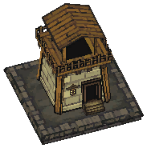](../files/Buildings_Watch_Tower_Level1.png.md) | 增加收获时间。 | 经济 |
| [车手（Wheelwright）](Wheelwright.md) |  | 增加  速度扩展等级。 | 战争 |
| [化学家（Alchemist）](Alchemist.md) |  | 增加  耐力扩展等级。 | 战争 |
| [大学（University）](University.md) |  | 增加  智能度量级。 | 战争 |
| [冒险家协会（Adventurer's Guild）](Adventurer_s_Guild.md) |  | 在击败老板后，你会继续探索一个层次。 | 战争 |
| [雪杯（Snowy Trophy）](Snowy_Trophy.md) |  | 获取范围效果功率，为每一个你完成了SNOWYxSHORES的角色。 | 战争 |

#### [边境沙漠](The_LIMINALxDESERT.md) 建筑蓝图 

| 建筑名称 | 图片 | 描述 | 分类 |
| --- | --- | --- | --- |
| [陵墓（Mausoleum）](Mausoleum.md) | [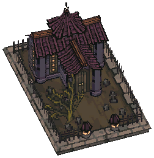](../files/Buildings_Mausoleum_Level1.png.md) | 一个房子 [暗影（The Shade）](The_Shade.md) . | 住房 |
| [洛基山（Rocky Hill）](Rocky_Hill.md) |  | 一个房子 [临时西西弗斯（The Makeshift Sisyphus）](The_Makeshift_Sisyphus.md) [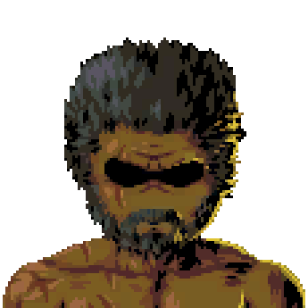](The_Makeshift_Sisyphus.md). | 住房 |
| [军事学院（Military Academy）](Military_Academy.md) |  | 增加  强度扩展等级。 | 战争 |
| [射箭射击范围（Archery Range）](Archery_Range.md) |  | 增加  性不适程度等级。 | 战争 |
| [外交厅（Diplomacy Hall）](Diplomacy_Hall.md) |  | 增加  在领导层上升。 | 战争 |
| [金矿（Gold Mine）](Gold_Mine.md) |  | 派一个工人到我的 当这座建筑被击落时，他们会被挖掘。 . | 经济 |
| [协会厅（Guild Hall）](Guild_Hall.md) |  | 用资源重新调整角色收获升级 | 经济 |
| [热水池（Spa）](Spa.md) |  | 直接花更多的金钱来收获。 | 经济 |
| [市场（Market）](Market.md) |  | 释放了交易黄金的能力。 | 经济 |
| [磁铁工厂（Magnet Factory）](Magnet_Factory.md) |  | 增加接收距离。 | 战争 |
| [银行（Bank）](Bank.md) |  | 增加战斗中的黄金 | 战争 |
| [沙漠奖杯（Desert Trophy）](Desert_Trophy.md) |  | 获得每一个你完成了LIMINALXDESERT的角色的成功机会。 | 战争 |

#### [真菌森林](The_FUNGALxFOREST.md) 建筑蓝图 

| 建筑名称 | 图片 | 描述 | 分类 |
| --- | --- | --- | --- |
| [匹配机（Matchmaker）](Matchmaker.md) |  | 让你把两个角色带到一起, | 战争 |
| [铁堡垒（Iron Fortress）](Iron_Fortress.md) | [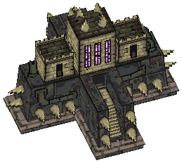](../files/Buildings_Iron_Fortress_Level1.png.md) | 一个房子 [持盾者（The Shieldbearer）](The_Shieldbearer.md) . | 住房 |
| [豪宅（Mansion）](Mansion.md) |  | 一个房子 [挥霍者（The Spendthrift）](The_Spendthrift.md) . | 住房 |
| [实验室（Laboratory）](Laboratory.md) |  | 一个房子 [物理学家（The Physicist）](The_Physicist.md) . | 住房 |
| [珠宝家（Jeweler）](Jeweler.md) |  | 提高起始球水平 | 战争 |
| [修道院（Abbey）](Abbey.md) |  | 增加获得的经验值 | 战争 |
| [赌场（Casino）](Casino.md) | [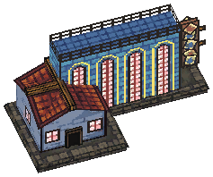](../files/Buildings_Casino_Level1.png.md) | 降低升级成本。 | 战争 |
| [死灵法师（Necromancer）](Necromancer.md) |  | 每次战斗一次，你死后，恢复健康，杀死所有附近的敌人 | 战争 |
| [蘑菇奖杯（Shroom Trophy）](Shroom_Trophy.md) |  | 你完成了FUNGALxFOREST的每一个角色的生命值。 | 战争 |

#### [血腥草原](The_GORYxGRASSLANDS.md) 建筑蓝图 

| 建筑名称 | 图片 | 描述 | 分类 |
| --- | --- | --- | --- |
| [密集的小麦（Dense Wheat）](Dense_Wheat.md) |  | 一个密集的场地  高增长率和产能的小麦。 | 经济 |
| [大树（Grand Tree）](Grand_Tree.md) |  | 一棵巨大的树，你可以从中收集  有高增长率和容量的木材。 | 经济 |
| [剧院（Theater）](Theater.md) |  | 一个房子 [杂耍者（The Juggler）](The_Juggler.md) . | 住房 |
| [修道院（Monastery）](Monastery.md) |  | 一个房子 [自笞者（The Flagellant）](The_Flagellant.md) . | 住房 |
| [收藏家的小屋（Gatherer's Hut）](Gatherer_s_Hut.md) |  | 在此，将一个字符分配到一个自动向前设置的方向发送, | 经济 |
| [赌徒巢穴（Gambler's Den）](Gambler_s_Den.md) |  | 在战斗中获得自由升级。 | 战争 |
| [石家庄（Gemsmith）](Gemsmith.md) | [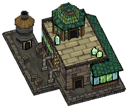](../files/Buildings_Gemsmith_Level1.png.md) | 开始每场战斗，选择一个额外的球。 | 战争 |
| [古董店（Antique Shop）](Antique_Shop.md) | [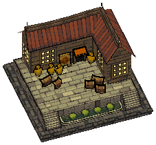](../files/Buildings_Antique_Shop_Level1.png.md) | 开始每一次战斗，选择一个被动的战斗。 | 战争 |
| [戈里奖杯（Gory Trophy）](Gory_Trophy.md) |  | 获得每一个你完成了GORYxGRASSLANDS的角色的球速度。 | 战争 |

#### [阴燃深渊](The_SMOLDERINGxDEPTHS.md) 建筑蓝图 

| 建筑名称 | 图片 | 描述 | 分类 |
| --- | --- | --- | --- |
| [花岗岩板（Granite Slab）](Granite_Slab.md) |  | 一块大石材，你可以从中收集  具有高增长率和容量的石头。 | 经济 |
| [队长的四处（Captain's Quarters）](Captain_s_Quarters.md) |  | 一个房子 [战术家（The Tactician）](The_Tactician.md) . | 住房 |
| [石域（Stone Domain）](Stone_Domain.md) |  | 一个房子 [掘地者（The Tunneller）](The_Tunneller.md) . | 住房 |
| [隐秘神殿（Hidden Temple）](Hidden_Temple.md) |  | 一个房子 [蹑足者（The Tiptoer）](The_Tiptoer.md) . | 住房 |
| [蜡烛作坊（Candle Maker）](Candle_Maker.md) | [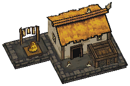](../files/Buildings_Candle_Maker_Level1.png.md) | 聚变反应堆包含增加的最低升级次数。 | 战争 |
| [愿意好好（Wishing Well）](Wishing_Well.md) |  | 在升级时增加一个额外的升级点的机会。 | 战争 |
| [战争室（War Room）](War_Room.md) |  | 发送字符到完成级别的自己 | 战争 |
| [冥想帐篷（Meditation Tent）](Meditation_Tent.md) |  | 在升级时增加升级选项的数量到4。 | 战争 |
| [生动的奖杯（Smoldering Trophy）](Smoldering_Trophy.md) |  | 为了每一个你完成的角色， 获得宝贝球损伤。 | 战争 |

#### [天堂之门](The_HEAVENLYxGATES.md) 建筑蓝图 

| 建筑名称 | 图片 | 描述 | 分类 |
| --- | --- | --- | --- |
| [不稳定的塔楼（Unstable Tower）](Unstable_Tower.md) |  | 一个房子 [白发囤积者（The Hoary Hoarder）](The_Hoary_Hoarder.md) . | 住房 |
| [露营场（Campground）](Campground.md) |  | 一个房子 [激进者（The Radical）](The_Radical.md) . | 住房 |
| [驯鹰小屋（Falconry Hut）](Falconry_Hut.md) | [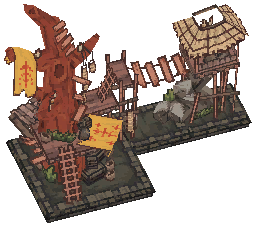](../files/Buildings_Falconry_Hut_Level1.png.md) | 一个房子 [驯鹰人（The Falconer）](The_Falconer.md) . | 住房 |
| [包装机器](Bag_Maker_Building.md) |  | 加入1个球口 | 战争 |
| [木匠](Carpenter_Building.md) |  | 加1个被动时位 | 战争 |
| [进化室](Evolution_Chamber_Building.md) |  | 新球都从2级开始。 | 战争 |
| [遗物收藏家](Relic_Collector_Building.md) |  | 新的负担全部从2级开始 | 战争 |
| [工人协会（Worker's Guild）](Worker_s_Guild_Building.md) |  | 让员工在比赛结束时收集24小时的资源, | 经济 |
| [天上的奖杯（Heavenly Trophy）](Heavenly_Trophy.md) |  | 获得每一个你完成的天空之门角色的被动力量。 | 战争 |

#### [浩瀚虚空](The_VASTxVOID.md) 建筑蓝图 

| 建筑名称 | 图片 | 描述 | 分类 |
| --- | --- | --- | --- |
| [聚会之家（Party House）](Party_House.md) |  | 一个房子 [畅饮者（The Carouser）](The_Carouser.md) . | 住房 |
| [球场（Ball House）](Ball_House.md) |  | 一个房子 [持球者（The Ballbearer）](The_Ballbearer.md) . | 住房 |
| [医院（Hospital）](Hospital.md) |  | 收益奖金  耐力，可以不断升级。 | 战争 |
| [战士协会（Warrior's Guild）](Warrior_s_Guild.md) |  | 收益奖金  强度，可以不断升级。 | 战争 |
| [资本中心（Capitolium）](Capitolium.md) | [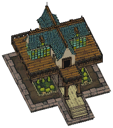](../files/Buildings_Capitolium_Level1.png.md) | 收益奖金  领导力，可以无限地升级。 | 战争 |
| [车车工厂（Wagon Factory）](Wagon_Factory.md) |  | 收益奖金  速度，可以不断升级。 | 战争 |
| [射手协会（Marksman's Guild）](Marksman_s_Guild.md) |  | 收益奖金  能够无限升级 | 战争 |
| [大博物馆（Grand Museum）](Grand_Museum.md) |  | 收益奖金  智能，可以无限地升级。 | 战争 |
| [虚空奖杯（Void Trophy）](Void_Trophy.md) |  | 为了每一个你完成了VASTxVOID的角色, | 战争 |

[返回总入口](../%E7%90%83%E6%AF%94%E4%BC%A6%E6%88%98%E8%AE%B0%20Wiki.md) · [返回本分目录](%E7%9B%AE%E5%BD%95.md)
