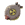
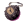
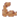

# 炸弹（Bomb）

击中敌人时爆炸，对附近的敌人造成150-300/200-400/200-400的伤害。再次射击前需等待3秒的冷却时间。

[原文与贡献者记录](https://ballxpit.wiki.gg/wiki/Bomb) · [修订 4082](https://ballxpit.wiki.gg/index.php?oldid=4082) · [返回目录](../%E7%90%83%E6%AF%94%E4%BC%A6%E6%88%98%E8%AE%B0%20Wiki.md)

## 基本信息

### 由……创建

[灼烧](Burn.md)  + [铁](Iron.md) 

### 初始角色（Starting Character）

-

### 命中效果（On-Hit Effects）

自爆

### 状态效果（Status Effects）

-

## 进化（Evolutions）

### 进化成

[核弹](Nuclear_Bomb.md) , [时间炸弹](Time_Bomb.md) 

## 进化配方

|  |  |  |  |  |  |  |
| --- | --- | --- | --- | --- | --- | --- |
|  |  |  |  |  |  |  |
| [灼烧（Burn）](Burn.md)  |  |  |  | [铁（Iron）](Iron.md)  |  |  |
|  |  |  |  |  |  |  |
|  |  | 炸弹（Bomb） |  |  |  |  |

## 关卡

| 等级 | 伤害 | 效果 |
| --- | --- | --- |
| 1 |  x(3.6 至 6.8) | 击中敌人时会爆炸，对附近的敌人造成150-300点伤害。再次射击前需等待3秒的冷却时间。 |
| 2 |  x(3.6 至 6.8) | 击中敌人时会爆炸，对附近的敌人造成200-400点伤害。再次射击前需等待3秒的冷却时间。 |
| 3 |  x(3.6 至 6.8) | 击中敌人时会爆炸，对附近的敌人造成200-400点伤害。再次射击前需等待3秒的冷却时间。 |

## 进化

| 组合 | 进化 |
| --- | --- |
|  炸弹（Bomb） + [中毒（Poison）](Poison.md)  | [核弹（Nuclear Bomb）](Nuclear_Bomb.md)  |
|  炸弹（Bomb） + [时间（Time）](Time.md)  | [时间炸弹（Time Bomb）](Time_Bomb.md)  |

## 策略

## 更新记录

## 冷知识

## 图片库

[共享导航](../navigation/nav-63012059ef49.md)

**分类**　[分类 · 进化圆球](../categories/Evolved_Balls.md) · [分类 · 圆球](../categories/Balls.md) · [分类 · 带有导航框的页面](../categories/Pages_with_navboxes.md)

[返回总入口](../%E7%90%83%E6%AF%94%E4%BC%A6%E6%88%98%E8%AE%B0%20Wiki.md) · [返回本分目录](%E7%9B%AE%E5%BD%95.md)
