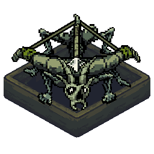

# 白骨弩炮（Bone Ballista）

[原文与贡献者记录](https://ballxpit.wiki.gg/wiki/Bone_Ballista) · [修订 3468](https://ballxpit.wiki.gg/index.php?oldid=3468) · [返回目录](../%E7%90%83%E6%AF%94%E4%BC%A6%E6%88%98%E8%AE%B0%20Wiki.md)

## 信息（Information）

### 类型

[小首领](../categories/Mini-bosses.md)

### 生命值倍率（Health scale）

20x

### 等级（Level）

[骸骨墓园](The_BONExYARD.md) 

**白骨弩炮**是出现在 [骸骨墓园](The_BONExYARD.md)  中的第二个[小首领](../categories/Mini-bosses.md)，生命值倍率为 20x。

## 说明

> “
> *向玩家发射箭雨*
> **—官方敌人说明**

## 行为

[点击此处添加更多信息！](https://ballxpit.wiki.gg/wiki/Bone_Ballista%3Faction%3Dedit)

## 策略

[点击此处添加策略！](https://ballxpit.wiki.gg/wiki/Bone_Ballista?action=edit&section=new)

## 冷知识

* 这是来自 [骸骨墓园](The_BONExYARD.md)  中唯一有 [图鉴](Encyclopedia.md) 描述的敌人。

待完善

*此条目为 [待完善](../categories/Stubs.md). 你可以通过帮助 BALL x PIT 维基贡献一份力量。 [补充内容](https://ballxpit.wiki.gg/wiki/Bone_Ballista?action=edit).*

[共享导航](../navigation/nav-115867ac1be8.md)

**分类**　[分类 · 敌人](../categories/Enemies.md) · [分类 · 小首领](../categories/Mini-bosses.md) · [分类 · 待完善](../categories/Stubs.md) · [分类 · 带有导航框的页面](../categories/Pages_with_navboxes.md)

[返回总入口](../%E7%90%83%E6%AF%94%E4%BC%A6%E6%88%98%E8%AE%B0%20Wiki.md) · [返回本分目录](%E7%9B%AE%E5%BD%95.md)
