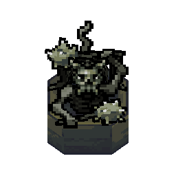

# 骨贝赫莫特（Bone Behemoth）

[原文与贡献者记录](https://ballxpit.wiki.gg/wiki/Bone_Behemoth) · [修订 3449](https://ballxpit.wiki.gg/index.php?oldid=3449) · [返回目录](../%E7%90%83%E6%AF%94%E4%BC%A6%E6%88%98%E8%AE%B0%20Wiki.md)

#### 信息（Information）

##### 类型

[常见的敌人](../categories/Normal_enemies.md)

##### 卫生规模

2x

##### 等级（Level）

[骸骨墓园](The_BONExYARD.md) 

其他 **骨贝赫莫特** 是一个 [通常的敌人](../categories/Normal_enemies.md) 在 [骸骨墓园](The_BONExYARD.md)  它的健康规模是2x.

[共享导航](../navigation/nav-115867ac1be8.md)

**分类**　[分类 · 敌人](../categories/Enemies.md) · [分类 · 普通敌人](../categories/Normal_enemies.md) · [分类 · 页面有导航框](../categories/Pages_with_navboxes.md)

[返回总入口](../%E7%90%83%E6%AF%94%E4%BC%A6%E6%88%98%E8%AE%B0%20Wiki.md) · [返回本分目录](%E7%9B%AE%E5%BD%95.md)
