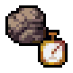
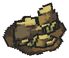
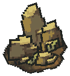

# 石头（Boulder）

一块巨大的石头要收获  石头。

[原文与贡献者记录](https://ballxpit.wiki.gg/wiki/Boulder) · [修订 3333](https://ballxpit.wiki.gg/index.php?oldid=3333) · [返回目录](../%E7%90%83%E6%AF%94%E4%BC%A6%E6%88%98%E8%AE%B0%20Wiki.md)

#### 信息（Information）

##### 分类（Category）

经济

##### 子类（Subcategory）

资源

##### 蓝图位置（Blueprint location）

- (默认解锁)

##### 基础资源消耗（Base resource cost）

 80  2

##### 建造点消耗（Build point cost）

0 (立即)

其他 **石头** 是一个资源 [建筑物](Buildings.md) 在 *[球比伦战记](Ball_x_Pit.md)* 是最初的变体  游戏开始时可用的石头资源砖块( 虽然与相应的基数不同)  小麦和小麦  木材资源砖块， 它已经以 1x1瓷砖形式出现。 此瓷砖生长  1在设定的间隔内，直到击中设定的最大容量为止，两者都可以通过建设升级来改进，但总是从  1在建时。除收割模式下的反弹或来自 [收藏家的小屋](Gatherer_s_Hut.md),这种瓷砖也可以被动地从 [石矿](Stone_Mine.md) 或是 [剧院](Theater.md) 一次 [杂耍者](The_Juggler.md)  与大多数建筑物不同，资源和收集子类别中的这类和其他建筑物可以建造多次，只要玩家有必要的资源和空间。

默认情况下， 此瓷砖砖块会让字符在从中抓取时弹出字符， 但是字符可以选择  [石头破碎者](https://ballxpit.wiki.gg/wiki/Stonepiercer?action=edit&redlink=1) [升级](Harvest_Upgrades_Character_Bonus.md) 来从这个瓷砖中获取资源，然后通过它。  [拆除主义者](https://ballxpit.wiki.gg/wiki/Demolitionist?action=edit&redlink=1) 或是  [石头师](https://ballxpit.wiki.gg/wiki/Stone_Master?action=edit&redlink=1) 提高升级，以便每次从瓷砖中收获时分别增加收获的石块数量或增加剩余的收获时钟。 还可以在附近提高再增长率。 [洛基山](Rocky_Hill.md) 一次 [临时西西弗斯](The_Makeshift_Sisyphus.md)  已经解锁了能力。

一旦打开 [花岗岩板](Granite_Slab.md) , 球体可以功能替换。

被动效果与升级

| 等级 | 图片 | 描述 | 资源消耗 | 建造点消耗 | 拆除 | 创建资源 | 复兴率 | 产能 |
| --- | --- | --- | --- | --- | --- | --- | --- | --- |
| 1 |  | 一块巨大的石头要收获  石头。 |  80  2 | 0 (立即) |  80  2 |  石头 | 10分钟 /  1 |  1 |
| 2 |  | 一块巨大的石头要收获  石头。 |  160  4 | 0 (立即) |  240  6 |  石头 | 8分钟  1 |  3 |
| 3 |  | 一块巨大的石头要收获  石头。 |  240  6 | 0 (立即) |  480  12 |  石头 | 6分钟/  1 |  5 |

[共享导航](../navigation/nav-d4956b01aa56.md)

**分类**　[分类 · 建筑](../categories/Buildings.md) · [分类 · 经济](../categories/Economy.md) · [分类 · 资源](../categories/Resources.md) · [分类 · 页面有导航框](../categories/Pages_with_navboxes.md)

[返回总入口](../%E7%90%83%E6%AF%94%E4%BC%A6%E6%88%98%E8%AE%B0%20Wiki.md) · [返回本分目录](%E7%9B%AE%E5%BD%95.md)
