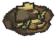
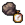

# 巨石（Boulder）

一块需要收获的大型  石块。

[原文与贡献者记录](https://ballxpit.wiki.gg/wiki/Boulder) · [修订 3333](https://ballxpit.wiki.gg/index.php?oldid=3333) · [返回目录](../%E7%90%83%E6%AF%94%E4%BC%A6%E6%88%98%E8%AE%B0%20Wiki.md)

## 信息（Information）

### 分类（Category）

经济

### 子类（Subcategory）

资源

### 蓝图位置（Blueprint location）

- (默认解锁)

### 基础资源消耗（Base resource cost）

 80  2

### 建造点消耗（Build point cost）

0（即时）

**巨石** 是 *[球比伦战记](Ball_x_Pit.md)* 中的一种资源[建造](Buildings.md)，也是游戏开始时即可使用的石料格  的初始变体：与  小麦和  木材等基础资源格不同，它一开始就以1x1的格形式出现。该格会生长，每隔固定时间产出  1，直到达到设定的最大容量为止。两者都可以通过建造升级来提升，但建造时始终从  1 开始。除了收获模式期间的弹跳以及来自 [采集者小屋](Gatherer_s_Hut.md) 的弹跳之外，该格还可以自行被动完成收获，也可以交给 [石矿场](Stone_Mine.md) 收获，或由 [剧场](Theater.md) 的 [杂耍者](The_Juggler.md)  在解锁该能力后收获。与大多数建筑不同，此建筑以及“资源采集”子类别中的其他建筑，只要玩家基地拥有必要的资源和空间，就可以建造任意多次。

默认情况下，角色从该格收获物品后会反弹离开该格；不过角色也可以通过  [石匠](https://ballxpit.wiki.gg/wiki/Stonepiercer?action=edit&redlink=1) [升级](Harvest_Upgrades_Character_Bonus.md)，在经过该格时直接收获其中的资源。此外，角色还可以分别借助  [破坏者](https://ballxpit.wiki.gg/wiki/Demolitionist?action=edit&redlink=1) 或  [石之大师](https://ballxpit.wiki.gg/wiki/Stone_Master?action=edit&redlink=1) 升级，在每次从该格收获时增加收获的石头数量，或增加剩余的收获时间。附近的再生率也可以借由 [岩石山丘](Rocky_Hill.md) 提高——只要有一名 [临时西西弗斯](The_Makeshift_Sisyphus.md)  解锁了该能力。

一旦解锁[花岗岩板](Granite_Slab.md)，它在功能上就会被其取代。

被动效果与升级

| 等级 | 图片 | 说明 | 资源消耗 | 建造点消耗 | 拆除 | 资源已创建 | 再生率 | 容量 |
| --- | --- | --- | --- | --- | --- | --- | --- | --- |
| 1 |  | 一块需要收获的大型  石块。 |  80  2 | 0（即时） |  80  2 |  石头 | 10分钟 /  1 |  1 |
| 2 |  | 一块需要收获的大型  石块。 |  160  4 | 0（即时） |  240  6 |  石头 | 8分钟 /  1 |  3 |
| 3 |  | 一块需要收获的大型  石块。 |  240  6 | 0（即时） |  480  12 |  石头 | 6分钟 /  1 |  5 |

[共享导航](../navigation/nav-d4956b01aa56.md)

**分类**　[分类 · 建筑](../categories/Buildings.md) · [分类 · 经济](../categories/Economy.md) · [分类 · 资源](../categories/Resources.md) · [分类 · 带有导航框的页面](../categories/Pages_with_navboxes.md)

[返回总入口](../%E7%90%83%E6%AF%94%E4%BC%A6%E6%88%98%E8%AE%B0%20Wiki.md) · [返回本分目录](%E7%9B%AE%E5%BD%95.md)
