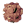
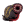
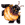
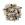
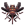
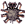

# 育巢母体（Brood Mother）

每次命中敌人时，有 25%/35%/45% 的概率产出一个小球

[原文与贡献者记录](https://ballxpit.wiki.gg/wiki/Brood_Mother) · [修订 4084](https://ballxpit.wiki.gg/index.php?oldid=4084) · [返回目录](../%E7%90%83%E6%AF%94%E4%BC%A6%E6%88%98%E8%AE%B0%20Wiki.md)

## 基本信息

### 初始角色（Starting Character）

[同居者](The_Cohabitants.md) 

### 解锁

默认解锁

### 命中效果（On-Hit Effects）

生成

### 状态效果（Status Effects）

生成 [小球](Baby_Ball.md)

### 由状态效果触发

命中时、生成时

## 进化（Evolutions）

### 进化成

[肉丘](Flesh_Mound.md) , [水蛭](Leech.md) , [闪电虫](Lightning_Bug.md) , [蛆虫](Maggot.md) , [蚊王](Mosquito_King.md) , [蜘蛛女王](Spider_Queen.md) 

**育巢母体** 是 [同居者](The_Cohabitants.md)  的初始 [圆球](Balls.md)，在 *[球比伦战记](Ball_x_Pit.md)* 的每一局开始时即可使用。和大多数圆球一样，**育巢母体** 会撞击敌人并造成伤害；命中敌人后，还有 25% 的概率生成新的 [小球](Baby_Ball.md) 。

与其他圆球结合使用时，直接伤害会增加，且两种效果均由该球触发。[小球](Baby_Ball.md)  也会触发组合圆球的效果。

## 关卡

| 等级 | 伤害 | 效果 |
| --- | --- | --- |
| 1 |  x(3.5 至 6.5) | 每次命中敌人时，有 25% 的概率产出一个小球 |
| 2 |  x(3.5 至 6.5) | 每次命中敌人时，有 35% 的概率产出一个小球 |
| 3 |  x(3.5 至 6.5) | 每次命中敌人时，有 45% 的概率产出一个小球 |

## 进化

| 组合 | 进化 |
| --- | --- |
|  育巢母体（Brood Mother） + [肉身（Flesh）](Flesh.md)  | [肉丘（Flesh Mound）](Flesh_Mound.md)  |
|  育巢母体（Brood Mother） + [流血（Bleed）](Bleed.md)  | [水蛭（Leech）](Leech.md)  |
|  育巢母体（Brood Mother） + [闪电（Lightning）](Lightning.md)  | [闪电虫（Lightning Bug）](Lightning_Bug.md)  |
|  育巢母体（Brood Mother） + [细胞（Cell）](Cell.md)  | [蛆虫（Maggot）](Maggot.md)  |
|  育巢母体（Brood Mother） + [吸血鬼（Vampire）](Vampire.md)  | [蚊王（Mosquito King）](Mosquito_King.md) （\*） |
|  育巢母体（Brood Mother） + [卵囊（Egg Sac）](Egg_Sac.md)  | [蜘蛛女王（Spider Queen）](Spider_Queen.md) （\*） |

* 可以进一步进化。

## 策略

**育巢母体** 是一个很好的组合选项，可以用来传播其他圆球的效果，例如 [流血](Bleed.md)  或 [灼烧](Burn.md) 。生成的小球会继承组合圆球的效果，这有助于让单个目标圆球获得类似范围效果的能力。

## 更新记录

## 冷知识

* 这个球指的是来自 *[Dragon Age](https://dragonage.fandom.com/wiki/)* 中的 [育巢母体](https://dragonage.fandom.com/wiki/Broodmother)。

## 图片库

[共享导航](../navigation/nav-63012059ef49.md)

**分类**　[分类 · 基础圆球](../categories/Base_Balls.md) · [分类 · 圆球](../categories/Balls.md) · [分类 · 带有导航框的页面](../categories/Pages_with_navboxes.md)

[返回总入口](../%E7%90%83%E6%AF%94%E4%BC%A6%E6%88%98%E8%AE%B0%20Wiki.md) · [返回本分目录](%E7%9B%AE%E5%BD%95.md)
