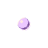

# 育巢母体（Brood Mother）

每当它击中敌人时，有25%/35%/45%的机会生育婴儿球

[原文与贡献者记录](https://ballxpit.wiki.gg/wiki/Brood_Mother) · [修订 4084](https://ballxpit.wiki.gg/index.php?oldid=4084) · [返回目录](../%E7%90%83%E6%AF%94%E4%BC%A6%E6%88%98%E8%AE%B0%20Wiki.md)

#### 一般信息

##### 开始的性格

[同居者](The_Cohabitants.md) 

##### 解锁

默认解锁

##### 命中效果（On-Hit Effects）

生成

##### 状态效果（Status Effects）

生成 [小球](Baby_Ball.md)

##### 由于状态影响

命中时、生成时

#### 发展情况（Evolutions）

##### 演变为

[肉山](Flesh_Mound.md) 、 [李克](Leech.md) 、 [闪电虫](Lightning_Bug.md) 、 [蛆虫](Maggot.md) 、 [蚊子王](Mosquito_King.md) 、 [蜘蛛女王](Spider_Queen.md) 

**育巢母体** 是一个开始 [球](Balls.md) 的 [同居者](The_Cohabitants.md)  在每场比赛开始时，它会被解锁。 *[球比伦战记](Ball_x_Pit.md)*像大多数球一样, **育巢母体** 在击中敌人时，它也有25%的机会产生新的 [小球](Baby_Ball.md) .

当与其他球结合时，直接伤害会增加, [小球](Baby_Ball.md)  结合球的产物也会引发结合球的效果。

#### 关卡

| 等级 | 伤害 | 影响 |
| --- | --- | --- |
| 1 |  x(3.5至6.5) | 每当它击中敌人时，有25%的机会生出宝贝球。 ／ |
| 2 |  x(3.5至6.5) | 每当它击中敌人时，有35%的机会生出宝贝球 ／ |
| 3 |  x(3.5至6.5) | 每当它击中敌人时，有45%的机会生出宝贝球 ／ |

#### 发展情况

| 组合 | 进化 |
| --- | --- |
|  育巢母体（Brood Mother） + [肉类（Flesh）](Flesh.md)  | [肉山（Flesh Mound）](Flesh_Mound.md)  |
|  育巢母体（Brood Mother） + [流血（Bleed）](Bleed.md)  | [李克（Leech）](Leech.md)  |
|  育巢母体（Brood Mother） + [闪电（Lightning）](Lightning.md)  | [闪电虫（Lightning Bug）](Lightning_Bug.md)  |
|  育巢母体（Brood Mother） + [细胞（Cell）](Cell.md)  | [蛆虫（Maggot）](Maggot.md)  |
|  育巢母体（Brood Mother） + [吸血鬼（Vampire）](Vampire.md)  | [蚊子王（Mosquito King）](Mosquito_King.md) （\*） |
|  育巢母体（Brood Mother） + [蛋袋（Egg Sac）](Egg_Sac.md)  | [蜘蛛女王（Spider Queen）](Spider_Queen.md) （\*） |

* 可以进一步发展。

#### 策略

**育巢母体** 是一个很好的组合选择来传播效果从其他球像 [流血](Bleed.md)  或是 [灼烧](Burn.md)  婴儿球将继承合体球的效果，这可以帮助给球体单个目标效果一个伪范围效果。

#### 更新记录

#### 冷知识

* 这个球是指 [育巢母体（Broodmother）](https://dragonage.fandom.com/wiki/Broodmother) 在 *[龙时代](https://dragonage.fandom.com/wiki/)*.

#### 图片库

[共享导航](../navigation/nav-63012059ef49.md)

**分类**　[分类 · 基础圆球](../categories/Base_Balls.md) · [分类 · 圆球](../categories/Balls.md) · [分类 · 页面有导航框](../categories/Pages_with_navboxes.md)

[返回总入口](../%E7%90%83%E6%AF%94%E4%BC%A6%E6%88%98%E8%AE%B0%20Wiki.md) · [返回本分目录](%E7%9B%AE%E5%BD%95.md)
