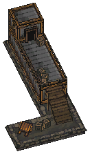
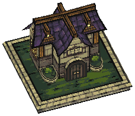
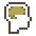
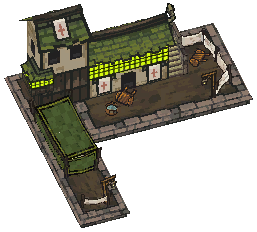
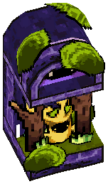
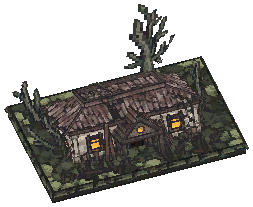
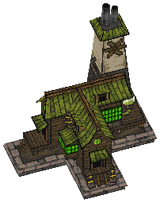
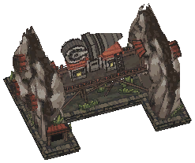

# 建筑（Buildings）

[原文与贡献者记录](https://ballxpit.wiki.gg/wiki/Buildings) · [修订 2829](https://ballxpit.wiki.gg/index.php?oldid=2829) · [返回目录](../%E7%90%83%E6%AF%94%E4%BC%A6%E6%88%98%E8%AE%B0%20Wiki.md)

待补充条目

*这是一个 [待补充条目](../categories/Stubs.md)你可以帮助BALL xPIT Wiki通过 [补充此条目](https://ballxpit.wiki.gg/wiki/Buildings?action=edit).*

加入建筑机械总结

整体:添加更多的UI图像用于更复杂的机械建筑，例如匹配机，市场，战争室

整体:模拟/添加每个建筑物的效果区格底/模板

单个建筑页面的信息框层次解锁链接，用"il的"模板链接取代

#### 经济

##### 资源

这些瓷砖为大多数其他建筑物和升级工程提供了所需的基本资源。  麦子,  树木和  石头。每张瓷砖上的资源以预先确定的速率增长，最多只能达到最大容量，每个都取决于瓷砖的变式和升级水平。资源砖块一旦被清空，在重新开发一些资源之前，不能再次从资源砖块中提取，尽管在运行期间和 [工人协会](Worker_s_Guild_Building.md) 每个资源都从最初的2×2版本开始 (除了  Stone)，后期的解锁为更高容量，更有效率的1x1版本。 和其他建筑不同，这些和配套的Gathering建筑都可以无限多次建造。

为了获得资源，这些瓷砖要么需要在收获模式下由人物从庄稼中收获，要么放在各自采集建筑物或性格建筑物的效应区，并相应进行被动收获升级。默认情况下， 字符每次在收割模式中进入瓷砖时， 都会导致该字符反弹并偏移该瓷砖( 除小麦瓷砖外) , 并从中提取1单位资源。然而，性格升级可以使字符在通过资源瓦片时从资源瓦片中收获，并增加从每次收获中获得的资源量(尽管注意到这并不增加从某一瓷砖中可获取的可用资源总量)。其他升级还可给从各自资源瓦砾中收获更多收获时间。此外，某些字符还可以提高他们家建筑物影响区内各自资源瓦的增长率(一旦他们解开这一能力)。

总的来说,  小麦是可积累的最容易和数量最大的资源。  石头是最硬，最低,  树在中间。

| 建筑名称 | 图片 | 描述 | 蓝图位置 |
| --- | --- | --- | --- |
| [麦田（Wheat Field）](Wheat_Field.md) |  | 一个收获的田野  麦子。 | - |
| [密集的小麦（Dense Wheat）](Dense_Wheat.md) |  | 一个密集的场地  高增长率和产能的小麦。 | [血腥草原（The GORYxGRASSLANDS）](The_GORYxGRASSLANDS.md)  |
| [森林（Forest）](Forest.md) |  | 一个收获的田野  树木。 | - |
| [大树（Grand Tree）](Grand_Tree.md) |  | 一棵巨大的树，你可以从中收集  有高增长率和容量的木材。 | [血腥草原（The GORYxGRASSLANDS）](The_GORYxGRASSLANDS.md)  |
| [石头（Boulder）](Boulder.md) |  | 一块巨大的石头要收获  石头。 | - |
| [花岗岩板（Granite Slab）](Granite_Slab.md) |  | 一块大石材，你可以从中收集  具有高增长率和容量的石头。 | [阴燃深渊（The SMOLDERINGxDEPTHS）](The_SMOLDERINGxDEPTHS.md)  |

##### 聚会

这一类的建筑物将自动收集背景资源，而没有玩家投入(金矿除外)，只要有接近的触动大楼影响区的砖块的资源，并有一个积极分配给大楼的字符。此外，除了金矿和收藏者小屋以外，任何收获建筑所分配的字符仍然可在收获期间发送，而不需要先移除它们。默认情况下，这些建筑不会在游戏关闭期间收集资源，但玩家可以建立工人协会，这将允许这些建筑这样做 (尽管只为高达24小时，而且以降低的利率)。与资源建筑一样，集成建筑在建筑中是独一无二的，因为相同的建筑可以多次建造。

对于农场、Lumberyard和Stone Mine, 指出资源瓷砖中只有一部分需要进入建筑物的效应区; **[查看建筑策略和优化]**

"{TODO:确定是否和哪些建筑和特征奖金适用于Gathering Hut运行}

| 建筑名称 | 图片 | 描述 | 蓝图位置 |
| --- | --- | --- | --- |
| [农场（Farm）](Farm.md) |  | 给一个角色来收获。  来自邻近的小麦田。 | [白雪海岸（The SNOWYxSHORES）](The_SNOWYxSHORES.md)  |
| [木工场（Lumberyard）](Lumberyard.md) |  | 给一个角色来收获。  取自邻近的森林瓷砖。 | [白雪海岸（The SNOWYxSHORES）](The_SNOWYxSHORES.md)  |
| [石矿（Stone Mine）](Stone_Mine.md) |  | 给一个角色来收获。  从邻近的岩石中。 | [白雪海岸（The SNOWYxSHORES）](The_SNOWYxSHORES.md)  |
| [金矿（Gold Mine）](Gold_Mine.md) |  | 派一个工人到我的 当这座建筑被击落时，他们会被挖掘。 . | [边境沙漠（The LIMINALxDESERT）](The_LIMINALxDESERT.md)  |
| [收藏家的小屋（Gatherer's Hut）](Gatherer_s_Hut.md) |  | 在此，将一个字符分配到一个自动向前设置的方向发送, | [血腥草原（The GORYxGRASSLANDS）](The_GORYxGRASSLANDS.md)  |

##### 收获升级

不应与 [收获升级 （角色奖金 / Character Bonus）](Harvest_Upgrades_Character_Bonus.md).

这些建筑物对收获模式运行使用奖金。 {TODO:确定是否和哪些建筑和特征奖金适用于采集棚运行}

| 建筑名称 | 图片 | 描述 | 蓝图位置 |
| --- | --- | --- | --- |
| [卫报（Watch Tower）](Watch_Tower.md) |  | 增加收获时间。 | [白雪海岸（The SNOWYxSHORES）](The_SNOWYxSHORES.md)  |
| [道路守护者（Road Keeper）](Road_Keeper.md) |  | 在收获期间增加字符运动速度。 | [真菌森林（The FUNGALxFOREST）](The_FUNGALxFOREST.md)  |

##### 多种类型

这些建筑增加了额外的机械或改变了现有的经济过程,

双重检查，汇率确实每13次重新设置吗?

| 建筑名称 | 图片 | 描述 | 蓝图位置 |
| --- | --- | --- | --- |
| [市场（Market）](Market.md) |  | 释放了交易黄金的能力。 | [边境沙漠（The LIMINALxDESERT）](The_LIMINALxDESERT.md)  |
| [工人协会（Worker's Guild）](Worker_s_Guild_Building.md) |  | 让员工在比赛结束时收集24小时的资源, | [天堂之门（The HEAVENLYxGATES）](The_HEAVENLYxGATES.md)  |
| [热水池（Spa）](Spa.md) |  | 直接花更多的金钱来收获。 | [边境沙漠（The LIMINALxDESERT）](The_LIMINALxDESERT.md)  |
| [协会厅（Guild Hall）](Guild_Hall.md) |  | 用资源重新调整角色收获升级 | [边境沙漠（The LIMINALxDESERT）](The_LIMINALxDESERT.md)  |

#### 战争

##### 属性加成

有6个基地。 [统计](Attributes.md) 奖金建筑物，每个建筑物都符合6个基本字符中的一个。每个建筑都为所有字符给予各自的状态 +1奖励，通过建筑升级，该奖励可增加至最大 +5。每个建筑物都能将其各自的统计数据赋予一个+1，当它们与船长四处的效果区交叉时,将其中任何一座建筑全面升级到5级， 就可以获得结构动力成就。 {? TODO: 将会升级到4级， 并增加队长的奖金。

| 建筑名称 | 图片 | 描述 | 蓝图位置 |
| --- | --- | --- | --- |
| [领事馆（Consulate）](Consulate.md) |  | 所有角色都获得奖金  领导。 | [骸骨墓园（The BONExYARD）](The_BONExYARD.md)  |
| [校园（Schoolhouse）](Schoolhouse.md) |  | 所有角色都获得奖金  情报。 | [骸骨墓园（The BONExYARD）](The_BONExYARD.md)  |
| [鞋匠（Shoemaker）](Shoemaker.md) |  | 所有角色都获得奖金  速度。 | [骸骨墓园（The BONExYARD）](The_BONExYARD.md)  |
| [枪手（Gunsmith）](Gunsmith.md) |  | 所有角色都获得奖金  敏捷。 | [骸骨墓园（The BONExYARD）](The_BONExYARD.md)  |
| [兵营（Barracks）](Barracks.md) |  | 所有角色都获得奖金  力量。 | [骸骨墓园（The BONExYARD）](The_BONExYARD.md)  |
| [诊所（Clinic）](Clinic.md) |  | 所有角色都获得奖金  坚持。 | [骸骨墓园（The BONExYARD）](The_BONExYARD.md)  |

##### 无穷无尽的升级建筑物

与基本数据奖金建筑一样，有6个无限可升级的数据奖金建筑，每个建筑都符合6个基本字符统计中的一个。与基数6的STAT奖金建筑不同，这些建筑没有在5级封顶，每级+1的STAT点可以升级无限次;然而，如下文所述，每级的资源成本增加。每个级别的建设点成本也会增加，但最终将达到1050级。每个建筑物可以在与建筑物的效应区交叉时给其各自的统计数据提供额外的+1。 [队长的四处](Captain_s_Quarters.md) 一次 [战术家](The_Tactician.md)  已经解锁了能力。与其他建筑物一样，拆除将完全偿还迄今为止用于建造和升级的全部资金。建造任何一个建筑物,将其中任何一座建筑物升级为5级，使结构动力得以实现。

建筑升级成本由该建筑的基础资源量和当前等级决定。每座建筑的基础资源量等于其 1 级时升级所需资源的一半。

例如:医院的基本数量为120个小麦和40个木头。这些值和当前水平将乘以下面定义的常数来确定升级建筑物的成本。如果医院排名第27，乘法简单地是 `(64*(27−1)+2)=1666` 升级到第28级的成本是 `120*1666=199,920` 小麦和小麦 `40*1666=66,640` 树木。

在1-5层楼时，下次升级的费用是: `(BaseAmount)*(1*(Level−1)+2)`
在6-10级的建筑物上， 下一次升级的成本是: `(BaseAmount)*(4*(Level−1)+2)`
在11-15层楼时，下一次升级的费用是: `(BaseAmount)*(8*(Level−1)+2)`
在建筑物16-20级时，下次升级的成本是: `(BaseAmount)*(16*(Level−1)+2)`
当楼层21-25级时，下一次升级的费用是: `(BaseAmount)*(32*(Level−1)+2)`
在建筑物26-30级时，下次升级的成本是: `(BaseAmount)*(64*(Level−1)+2)`
如果楼层是31级，下次升级的费用是: `(BaseAmount)*(128*(Level−1)+2)`

在建筑物1-5级时，下次升级的成本是: `(BaseAmount)*(Level+1)`
如果建筑物是6级以上，下一次升级的费用是: `(BaseAmount)*(2^(min(7,⌈Level/5⌉))*(Level−1)+2)`

| 建筑名称 | 图片 | 描述 | 蓝图位置 |
| --- | --- | --- | --- |
| [医院（Hospital）](Hospital.md) |  | 收益奖金  耐力，可以不断升级。 | [浩瀚虚空（The VASTxVOID）](The_VASTxVOID.md)  |
| [战士协会（Warrior's Guild）](Warrior_s_Guild.md) |  | 收益奖金  强度，可以不断升级。 | [浩瀚虚空（The VASTxVOID）](The_VASTxVOID.md)  |
| [资本中心（Capitolium）](Capitolium.md) |  | 收益奖金  领导力，可以无限地升级。 | [浩瀚虚空（The VASTxVOID）](The_VASTxVOID.md)  |
| [车车工厂（Wagon Factory）](Wagon_Factory.md) |  | 收益奖金  速度，可以不断升级。 | [浩瀚虚空（The VASTxVOID）](The_VASTxVOID.md)  |
| [射手协会（Marksman's Guild）](Marksman_s_Guild.md) |  | 收益奖金  能够无限升级 | [浩瀚虚空（The VASTxVOID）](The_VASTxVOID.md)  |
| [大博物馆（Grand Museum）](Grand_Museum.md) |  | 收益奖金  智能，可以无限地升级。 | [浩瀚虚空（The VASTxVOID）](The_VASTxVOID.md)  |

##### 统计规模

有6个数据尺寸建筑，每个符合6个基本字符数据之一。每个建筑物对其各个字符的统计层进行增加，从E级基层升至S级最高，随后升级至5级。每个增加的统计规模级别都相当于对每个分数所应用的相关能力的成比例改善。将其中任何一座建筑物全面升级到5级，就可以取得SRAK成绩。 {?TODO:这些是否影响到Trophies授予的奖金?}

| 建筑名称 | 图片 | 描述 | 蓝图位置 |
| --- | --- | --- | --- |
| [车手（Wheelwright）](Wheelwright.md) |  | 增加  速度扩展等级。 | [白雪海岸（The SNOWYxSHORES）](The_SNOWYxSHORES.md)  |
| [军事学院（Military Academy）](Military_Academy.md) |  | 增加  强度扩展等级。 | [边境沙漠（The LIMINALxDESERT）](The_LIMINALxDESERT.md)  |
| [化学家（Alchemist）](Alchemist.md) |  | 增加  耐力扩展等级。 | [白雪海岸（The SNOWYxSHORES）](The_SNOWYxSHORES.md)  |
| [大学（University）](University.md) |  | 增加  智能度量级。 | [白雪海岸（The SNOWYxSHORES）](The_SNOWYxSHORES.md)  |
| [射箭射击范围（Archery Range）](Archery_Range.md) |  | 增加  性不适程度等级。 | [边境沙漠（The LIMINALxDESERT）](The_LIMINALxDESERT.md)  |
| [外交厅（Diplomacy Hall）](Diplomacy_Hall.md) |  | 增加  在领导层上升。 | [边境沙漠（The LIMINALxDESERT）](The_LIMINALxDESERT.md)  |

##### 通关奖励

共有8座奖杯建筑，每个奖杯建筑与坑内的一个级别相对应，与其他建筑不同，奖杯蓝图不能作为来自战败敌人的滴水物找到，相反，每座奖杯蓝图在第一次完成时会自动授予。 [的水平](Levels.md) 任何一个角色。每个奖杯给所有字符都颁发独特的奖金，其数额随着随后在新游戏+的更高难度和每个字符的快速分层完成同等水平的成绩而自动增加，尽管所有在正常困难基础上完成的成绩都低于基准水平，只给基本奖金价值的1/10。对于大多数平台来说，每个奖杯的理论最大奖金是261.8*基奖金值: `(22x1){Base Level Normal clears} + ((22x10)x0.1){Base Level Fast-Fast+9 clears} + (9(22x11)x0.1){New Game+-New Game+9 clears on Normal-Fast+9 each} = 22 + 22 + 217.8 = 261.8`. 然而，如果在PC上播放并激活Twitch扩展程序, [伪救世主](The_False_Messiah.md)  ,这个最高奖金增加到273.7*基本奖金值。构建其中任何一个奖项是奖杯的成就。 {?TODO:Shroom/Smoldering/Void奖杯是否有效地以实际的0.1个增长为奖金,(生命值/损伤/愈合仅显示为整数)}

| 建筑名称 | 图片 | 描述 | 蓝图位置 |
| --- | --- | --- | --- |
| [骸骨墓园奖杯（Boneyard Trophy）](Boneyard_Trophy.md) |  | 获得状态效果功率，每一个你完成了BONExYARD的角色。 | [骸骨墓园（The BONExYARD）](The_BONExYARD.md)  |
| [雪杯（Snowy Trophy）](Snowy_Trophy.md) |  | 获取范围效果功率，为每一个你完成了SNOWYxSHORES的角色。 | [白雪海岸（The SNOWYxSHORES）](The_SNOWYxSHORES.md)  |
| [沙漠奖杯（Desert Trophy）](Desert_Trophy.md) |  | 获得每一个你完成了LIMINALXDESERT的角色的成功机会。 | [边境沙漠（The LIMINALxDESERT）](The_LIMINALxDESERT.md)  |
| [蘑菇奖杯（Shroom Trophy）](Shroom_Trophy.md) |  | 你完成了FUNGALxFOREST的每一个角色的生命值。 | [真菌森林（The FUNGALxFOREST）](The_FUNGALxFOREST.md)  |
| [戈里奖杯（Gory Trophy）](Gory_Trophy.md) |  | 获得每一个你完成了GORYxGRASSLANDS的角色的球速度。 | [血腥草原（The GORYxGRASSLANDS）](The_GORYxGRASSLANDS.md)  |
| [生动的奖杯（Smoldering Trophy）](Smoldering_Trophy.md) |  | 为了每一个你完成的角色， 获得宝贝球损伤。 | [阴燃深渊（The SMOLDERINGxDEPTHS）](The_SMOLDERINGxDEPTHS.md)  |
| [天上的奖杯（Heavenly Trophy）](Heavenly_Trophy.md) |  | 获得每一个你完成的天空之门角色的被动力量。 | [天堂之门（The HEAVENLYxGATES）](The_HEAVENLYxGATES.md)  |
| [虚空奖杯（Void Trophy）](Void_Trophy.md) |  | 为了每一个你完成了VASTxVOID的角色, | [浩瀚虚空（The VASTxVOID）](The_VASTxVOID.md)  |

##### 总

这类建筑物包括各种效果的广泛的建筑物，从增加到获得的经验，到增加的复兴能力，到特殊球和被动球的起始水平。

艾比奖金适用于中期级经验值和永久级经验值吗?

在使用Necromancer的复兴中杀伤半径是多少?

匹配机的允许字符组合表}

| 建筑名称 | 图片 | 描述 | 蓝图位置 |
| --- | --- | --- | --- |
| [修道院（Abbey）](Abbey.md) |  | 增加获得的经验值 | [真菌森林（The FUNGALxFOREST）](The_FUNGALxFOREST.md)  |
| [珠宝家（Jeweler）](Jeweler.md) |  | 提高起始球水平 | [真菌森林（The FUNGALxFOREST）](The_FUNGALxFOREST.md)  |
| [死灵法师（Necromancer）](Necromancer.md) |  | 每次战斗一次，你死后，恢复健康，杀死所有附近的敌人 | [真菌森林（The FUNGALxFOREST）](The_FUNGALxFOREST.md)  |
| [银行（Bank）](Bank.md) |  | 增加战斗中的黄金 | [边境沙漠（The LIMINALxDESERT）](The_LIMINALxDESERT.md)  |
| [匹配机（Matchmaker）](Matchmaker.md) |  | 让你把两个角色带到一起, | [真菌森林（The FUNGALxFOREST）](The_FUNGALxFOREST.md)  |
| [磁铁工厂（Magnet Factory）](Magnet_Factory.md) |  | 增加接收距离。 | [边境沙漠（The LIMINALxDESERT）](The_LIMINALxDESERT.md)  |
| [蜡烛作坊（Candle Maker）](Candle_Maker.md) |  | 聚变反应堆包含增加的最低升级次数。 | [阴燃深渊（The SMOLDERINGxDEPTHS）](The_SMOLDERINGxDEPTHS.md)  |
| [赌徒巢穴（Gambler's Den）](Gambler_s_Den.md) |  | 在战斗中获得自由升级。 | [血腥草原（The GORYxGRASSLANDS）](The_GORYxGRASSLANDS.md)  |
| [赌场（Casino）](Casino.md) |  | 降低升级成本。 | [真菌森林（The FUNGALxFOREST）](The_FUNGALxFOREST.md)  |
| [愿意好好（Wishing Well）](Wishing_Well.md) |  | 在升级时增加一个额外的升级点的机会。 | [阴燃深渊（The SMOLDERINGxDEPTHS）](The_SMOLDERINGxDEPTHS.md)  |
| [进化室](Evolution_Chamber_Building.md) |  | 新球都从2级开始。 | [天堂之门（The HEAVENLYxGATES）](The_HEAVENLYxGATES.md)  |
| [遗物收藏家](Relic_Collector_Building.md) |  | 新的负担全部从2级开始 | [天堂之门（The HEAVENLYxGATES）](The_HEAVENLYxGATES.md)  |
| [冥想帐篷（Meditation Tent）](Meditation_Tent.md) |  | 在升级时增加升级选项的数量到4。 | [阴燃深渊（The SMOLDERINGxDEPTHS）](The_SMOLDERINGxDEPTHS.md)  |
| [驱魔者（Exorcist）](Exorcist.md) |  | 在升级时，添加升级功能。 | [骸骨墓园（The BONExYARD）](The_BONExYARD.md)  |
| [石家庄（Gemsmith）](Gemsmith.md) |  | 开始每场战斗，选择一个额外的球。 | [血腥草原（The GORYxGRASSLANDS）](The_GORYxGRASSLANDS.md)  |
| [古董店（Antique Shop）](Antique_Shop.md) |  | 开始每一次战斗，选择一个被动的战斗。 | [血腥草原（The GORYxGRASSLANDS）](The_GORYxGRASSLANDS.md)  |
| [战争室（War Room）](War_Room.md) |  | 发送字符到完成级别的自己 | [阴燃深渊（The SMOLDERINGxDEPTHS）](The_SMOLDERINGxDEPTHS.md)  |
| [包装机器](Bag_Maker_Building.md) |  | 加入1个球口 | [天堂之门（The HEAVENLYxGATES）](The_HEAVENLYxGATES.md)  |
| [木匠](Carpenter_Building.md) |  | 加1个被动时位 | [天堂之门（The HEAVENLYxGATES）](The_HEAVENLYxGATES.md)  |
| [冒险家协会（Adventurer's Guild）](Adventurer_s_Guild.md) |  | 在击败老板后，你会继续探索一个层次。 | [白雪海岸（The SNOWYxSHORES）](The_SNOWYxSHORES.md)  |

#### 住房

住房包括所有解锁字符的建筑物，并赋予其各自的被动建筑奖金。

所有字符都需要在使用之前找到和建造各自的房屋蓝图 (除了 [战士](The_Warrior.md) ,默认解锁，以及 [伪救世主](The_False_Messiah.md)  并且拆除一个人物的房屋，将解除任何建筑任务中的该特征，使其无法用于收获模式或坑道运行，直到其房屋得到重建(尽管该特征仍将保留所有统计数据、经验、收成升级和以前水平的清除)。与其他建筑物不同，住宅建筑通过增加各自的特性来获得和升级其被动效益 [永久水平](Character_Level_Mechanics.md) 而不是花费资源，升级即时发生，而不需要跳转/建立点。一般说来，一个性格的房屋将获得其独特的能力，一旦每个性格达到第4级，随后在7级和9级的性格技能(和建筑物自己的水平)得到提升,{?TODO:找到对每个被动能力的级别要求和说明，解锁和升级}建造所有住房结构都使邻里地区的成就得以实现。

对于各种效果建筑，例如豪宅，退伍军人小屋，船长的房间,

##### 住房建筑一览

| 建筑名称 | 图片 | 描述 | 蓝图位置 |
| --- | --- | --- | --- |
| [警长办公室（Sheriff's Office）](Sheriff_s_Office.md) |  | 一个房子 [快枪手（The Itchy Finger）](The_Itchy_Finger.md) . | [骸骨墓园（The BONExYARD）](The_BONExYARD.md)  |
| [鬼鬼之家（Haunted House）](Haunted_House.md) |  | 一个房子 [忏悔者（The Repentant）](The_Repentant.md) . | [骸骨墓园（The BONExYARD）](The_BONExYARD.md)  |
| [剧院（Theater）](Theater.md) |  | 一个房子 [杂耍者（The Juggler）](The_Juggler.md) . | [血腥草原（The GORYxGRASSLANDS）](The_GORYxGRASSLANDS.md)  |
| [舒适的家（Cozy Home）](Cozy_Home.md) |  | 一个房子 [同居者（The Cohabitants）](The_Cohabitants.md) . | [骸骨墓园（The BONExYARD）](The_BONExYARD.md)  |
| [别墅（Villa）](Villa.md) |  | 一个房子 [沉思者（The Cogitator）](The_Cogitator.md) . | [白雪海岸（The SNOWYxSHORES）](The_SNOWYxSHORES.md)  |
| [陵墓（Mausoleum）](Mausoleum.md) |  | 一个房子 [暗影（The Shade）](The_Shade.md) . | [边境沙漠（The LIMINALxDESERT）](The_LIMINALxDESERT.md)  |
| [铁堡垒（Iron Fortress）](Iron_Fortress.md) |  | 一个房子 [持盾者（The Shieldbearer）](The_Shieldbearer.md) . | [真菌森林（The FUNGALxFOREST）](The_FUNGALxFOREST.md)  |
| [队长的四处（Captain's Quarters）](Captain_s_Quarters.md) |  | 一个房子 [战术家（The Tactician）](The_Tactician.md) . | [阴燃深渊（The SMOLDERINGxDEPTHS）](The_SMOLDERINGxDEPTHS.md)  |
| [露营场（Campground）](Campground.md) |  | 一个房子 [激进者（The Radical）](The_Radical.md) . | [天堂之门（The HEAVENLYxGATES）](The_HEAVENLYxGATES.md)  |
| [单身家庭（Single Family Home）](Single_Family_Home.md) |  | 一个房子 [空巢者（The Empty Nester）](The_Empty_Nester.md) . | [白雪海岸（The SNOWYxSHORES）](The_SNOWYxSHORES.md)  |
| [洛基山（Rocky Hill）](Rocky_Hill.md) |  | 一个房子 [临时西西弗斯（The Makeshift Sisyphus）](The_Makeshift_Sisyphus.md) . | [边境沙漠（The LIMINALxDESERT）](The_LIMINALxDESERT.md)  |
| [修道院（Monastery）](Monastery.md) |  | 一个房子 [自笞者（The Flagellant）](The_Flagellant.md) . | [血腥草原（The GORYxGRASSLANDS）](The_GORYxGRASSLANDS.md)  |
| [实验室（Laboratory）](Laboratory.md) |  | 一个房子 [物理学家（The Physicist）](The_Physicist.md) . | [真菌森林（The FUNGALxFOREST）](The_FUNGALxFOREST.md)  |
| [退伍军人小屋（Veteran's Hut）](Veteran_s_Hut.md) |  | 一个房子 [潜伏者（The Embedded）](The_Embedded.md) . | [白雪海岸（The SNOWYxSHORES）](The_SNOWYxSHORES.md)  |
| [豪宅（Mansion）](Mansion.md) |  | 一个房子 [挥霍者（The Spendthrift）](The_Spendthrift.md) . | [真菌森林（The FUNGALxFOREST）](The_FUNGALxFOREST.md)  |
| [驯鹰小屋（Falconry Hut）](Falconry_Hut.md) |  | 一个房子 [驯鹰人（The Falconer）](The_Falconer.md) . | [天堂之门（The HEAVENLYxGATES）](The_HEAVENLYxGATES.md)  |
| [聚会之家（Party House）](Party_House.md) |  | 一个房子 [畅饮者（The Carouser）](The_Carouser.md) . | [浩瀚虚空（The VASTxVOID）](The_VASTxVOID.md)  |
| [石域（Stone Domain）](Stone_Domain.md) |  | 一个房子 [掘地者（The Tunneller）](The_Tunneller.md) . | [阴燃深渊（The SMOLDERINGxDEPTHS）](The_SMOLDERINGxDEPTHS.md)  |
| [隐秘神殿（Hidden Temple）](Hidden_Temple.md) |  | 一个房子 [蹑足者（The Tiptoer）](The_Tiptoer.md) . | [阴燃深渊（The SMOLDERINGxDEPTHS）](The_SMOLDERINGxDEPTHS.md)  |
| [球场（Ball House）](Ball_House.md) |  | 一个房子 [持球者（The Ballbearer）](The_Ballbearer.md) . | [浩瀚虚空（The VASTxVOID）](The_VASTxVOID.md)  |
| [不稳定的塔楼（Unstable Tower）](Unstable_Tower.md) |  | 一个房子 [白发囤积者（The Hoary Hoarder）](The_Hoary_Hoarder.md) . | [天堂之门（The HEAVENLYxGATES）](The_HEAVENLYxGATES.md)  |

**分类**　[分类 · 坚力](../categories/Stubs.md)

[返回总入口](../%E7%90%83%E6%AF%94%E4%BC%A6%E6%88%98%E8%AE%B0%20Wiki.md) · [返回本分目录](%E7%9B%AE%E5%BD%95.md)
