# 建筑（Buildings）

[原文与贡献者记录](https://ballxpit.wiki.gg/wiki/Buildings) · [修订 2829](https://ballxpit.wiki.gg/index.php?oldid=2829) · [返回目录](../%E7%90%83%E6%AF%94%E4%BC%A6%E6%88%98%E8%AE%B0%20Wiki.md)

待完善

*此条目为 [待完善](../categories/Stubs.md). 你可以通过帮助 BALL x PIT 维基贡献一份力量。 [补充内容](https://ballxpit.wiki.gg/wiki/Buildings?action=edit).*

TODO: 添加建筑机制概述

TODO: 为具有更复杂机制的建筑添加额外的UI图片，例如匹配机、市场、作战室。

TODO: 为每栋建筑创建模型，并添加建筑占地面积和效果区域网格底图/模板

TODO: 将单个建筑页面上的信息框等级解锁链接替换为“il|”模板链接

## 经济

### 资源

这些格可以生成大多数其他建筑与升级所需的基础资源，包括  小麦、 木材和  石头。每个格的资源以预定的速率增长，但受限于上限，这取决于格的变体及升级等级。一旦某个资源格被耗尽，除非有新的资源重新生长出来，否则无法再次采集。不过，这种情况会在游戏运行期间实时被动发生，而当 [工人工会](Worker_s_Guild_Building.md)建立后，即使游戏关闭，资源也会被动重新生长。每种资源最初都有 2x2 的版本（ 石头除外），之后会解锁更高容量且效率更高的 1x1 版本。与其他建筑不同，这些格以及配套的采集建筑可以无限次建造。

要获取资源，这些格需要由角色在收获模式下进行收获，或者将其放置在相应的采集建筑或角色建筑的效果区域内，并启用相应的被动收获升级。默认情况下，每当角色在收获模式下遇到该格时，角色会反弹并偏离该格（小麦格除外），并从其中收获1单位资源。不过，角色升级可以让角色在穿过该格时也能进行收获，并增加每次收获获得的资源量（但请注意，这并不会增加从特定格可收获的总资源量）。其他升级还可以为从相应资源格的收获提供额外的时间。此外，某些角色还可以提高其所在建筑效果区域内的相应资源格的生长速率（一旦解锁了该能力）。

一般来说， 小麦是最容易获取且产量最高的资源，而  石头则是最难获取且产量最低的，而  木材则处于两者之间。

| 建筑名称 | 图片 | 说明 | 蓝图位置 |
| --- | --- | --- | --- |
| [小麦田（Wheat Field）](Wheat_Field.md) | [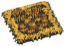](../files/Buildings_Wheat_Field_Level1.png.md) | 一片需要收获  小麦的田地。 | - |
| [密集小麦（Dense Wheat）](Dense_Wheat.md) | [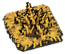](../files/Buildings_Dense_Wheat_Level1.png.md) | 密植的小麦田，资源再生更快，储量更高。 | [血腥草原（The GORYxGRASSLANDS）](The_GORYxGRASSLANDS.md) [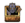](The_GORYxGRASSLANDS.md) |
| [森林（Forest）](Forest.md) | [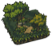](../files/Buildings_Forest_Level1.png.md) | 一片需要收获  木材的林地。 | - |
| [大树（Grand Tree）](Grand_Tree.md) | [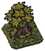](../files/Buildings_Grand_Tree_Level1.png.md) | 一棵巨大的树木，你可以从中收集生长率高、产量大的  木材。 | [血腥草原（The GORYxGRASSLANDS）](The_GORYxGRASSLANDS.md)  |
| [巨石（Boulder）](Boulder.md) | [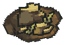](../files/Buildings_Boulder_Level1.png.md) | 一块需要收获的大型  石块。 | - |
| [花岗岩板（Granite Slab）](Granite_Slab.md) | [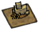](../files/Buildings_Granite_Slab_Level1.png.md) | 一块巨大的花岗岩，你可以从其中收集再生率高、再生能力强的  石头。 | [阴燃深渊（The SMOLDERINGxDEPTHS）](The_SMOLDERINGxDEPTHS.md)  |

### 收集

此分类中的建筑在后台会自动收集资源，无需玩家干预（金矿除外），前提是建筑效果区域附近的格子上存在可用资源，并且有角色被主动分配到该建筑上。此外，除了金矿和采集者小屋之外，分配到任何收集类建筑的角色在收获期间仍可派出，无需先移除它们。默认情况下，这些建筑在游戏关闭时不会收集资源，但玩家可以建造工人工会，这样这些建筑就可以进行资源收集（不过只能收集最多24小时的量，且价格较低）。与资源建筑一样，收集类建筑的独特之处在于同一建筑可以多次建造。

对于农场、伐木场和石矿场，请注意只有部分资源格需要位于建筑的效应区域内；这样比简单的方格网格能更有效地管理基础级资源格。**{?参见建筑策略和优化}**

?{TODO: 确定哪些建筑角色加成适用于“采集小屋”任务}

| 建筑名称 | 图片 | 说明 | 蓝图位置 |
| --- | --- | --- | --- |
| [农场（Farm）](Farm.md) | [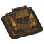](../files/Buildings_Farm_Level1.png.md) | 在此分配一个角色来收割相邻小麦田中的 。 | [白雪海岸（The SNOWYxSHORES）](The_SNOWYxSHORES.md)  |
| [伐木场（Lumberyard）](Lumberyard.md) | [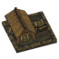](../files/Buildings_Lumberyard_Level1.png.md) | 在此分配一个角色来从相邻的森林格中收获 。 | [白雪海岸（The SNOWYxSHORES）](The_SNOWYxSHORES.md)  |
| [石矿场（Stone Mine）](Stone_Mine.md) | [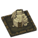](../files/Buildings_Stone_Mine_Level1.png.md) | 在此分配一个角色来从相邻的巨石中收获 。 | [白雪海岸（The SNOWYxSHORES）](The_SNOWYxSHORES.md)  |
| [金矿（Gold Mine）](Gold_Mine.md) | [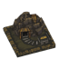](../files/Buildings_Gold_Mine_Level1.png.md) | 在此分配一名工人来开采 。当这座建筑被触发时，他们将开采 。 | [边境沙漠（The LIMINALxDESERT）](The_LIMINALxDESERT.md)  |
| [采集者小屋（Gatherer's Hut）](Gatherer_s_Hut.md) | [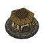](../files/Buildings_Gatherer_s_Hut_Level1.png.md) | 在此分配一个角色，使其按预设方向自动移动，每隔几分钟独立进行收获。 | [血腥草原（The GORYxGRASSLANDS）](The_GORYxGRASSLANDS.md)  |

### 收获升级

请勿与 [收获升级（角色加成）](Harvest_Upgrades_Character_Bonus.md)混淆。

这些建筑在收获模式运行中提供额外奖励。?{TODO: 确定哪些建筑及角色奖励适用于采集屋运行}

| 建筑名称 | 图片 | 说明 | 蓝图位置 |
| --- | --- | --- | --- |
| [守望塔（Watch Tower）](Watch_Tower.md) | [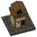](../files/Buildings_Watch_Tower_Level1.png.md) | 增加收获时钟。 | [白雪海岸（The SNOWYxSHORES）](The_SNOWYxSHORES.md)  |
| [道路守护者（Road Keeper）](Road_Keeper.md) | [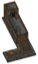](../files/Buildings_Road_Keeper_Level1.png.md) | 在收获期间提高角色的移动速度。 | [真菌森林（The FUNGALxFOREST）](The_FUNGALxFOREST.md)  |

### 其他信息

这些建筑会增加额外的机制，或改变获取和消耗资源的现有经济流程。

?{TODO: 补充市场机制的详细信息，确认汇率是否确实每13局重置？}

| 建筑名称 | 图片 | 说明 | 蓝图位置 |
| --- | --- | --- | --- |
| [市场（Market）](Market.md) | [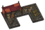](../files/Buildings_Market_Level1.png.md) | 解锁用金币兑换其他资源的功能。 | [边境沙漠（The LIMINALxDESERT）](The_LIMINALxDESERT.md)  |
| [工人工会（Worker's Guild）](Worker_s_Guild_Building.md) | [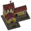](../files/Buildings_Worker_s_Guild_Level1.png.md) | 在游戏关闭期间，工人们可以收集最多相当于24小时所需资源的量，但速度会较慢。 | [天堂之门（The HEAVENLYxGATES）](The_HEAVENLYxGATES.md) [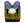](The_HEAVENLYxGATES.md) |
| [温泉浴场（Spa）](Spa.md) | [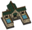](../files/Buildings_Spa_Level1.png.md) | 立即使用金币进行多次收获。 | [边境沙漠（The LIMINALxDESERT）](The_LIMINALxDESERT.md)  |
| [公会大厅（Guild Hall）](Guild_Hall.md) | [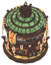](../files/Buildings_Guild_Hall_Level1.png.md) | 使用资源重新随机一名角色的收获升级。 | [边境沙漠（The LIMINALxDESERT）](The_LIMINALxDESERT.md)  |

## 战争

### 属性加成

有 6 座基础 [属性](Attributes.md)加成建筑，每座建筑对应 6 种基础角色属性之一。这些建筑为所有角色提供其对应属性的 +1 加成，通过升级建筑，该加成最高可增至 +5。当战术家解锁了“队长宿舍”效果区域后，每座建筑在与其效果区域相交时，还可额外为其对应属性提供 +1 加成。将其中任何一座建筑升级到 5 级即可获得“结构力量”成就。{?TODO：将升级到 4 级并添加“队长宿舍”加成是否也能解锁该成就？}

| 建筑名称 | 图片 | 说明 | 蓝图位置 |
| --- | --- | --- | --- |
| [领事馆（Consulate）](Consulate.md) | [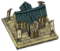](../files/Buildings_Consulate_Level1.png.md) | 所有角色均可获得  领导力加成。 | [骸骨墓园（The BONExYARD）](The_BONExYARD.md)  |
| [学堂（Schoolhouse）](Schoolhouse.md) | [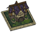](../files/Buildings_Schoolhouse_Level1.png.md) | 所有角色均可获得  智力的加成。 | [骸骨墓园（The BONExYARD）](The_BONExYARD.md)  |
| [鞋匠（Shoemaker）](Shoemaker.md) | [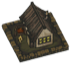](../files/Buildings_Shoemaker_Level1.png.md) | 所有角色均获得  速度的加成。 | [骸骨墓园（The BONExYARD）](The_BONExYARD.md)  |
| [枪匠（Gunsmith）](Gunsmith.md) | [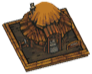](../files/Buildings_Gunsmith_Level1.png.md) | 所有角色均可获得  敏捷加值。 | [骸骨墓园（The BONExYARD）](The_BONExYARD.md)  |
| [兵营（Barracks）](Barracks.md) | [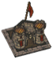](../files/Buildings_Barracks_Level1.png.md) | 所有角色均可获得  力量的加成。 | [骸骨墓园（The BONExYARD）](The_BONExYARD.md)  |
| [诊所（Clinic）](Clinic.md) | [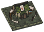](../files/Buildings_Clinic_Level1.png.md) | 所有角色均可获得  耐力的加成。 | [骸骨墓园（The BONExYARD）](The_BONExYARD.md)  |

### 可无限升级的建筑

与基础属性加成建筑一样，还有6座可无限升级的属性加成建筑，每座建筑对应6种基础角色属性之一。与基础6座属性加成建筑不同，这些建筑在5级后不会受到限制，并且可以无限次升级，每级增加1点属性点数；不过，资源消耗会按以下方式逐级增加。建造点消耗也会逐级增加，但最终会达到1050。当每座建筑与效果区域相交时，还能进一步增加其各自属性的1点（前提是 [队长宿舍](Captain_s_Quarters.md) 中有一名 [战术家](The_Tactician.md)  已解锁该能力）。与其他建筑相同，拆除该建筑将全额退还迄今为止在该建筑建造和升级过程中花费的所有资源。建造这些建筑中的任何一座均可获得“纪念碑”成就。将该建筑升级至5级可获得“结构力量”成就。

建筑升级成本由该建筑的基础资源量和当前等级决定。每座建筑的基础资源量等于其 1 级时升级所需资源的一半。

例如：一座医院的基础资源为120小麦和40木材。这些数值连同当前等级，将按以下定义的标准进行相乘，以确定升级该建筑的成本。如果医院等级为27级，则乘数就是简单的 `(64*(27−1)+2)=1666` 而升级到28级的费用为 `120*1666=199,920` 小麦和 `40*1666=66,640` 木材。

当建筑等级为 1-5 级时，下一次升级的成本为： `(BaseAmount)*(1*(Level−1)+2)`
当建筑等级为6-10级时，下一次升级的成本为： `(BaseAmount)*(4*(Level−1)+2)`
当建筑等级为 11-15 级时，下一次升级的花费为： `(BaseAmount)*(8*(Level−1)+2)`
当建筑等级为 16-20 级时，下一次升级的花费为： `(BaseAmount)*(16*(Level−1)+2)`
当建筑等级为 21-25 级时，下一次升级的成本为： `(BaseAmount)*(32*(Level−1)+2)`
当建筑等级为 26-30 级时，下一次升级的费用为： `(BaseAmount)*(64*(Level−1)+2)`
当建筑达到 31 级或以上时，下次升级的成本如下： `(BaseAmount)*(128*(Level−1)+2)`

这样一来，当建筑等级为 1-5 级时，下一次升级的成本为： `(BaseAmount)*(Level+1)`
而当建筑达到6级及以上时，下一次升级的成本为： `(BaseAmount)*(2^(min(7,⌈Level/5⌉))*(Level−1)+2)`

| 建筑名称 | 图片 | 说明 | 蓝图位置 |
| --- | --- | --- | --- |
| [医院（Hospital）](Hospital.md) | [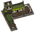](../files/Buildings_Hospital_Level1.png.md) | 获得  耐力加成。可无限升级。 | [浩瀚虚空（The VASTxVOID）](The_VASTxVOID.md)  |
| [战士公会（Warrior's Guild）](Warrior_s_Guild.md) | [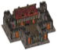](../files/Buildings_Warrior_s_Guild_Level1.png.md) | 获得  力量的加成。可无限升级。 | [浩瀚虚空（The VASTxVOID）](The_VASTxVOID.md)  |
| [议事殿（Capitolium）](Capitolium.md) | [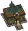](../files/Buildings_Capitolium_Level1.png.md) | 获得  点领导力加成。可无限升级。 | [浩瀚虚空（The VASTxVOID）](The_VASTxVOID.md)  |
| [马车工厂（Wagon Factory）](Wagon_Factory.md) | [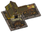](../files/Buildings_Wagon_Factory_Level1.png.md) | 获得  速度加成。可无限升级。 | [浩瀚虚空（The VASTxVOID）](The_VASTxVOID.md)  |
| [射手公会（Marksman's Guild）](Marksman_s_Guild.md) | [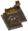](../files/Buildings_Marksman_s_Guild_Level1.png.md) | 敏捷加成 。可无限升级。 | [浩瀚虚空（The VASTxVOID）](The_VASTxVOID.md)  |
| [大博物馆（Grand Museum）](Grand_Museum.md) | [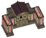](../files/Buildings_Grand_Museum_Level1.png.md) | 获得  点智力加成。可无限升级。 | [浩瀚虚空（The VASTxVOID）](The_VASTxVOID.md)  |

### 属性系数

有 6 座属性系数建筑，每座建筑对应一种基础角色属性。每座建筑都会为所有角色提升相应属性的属性系数等级，随着建筑升级至第 5 级，可从基础 E 级一直提升到最高 S 级。每提升一个属性系数等级，该属性相关能力的提升比例也会相应增加。将其中任何一座建筑升级至第 5 级即可获得 S 级成就。{?TODO: 这些建筑是否会影响奖杯带来的奖励？}

| 建筑名称 | 图片 | 说明 | 蓝图位置 |
| --- | --- | --- | --- |
| [车轮匠（Wheelwright）](Wheelwright.md) | [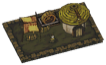](../files/Buildings_Wheelwright_Level1.png.md) | 提升  速度的属性系数等级。 | [白雪海岸（The SNOWYxSHORES）](The_SNOWYxSHORES.md)  |
| [军事学院（Military Academy）](Military_Academy.md) | [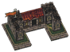](../files/Buildings_Military_Academy_Level1.png.md) | 提升  力量的属性系数等级。 | [边境沙漠（The LIMINALxDESERT）](The_LIMINALxDESERT.md)  |
| [炼金术士（Alchemist）](Alchemist.md) | [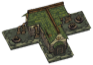](../files/Buildings_Alchemist_Level1.png.md) | 提升  耐力的属性系数等级。 | [白雪海岸（The SNOWYxSHORES）](The_SNOWYxSHORES.md)  |
| [大学（University）](University.md) | [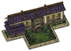](../files/Buildings_University_Level1.png.md) | 提升  智力的属性系数等级。 | [白雪海岸（The SNOWYxSHORES）](The_SNOWYxSHORES.md)  |
| [射箭场（Archery Range）](Archery_Range.md) | [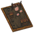](../files/Buildings_Archery_Range_Level1.png.md) | 提升  敏捷的属性系数等级。 | [边境沙漠（The LIMINALxDESERT）](The_LIMINALxDESERT.md)  |
| [外交厅（Diplomacy Hall）](Diplomacy_Hall.md) | [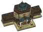](../files/Buildings_Diplomacy_Hall_Level1.png.md) | 提升  领导力的属性系数等级。 | [边境沙漠（The LIMINALxDESERT）](The_LIMINALxDESERT.md)  |

### 通关奖励

共有8座奖杯建筑，每座建筑对应深坑中的一层。与其他建筑不同，奖杯建筑蓝图无法从被击败的敌人那里获得。相反，任意角色首次通关对应的 [等级](Levels.md) 时，即可自动获得该奖杯建筑的蓝图。每个奖杯都会为所有角色提供独特的加成，且该加成会在更高难度新游戏+模式以及快速等级段中，随着同一等级下的后续完成而自动增加。不过，在普通难度下，所有低于基础等级的成绩仅能获得基础加成值的1/10。对于大多数平台，每个奖杯的理论最大加成为261.8*基础加成值。 `(22x1){Base Level Normal clears} + ((22x10)x0.1){Base Level Fast-Fast+9 clears} + (9(22x11)x0.1){New Game+-New Game+9 clears on Normal-Fast+9 each} = 22 + 22 + 217.8 = 261.8`. 不过，如果是在电脑上游玩，并且在 Twitch 扩展程序中使用 [伪救世主](The_False_Messiah.md) ，此上限加成将提高至 273.7*基础加成值。完成其中任意一项即可获得“战绩”成就。{?待办事项：这些奖杯是否确实以 0.1 为单位提供加成，还是会四舍五入到最接近的整数？（生命值、伤害和治愈值仅显示为整数）}

| 建筑名称 | 图片 | 说明 | 蓝图位置 |
| --- | --- | --- | --- |
| [骸骨墓园奖杯（Boneyard Trophy）](Boneyard_Trophy.md) | [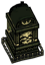](../files/Buildings_Boneyard_Trophy_Level1.png.md) | 每通关一次骸骨墓园（The BONExYARD），每位角色都会获得状态效果强度。 | [骸骨墓园（The BONExYARD）](The_BONExYARD.md)  |
| [白雪海岸奖杯（Snowy Trophy）](Snowy_Trophy.md) | [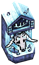](../files/Buildings_Snowy_Trophy_Level1.png.md) | 每通关一次白雪海岸（The SNOWYxSHORES），每位角色都会获得范围效果强度。 | [白雪海岸（The SNOWYxSHORES）](The_SNOWYxSHORES.md)  |
| [沙漠奖杯（Desert Trophy）](Desert_Trophy.md) | [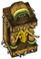](../files/Buildings_Desert_Trophy_Level1.png.md) | 每通关一次边境沙漠（The LIMINALxDESERT），每位角色都会获得更高的暴击率。 | [边境沙漠（The LIMINALxDESERT）](The_LIMINALxDESERT.md)  |
| [蘑菇奖杯（Shroom Trophy）](Shroom_Trophy.md) |  | 每通关一次真菌森林（The FUNGALxFOREST），所有角色都会获得生命值。 | [真菌森林（The FUNGALxFOREST）](The_FUNGALxFOREST.md)  |
| [血腥草原奖杯（Gory Trophy）](Gory_Trophy.md) | [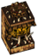](../files/Buildings_Gory_Trophy_Level1.png.md) | 每通关一次血腥草原（The GORYxGRASSLANDS），每位角色都会获得球速。 | [血腥草原（The GORYxGRASSLANDS）](The_GORYxGRASSLANDS.md)  |
| [阴燃深渊奖杯（Smoldering Trophy）](Smoldering_Trophy.md) | [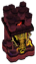](../files/Buildings_Smoldering_Trophy_Level1.png.md) | 每有一名角色通关阴燃深渊（The SMOLDERINGxDEPTHS），即可获得小球伤害。 | [阴燃深渊（The SMOLDERINGxDEPTHS）](The_SMOLDERINGxDEPTHS.md)  |
| [天堂之门奖杯（Heavenly Trophy）](Heavenly_Trophy.md) | [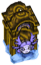](../files/Buildings_Heavenly_Trophy_Level1.png.md) | 每通关一次天堂之门（The HEAVENLYxGATES），每位角色都会获得被动效果强度。 | [天堂之门（The HEAVENLYxGATES）](The_HEAVENLYxGATES.md)  |
| [虚空奖杯（Void Trophy）](Void_Trophy.md) | [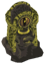](../files/Buildings_Void_Trophy_Level1.png.md) | 每通关一次浩瀚虚空（The VASTxVOID），每位角色都会获得基础伤害。 | [浩瀚虚空（The VASTxVOID）](The_VASTxVOID.md)  |

### 将军

本分类包含多种具有不同效果的建筑，从提升经验值到增加复活能力，再到提高特殊圆球和被动道具的初始等级，应有尽有。

{?TODO: 艾比奖励是否同时适用于单局等级经验值和永久角色经验值？}

使用亡灵法师复活时，击杀半径的格数范围是多少？

《球比伦战记》游戏百科中允许的角色组合表。

| 建筑名称 | 图片 | 说明 | 蓝图位置 |
| --- | --- | --- | --- |
| [修道院（Abbey）](Abbey.md) | [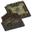](../files/Buildings_Abbey_Level1.png.md) | 增加获得的经验值。 | [真菌森林（The FUNGALxFOREST）](The_FUNGALxFOREST.md)  |
| [珠宝匠（Jeweler）](Jeweler.md) | [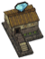](../files/Buildings_Jeweler_Level1.png.md) | 提升初始球等级。 | [真菌森林（The FUNGALxFOREST）](The_FUNGALxFOREST.md)  |
| [死灵法师（Necromancer）](Necromancer.md) | [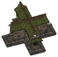](../files/Buildings_Necromancer_Level1.png.md) | 每场战斗中，当你死亡时，将以较低的生命值复活，并杀死所有附近的敌人。 | [真菌森林（The FUNGALxFOREST）](The_FUNGALxFOREST.md)  |
| [银行（Bank）](Bank.md) | [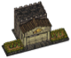](../files/Buildings_Bank_Level1.png.md) | 增加战斗中获得的金币数量。 | [边境沙漠（The LIMINALxDESERT）](The_LIMINALxDESERT.md)  |
| [匹配机（Matchmaker）](Matchmaker.md) | [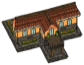](../files/Buildings_Matchmaker_Level1.png.md) | 允许你选择两名角色带入单局游戏，并融合两者的能力。 | [真菌森林（The FUNGALxFOREST）](The_FUNGALxFOREST.md)  |
| [磁铁工厂（Magnet Factory）](Magnet_Factory.md) | [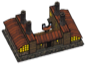](../files/Buildings_Magnet_Factory_Level1.png.md) | 增加拾取范围。 | [边境沙漠（The LIMINALxDESERT）](The_LIMINALxDESERT.md)  |
| [蜡烛作坊（Candle Maker）](Candle_Maker.md) |  | 融合反应堆所需的升级次数下限更高。 | [阴燃深渊（The SMOLDERINGxDEPTHS）](The_SMOLDERINGxDEPTHS.md)  |
| [赌徒巢穴（Gambler's Den）](Gambler_s_Den.md) |  | 战斗中可免费重新进行升级尝试。 | [血腥草原（The GORYxGRASSLANDS）](The_GORYxGRASSLANDS.md)  |
| [赌场（Casino）](Casino.md) |  | 降低升级重投成本。 | [真菌森林（The FUNGALxFOREST）](The_FUNGALxFOREST.md)  |
| [许愿池（Wishing Well）](Wishing_Well.md) |  | 升级时会增加获得额外升级点的几率。 | [阴燃深渊（The SMOLDERINGxDEPTHS）](The_SMOLDERINGxDEPTHS.md)  |
| [进化舱](Evolution_Chamber_Building.md) |  | 新球都从 2 级开始。 | [天堂之门（The HEAVENLYxGATES）](The_HEAVENLYxGATES.md)  |
| [遗物收集者](Relic_Collector_Building.md) |  | 新被动道具均从 2 级开始生效。 | [天堂之门（The HEAVENLYxGATES）](The_HEAVENLYxGATES.md)  |
| [冥想帐篷（Meditation Tent）](Meditation_Tent.md) |  | 升级时的可选项数量增加至 4 个。 | [阴燃深渊（The SMOLDERINGxDEPTHS）](The_SMOLDERINGxDEPTHS.md)  |
| [驱魔人（Exorcist）](Exorcist.md) |  | 升级时会添加驱逐类升级。 | [骸骨墓园（The BONExYARD）](The_BONExYARD.md)  |
| [宝石匠（Gemsmith）](Gemsmith.md) |  | 每场战斗开始时，可以选择额外一个球。 | [血腥草原（The GORYxGRASSLANDS）](The_GORYxGRASSLANDS.md)  |
| [古董店（Antique Shop）](Antique_Shop.md) |  | 每场战斗都从选择一个被动技能开始。 | [血腥草原（The GORYxGRASSLANDS）](The_GORYxGRASSLANDS.md)  |
| [作战室（War Room）](War_Room.md) |  | 派遣角色自行完成关卡。 | [阴燃深渊（The SMOLDERINGxDEPTHS）](The_SMOLDERINGxDEPTHS.md)  |
| [包装机](Bag_Maker_Building.md) |  | 增加1个圆球槽位。 | [天堂之门（The HEAVENLYxGATES）](The_HEAVENLYxGATES.md)  |
| [木匠](Carpenter_Building.md) |  | 增加1个被动技能位 | [天堂之门（The HEAVENLYxGATES）](The_HEAVENLYxGATES.md)  |
| [冒险者公会（Adventurer's Guild）](Adventurer_s_Guild.md) |  | 解锁击败首领后无限次继续探索关卡的能力。 | [白雪海岸（The SNOWYxSHORES）](The_SNOWYxSHORES.md)  |

## 住房

住房包含所有能解锁角色并赋予其相应被动建筑增益的建筑。

所有角色在使用前都需要找到并建造各自的住房蓝图才能使用（[战士](The_Warrior.md)  默认已解锁，以及通过启用 Twitch 扩展功能解锁的 [伪救世主](The_False_Messiah.md)  除外）。拆除角色的住宅会将其从所有建筑任务中移除，并使其在收获模式或深坑奔跑中无法使用，直到其住宅重建为止（尽管该角色仍保留之前的所有属性、经验值、收获升级和等级通关记录）。与其他建筑不同，住房建筑通过增加相应角色的 [永久等级](Character_Level_Mechanics.md)来获取和升级其被动收益，而不是消耗资源，升级过程瞬间完成，无需反弹/建造点数。通常，当角色达到等级 4 时，其住宅会获得独特能力，随后在等级 7 和 9 时对该技能（以及建筑本身的等级）进行升级。{?TODO: 查找每个被动能力解锁和升级的等级要求及描述} 建造所有住房结构可获得“邻里”成就。

{?TODO: 针对各种效果建筑的最佳住房布局，例如豪宅、老兵小屋、队长宿舍}

### 住房建筑一览

| 建筑名称 | 图片 | 说明 | 蓝图位置 |
| --- | --- | --- | --- |
| [警长办公室（Sheriff's Office）](Sheriff_s_Office.md) |  | [快枪手（The Itchy Finger）](The_Itchy_Finger.md)  的房子。 | [骸骨墓园（The BONExYARD）](The_BONExYARD.md)  |
| [鬼屋（Haunted House）](Haunted_House.md) |  | [忏悔者（The Repentant）](The_Repentant.md)  的住宅。 | [骸骨墓园（The BONExYARD）](The_BONExYARD.md)  |
| [剧场（Theater）](Theater.md) |  | [杂耍者（The Juggler）](The_Juggler.md)  的房子。 | [血腥草原（The GORYxGRASSLANDS）](The_GORYxGRASSLANDS.md)  |
| [舒适的家（Cozy Home）](Cozy_Home.md) |  | [同居者（The Cohabitants）](The_Cohabitants.md)  的房子。 | [骸骨墓园（The BONExYARD）](The_BONExYARD.md)  |
| [别墅（Villa）](Villa.md) |  | [沉思者（The Cogitator）](The_Cogitator.md)  的住宅。 | [白雪海岸（The SNOWYxSHORES）](The_SNOWYxSHORES.md)  |
| [陵墓（Mausoleum）](Mausoleum.md) |  | [暗影（The Shade）](The_Shade.md)  的房子。 | [边境沙漠（The LIMINALxDESERT）](The_LIMINALxDESERT.md)  |
| [铁堡（Iron Fortress）](Iron_Fortress.md) |  | [持盾者（The Shieldbearer）](The_Shieldbearer.md)  的住宅。 | [真菌森林（The FUNGALxFOREST）](The_FUNGALxFOREST.md)  |
| [队长宿舍（Captain's Quarters）](Captain_s_Quarters.md) |  | [战术家（The Tactician）](The_Tactician.md)  的房子。 | [阴燃深渊（The SMOLDERINGxDEPTHS）](The_SMOLDERINGxDEPTHS.md)  |
| [露营地（Campground）](Campground.md) |  | [激进者（The Radical）](The_Radical.md)  的住宅。 | [天堂之门（The HEAVENLYxGATES）](The_HEAVENLYxGATES.md)  |
| [独栋住宅（Single Family Home）](Single_Family_Home.md) |  | [空巢者（The Empty Nester）](The_Empty_Nester.md)  的房子。 | [白雪海岸（The SNOWYxSHORES）](The_SNOWYxSHORES.md)  |
| [岩石山丘（Rocky Hill）](Rocky_Hill.md) |  | [临时西西弗斯（The Makeshift Sisyphus）](The_Makeshift_Sisyphus.md)  的住所。 | [边境沙漠（The LIMINALxDESERT）](The_LIMINALxDESERT.md)  |
| [修道院（Monastery）](Monastery.md) |  | [自笞者（The Flagellant）](The_Flagellant.md)  的房子。 | [血腥草原（The GORYxGRASSLANDS）](The_GORYxGRASSLANDS.md)  |
| [实验室（Laboratory）](Laboratory.md) |  | [物理学家（The Physicist）](The_Physicist.md)  的房子。 | [真菌森林（The FUNGALxFOREST）](The_FUNGALxFOREST.md)  |
| [老兵小屋（Veteran's Hut）](Veteran_s_Hut.md) |  | [潜伏者（The Embedded）](The_Embedded.md)  的房子。 | [白雪海岸（The SNOWYxSHORES）](The_SNOWYxSHORES.md)  |
| [豪宅（Mansion）](Mansion.md) |  | [挥霍者（The Spendthrift）](The_Spendthrift.md)  的房子。 | [真菌森林（The FUNGALxFOREST）](The_FUNGALxFOREST.md)  |
| [驯鹰小屋（Falconry Hut）](Falconry_Hut.md) |  | [驯鹰人（The Falconer）](The_Falconer.md)  的住宅。 | [天堂之门（The HEAVENLYxGATES）](The_HEAVENLYxGATES.md)  |
| [派对之家（Party House）](Party_House.md) |  | [畅饮者（The Carouser）](The_Carouser.md)  的住宅。 | [浩瀚虚空（The VASTxVOID）](The_VASTxVOID.md)  |
| [石之领域（Stone Domain）](Stone_Domain.md) |  | [掘地者（The Tunneller）](The_Tunneller.md)  的住宅。 | [阴燃深渊（The SMOLDERINGxDEPTHS）](The_SMOLDERINGxDEPTHS.md)  |
| [隐秘神殿（Hidden Temple）](Hidden_Temple.md) |  | [蹑足者（The Tiptoer）](The_Tiptoer.md)  的房子。 | [阴燃深渊（The SMOLDERINGxDEPTHS）](The_SMOLDERINGxDEPTHS.md)  |
| [圆球屋（Ball House）](Ball_House.md) |  | [持球者（The Ballbearer）](The_Ballbearer.md)  的房子。 | [浩瀚虚空（The VASTxVOID）](The_VASTxVOID.md)  |
| [不稳定塔（Unstable Tower）](Unstable_Tower.md) |  | [白发囤积者（The Hoary Hoarder）](The_Hoary_Hoarder.md)  的房子。 | [天堂之门（The HEAVENLYxGATES）](The_HEAVENLYxGATES.md)  |

**分类**　[分类 · 待完善](../categories/Stubs.md)

[返回总入口](../%E7%90%83%E6%AF%94%E4%BC%A6%E6%88%98%E8%AE%B0%20Wiki.md) · [返回本分目录](%E7%9B%AE%E5%BD%95.md)
