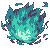

# 灼烧（Burn）

在击中时添加1堆燃烧3/3/5秒 (最大3/3/5堆)。烧伤单位每堆每秒损坏4-8/7-11/7-11。

[原文与贡献者记录](https://ballxpit.wiki.gg/wiki/Burn) · [修订 4085](https://ballxpit.wiki.gg/index.php?oldid=4085) · [返回目录](../%E7%90%83%E6%AF%94%E4%BC%A6%E6%88%98%E8%AE%B0%20Wiki.md)

#### 一般信息

##### 开始的性格

[快枪手](The_Itchy_Finger.md) 

##### 解锁

默认解锁

##### 状态效果（Status Effects）

[灼烧](https://ballxpit.wiki.gg/wiki/Status_Effects?action=edit&redlink=1)

##### 由于状态影响

命中时

#### 发展情况（Evolutions）

##### 演变为

[驱逐的火焰](Banished_Flame.md) 、 [贝尔塞克](Berserk.md) 、 [炸弹](Bomb.md) 、 [硫磺](Brimstone.md) 、 [基本](Elemental.md) 、 [烟花](Fireworks.md) 、 [冰冻火焰](Frozen_Flame.md) 、 [在地狱里](Inferno.md) 、 [马格玛](Magma.md) 、 [太阳](Sun.md) 

**灼烧** 是一个开始 [球](Balls.md) 的 [快枪手](The_Itchy_Finger.md)  在每场比赛开始时，它会被解锁。 *[球比伦战记](Ball_x_Pit.md)*像大多数球一样, **灼烧** 在击中敌人时，它也适用于 (1) 堆积的 [灼烧](https://ballxpit.wiki.gg/wiki/Status_Effects?action=edit&redlink=1).

当与其他球结合时，直接的伤害会增加,

#### 关卡

| 等级 | 伤害 | 影响 |
| --- | --- | --- |
| 1 |  x(3.5至6.5) | 在击中时添加1堆燃烧3秒 (最高3堆)。烧毁的单元每堆损坏4-8秒。 ／ |
| 2 |  x(3.5至6.5) | 在击中时添加1堆燃烧3秒 (最高3堆)。烧毁的单元每秒损坏7-11堆。 ／ |
| 3 |  x(3.5至6.5) | 在击中时添加1堆燃烧,5秒 (最多5堆燃烧) 燃烧单位每秒损坏7-11堆。 ／ |

#### 发展情况

| 组合 | 进化 |
| --- | --- |
|  灼烧（Burn） + [黑暗（Dark）](Dark.md)  | [驱逐的火焰（Banished Flame）](Banished_Flame.md)  |
|  灼烧（Burn） + [迷人（Charm）](Charm.md)  | [贝尔塞克（Berserk）](Berserk.md)  |
|  灼烧（Burn） + [铁（Iron）](Iron.md)  | [炸弹（Bomb）](Bomb.md) （\*） |
|  灼烧（Burn） + [中毒（Poison）](Poison.md)  ／  灼烧（Burn） + [石头（Stone）](Stone.md)  | [硫磺（Brimstone）](Brimstone.md)  |
|  灼烧（Burn） + [风（Wind）](Wind.md)  + [冻结（Freeze）](Freeze.md)  + [地震（Earthquake）](Earthquake.md)  | [基本（Elemental）](Elemental.md)  |
|  灼烧（Burn） + [蛋袋（Egg Sac）](Egg_Sac.md)  | [烟花（Fireworks）](Fireworks.md)  |
|  灼烧（Burn） + [冻结（Freeze）](Freeze.md)  | [冰冻火焰（Frozen Flame）](Frozen_Flame.md)  |
|  灼烧（Burn） + [时间（Time）](Time.md)  ／  灼烧（Burn） + [风（Wind）](Wind.md)  | [在地狱里（Inferno）](Inferno.md) （\*） |
|  灼烧（Burn） + [地震（Earthquake）](Earthquake.md)  | [马格玛（Magma）](Magma.md)  |
|  灼烧（Burn） + [光（Light）](Light.md)  | [太阳（Sun）](Sun.md) （\*） |

* 可以进一步发展。

#### 策略

结合 **灼烧** 通过分成更多球或处理范围效果伤害可以成为传播 [灼烧](https://ballxpit.wiki.gg/wiki/Status_Effects?action=edit&redlink=1) 需要注意的是: [灼烧](https://ballxpit.wiki.gg/wiki/Status_Effects?action=edit&redlink=1) 这意味着您不再可以使用效果来增加所造成的伤害。

#### 更新记录

#### 冷知识

#### 图片库

[共享导航](../navigation/nav-63012059ef49.md)

**分类**　[分类 · 基础圆球](../categories/Base_Balls.md) · [分类 · 圆球](../categories/Balls.md) · [分类 · 页面有导航框](../categories/Pages_with_navboxes.md)

[返回总入口](../%E7%90%83%E6%AF%94%E4%BC%A6%E6%88%98%E8%AE%B0%20Wiki.md) · [返回本分目录](%E7%9B%AE%E5%BD%95.md)
