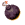

# 灼烧（Burn）

添加1层命中时灼烧效果，持续3/3/5秒（最多3/3/5层）。被灼烧的单位每秒每层会受到4-8/7-11/7-11点伤害。

[原文与贡献者记录](https://ballxpit.wiki.gg/wiki/Burn) · [修订 4085](https://ballxpit.wiki.gg/index.php?oldid=4085) · [返回目录](../%E7%90%83%E6%AF%94%E4%BC%A6%E6%88%98%E8%AE%B0%20Wiki.md)

## 基本信息

### 初始角色（Starting Character）

[快枪手](The_Itchy_Finger.md) 

### 解锁

默认解锁

### 状态效果（Status Effects）

[灼烧](https://ballxpit.wiki.gg/wiki/Status_Effects?action=edit&redlink=1)

### 由状态效果触发

命中时

## 进化（Evolutions）

### 进化成

[放逐之焰](Banished_Flame.md) 、 [狂暴](Berserk.md) 、 [炸弹](Bomb.md) 、 [硫磺](Brimstone.md) 、 [元素](Elemental.md) 、 [烟花](Fireworks.md) 、 [冰冻火焰](Frozen_Flame.md) 、 [炼狱](Inferno.md) 、 [岩浆](Magma.md) 、 [太阳](Sun.md) 

**灼烧** 是起始状态 [圆球](Balls.md) 的 [快枪手](The_Itchy_Finger.md) . 在每局游戏开始时即可解锁。 *[球比伦战记](Ball_x_Pit.md)*. 和大多数球一样， **灼烧** 在撞击敌人时发生碰撞并造成伤害。撞击敌人后，还会施加（1）层效果。 [灼烧](https://ballxpit.wiki.gg/wiki/Status_Effects?action=edit&redlink=1).

与其他球结合使用时，直接伤害会增加，且效果相互叠加。

## 关卡

| 等级 | 伤害 | 效果 |
| --- | --- | --- |
| 1 |  x(3.5 至 6.5) | 每命中时添加1层灼烧效果，持续3秒（最多3层）。被灼烧的单位每秒每层会受到4-8点伤害。 |
| 2 |  x(3.5 至 6.5) | 每命中时添加1层灼烧效果，持续3秒（最多3层）。被灼烧的单位每秒每层会受到7-11点伤害。 |
| 3 |  x(3.5 至 6.5) | 添加1层命中时灼烧效果，持续5秒（最多5层）。被灼烧的单位每秒每层会受到7-11点伤害。 |

## 进化

| 组合 | 进化 |
| --- | --- |
|  灼烧（Burn） + [黑暗（Dark）](Dark.md)  | [放逐之焰（Banished Flame）](Banished_Flame.md)  |
|  灼烧（Burn） + [魅惑（Charm）](Charm.md)  | [狂暴（Berserk）](Berserk.md)  |
|  灼烧（Burn） + [铁（Iron）](Iron.md)  | [炸弹（Bomb）](Bomb.md) （\*） |
|  灼烧（Burn） + [中毒（Poison）](Poison.md)  ／  灼烧（Burn） + [石头（Stone）](Stone.md)  | [硫磺（Brimstone）](Brimstone.md)  |
|  灼烧（Burn） + [风（Wind）](Wind.md)  + [冻结（Freeze）](Freeze.md)  + [地震（Earthquake）](Earthquake.md)  | [元素（Elemental）](Elemental.md)  |
|  灼烧（Burn） + [卵囊（Egg Sac）](Egg_Sac.md)  | [烟花（Fireworks）](Fireworks.md)  |
|  灼烧（Burn） + [冻结（Freeze）](Freeze.md)  | [冰冻火焰（Frozen Flame）](Frozen_Flame.md)  |
|  灼烧（Burn） + [时间（Time）](Time.md)  ／  灼烧（Burn） + [风（Wind）](Wind.md)  | [炼狱（Inferno）](Inferno.md) （\*） |
|  灼烧（Burn） + [地震（Earthquake）](Earthquake.md)  | [岩浆（Magma）](Magma.md)  |
|  灼烧（Burn） + [光（Light）](Light.md)  | [太阳（Sun）](Sun.md) （\*） |

* 可以进一步进化。

## 策略

将 **灼烧**与分裂成多个子弹或造成范围效果伤害的子弹结合使用，是扩散 [灼烧](https://ballxpit.wiki.gg/wiki/Status_Effects?action=edit&redlink=1)效果的好方法。请注意，[灼烧](https://ballxpit.wiki.gg/wiki/Status_Effects?action=edit&redlink=1)具有最大层数限制。达到该限制后，你将无法再使用该效果来增加伤害。

## 更新记录

## 冷知识

## 图片库

[共享导航](../navigation/nav-63012059ef49.md)

**分类**　[分类 · 基础圆球](../categories/Base_Balls.md) · [分类 · 圆球](../categories/Balls.md) · [分类 · 带有导航框的页面](../categories/Pages_with_navboxes.md)

[返回总入口](../%E7%90%83%E6%AF%94%E4%BC%A6%E6%88%98%E8%AE%B0%20Wiki.md) · [返回本分目录](%E7%9B%AE%E5%BD%95.md)
