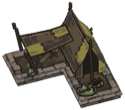

# 露营地（Campground）

[原文与贡献者记录](https://ballxpit.wiki.gg/wiki/Campground) · [修订 3398](https://ballxpit.wiki.gg/index.php?oldid=3398) · [返回目录](../%E7%90%83%E6%AF%94%E4%BC%A6%E6%88%98%E8%AE%B0%20Wiki.md)

[激进者](The_Radical.md)  的住宅。

## 信息（Information）

### 分类（Category）

住房

### 子类（Subcategory）

住房

### 蓝图位置（Blueprint location）

[天堂之门](The_HEAVENLYxGATES.md) 

### 基础资源消耗（Base resource cost）

 120  20

### 建造点消耗（Build point cost）

35

**露营地** 是 *[球比伦战记](Ball_x_Pit.md)* 中的一座角色房屋[建造](Buildings.md)，建造露营地即可解锁 [激进者](The_Radical.md)  作为可游玩 [角色](Characters.md)。一旦 [角色获得足够的经验值](Character_Level_Mechanics.md) 达到等级4，这座建筑就会解锁一项被动能力：附近含  木材的资源格再生速度更快。该建筑的能力不通过直接升级建筑本身来提升，而是随角色等级的提升而增强。注意，拆除角色的房屋将使该角色在收获模式或升级过程中无法使用，并将其从任何建筑任务中移除，直到其房屋重建为止（尽管该角色仍会保留之前的所有进度）。

被动效果与升级

| 等级 | 图片 | 说明 | 资源消耗 | 建造点消耗 | 拆除 | 角色等级要求 |
| --- | --- | --- | --- | --- | --- | --- |
| 1 |  | 一个为激进者准备的房子。 |  120  20 | 35 |  120  20 | - |
| 1 | - | 一个为激进者准备的房子。 附近的森林再生速度提高25%。 | - | - |  120  20 | 4 |
| 2 | - | 一个为激进者准备的房子。 附近的森林再生速度提高35%。 | - | - |  120  20 | 7 |
| 3 | - | 一个为激进者准备的房子。 附近的森林再生速度提高45%。 | - | - |  120  20 | 9 |

[共享导航](../navigation/nav-d4956b01aa56.md)

**分类**　[分类 · 建筑](../categories/Buildings.md) · [分类 · 住房](../categories/Housing.md) · [分类 · 带有导航框的页面](../categories/Pages_with_navboxes.md)

[返回总入口](../%E7%90%83%E6%AF%94%E4%BC%A6%E6%88%98%E8%AE%B0%20Wiki.md) · [返回本分目录](%E7%9B%AE%E5%BD%95.md)
