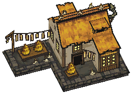

# 蜡烛作坊（Candle Maker）

聚变反应堆包含增加的最低升级次数。

[原文与贡献者记录](https://ballxpit.wiki.gg/wiki/Candle_Maker) · [修订 3378](https://ballxpit.wiki.gg/index.php?oldid=3378) · [返回目录](../%E7%90%83%E6%AF%94%E4%BC%A6%E6%88%98%E8%AE%B0%20Wiki.md)

#### 信息（Information）

##### 分类（Category）

战争

##### 子类（Subcategory）

总

##### 蓝图位置（Blueprint location）

[SMOLDERINGxDEPTHS](The_SMOLDERINGxDEPTHS.md)

##### 基础资源消耗（Base resource cost）

 1,500  200  20

##### 建造点消耗（Build point cost）

75

建造蜡烛制造厂增加了每辆核聚变反应堆小卡车允许的免费升级的最低数量，建筑物的升级进一步提高了这一最低数量。 但请注意，根据小卡车现有升级数量确定的限制仍然适用。

被动效果与升级

| 等级 | 图片 | 描述 | 资源消耗 | 建造点消耗 | 拆除 |
| --- | --- | --- | --- | --- | --- |
| 1 |  | 融合反应堆至少有2次免费升级。 |  1,500  200  20 | 75 |  1,500  200  20 |
| 2 |  | 融合反应堆至少有3次免费升级。 |  5,000  500  40 | 75 |  6,500  700  20  40 |

[共享导航](../navigation/nav-d4956b01aa56.md)

**分类**　[分类 · 建筑](../categories/Buildings.md) · [分类 · 战争](../categories/Warfare.md) · [分类 · 总](../categories/General.md) · [分类 · 页面有导航框](../categories/Pages_with_navboxes.md)

[返回总入口](../%E7%90%83%E6%AF%94%E4%BC%A6%E6%88%98%E8%AE%B0%20Wiki.md) · [返回本分目录](%E7%9B%AE%E5%BD%95.md)
