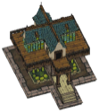

# 议事殿（Capitolium）

获得  领导力加成。可无限升级。

[原文与贡献者记录](https://ballxpit.wiki.gg/wiki/Capitolium) · [修订 3354](https://ballxpit.wiki.gg/index.php?oldid=3354) · [返回目录](../%E7%90%83%E6%AF%94%E4%BC%A6%E6%88%98%E8%AE%B0%20Wiki.md)

## 信息（Information）

### 分类（Category）

战争

### 子类（Subcategory）

属性加成

### 蓝图位置（Blueprint location）

[浩瀚虚空](The_VASTxVOID.md)

### 基础资源消耗（Base resource cost）

 80  20

### 建造点消耗（Build point cost）

50

作为六座可无限升级的属性加成建筑之一，Capitolium 为所有角色在建造时提供  领导力的额外加成。与基础六种属性加成建筑不同，该建筑在5级后没有上限，且可无限次升级，每级增加1点属性点数。不过，每级资源消耗呈指数级增长，建造点消耗则呈线性增长，但最终会达到1050的上限。与其他建筑一样，拆除后仍可全额退还截至该阶段在建造和升级过程中投入的所有资源。当 [战术家](The_Tactician.md)  解锁该能力后，将该建筑放置在 [队长宿舍](Captain_s_Quarters.md) 的效果区域时，可额外获得+1的加成。建造该建筑可获得“纪念碑”成就，升级至5级则可获得“结构力量”成就。

被动效果与升级

| 图片 | 说明 | 资源消耗 | 建造点消耗 | 拆除 |
| --- | --- | --- | --- | --- |
|  | 获得 +1 领导力加成 。可无限升级。或每等级额外获得 +1 领导力加成 。 |  80  20 | 50 |  80  20 |

|  |  |  |  |
| --- | --- | --- | --- |
|  | [升级到下一等级的成本](Buildings.md#%E5%8F%AF%E6%97%A0%E9%99%90%E5%8D%87%E7%BA%A7%E7%9A%84%E5%BB%BA%E7%AD%91) |  |  |
| 等级 |  |  | 建造点 |
| 1 | 200 | 40 | 50 |
| 2 | 300 | 60 | 150 |
| 3 | 400 | 80 | 250 |
| 4 | 500 | 100 | 350 |
| 5 | 600 | 120 | 450 |
| 6 | 2,200 | 440 | 550 |
| 7 | 2,600 | 520 | 650 |
| 8 | 3,000 | 600 | 750 |
| 9 | 3,400 | 680 | 850 |
| 10 | 3,800 | 760 | 950 |
| 11 | 8,200 | 1,640 | 1050 |
| 12 | 9,000 | 1,800 | 1050 |
| 13 | 9,800 | 1,960 | 1050 |
| 14 | 10,600 | 2,120 | 1050 |
| 15 | 11,400 | 2,280 | 1050 |
| 16 | 24,200 | 4,840 | 1050 |
| 17 | 25,800 | 5,160 | 1050 |
| 18 | 27,400 | 5,480 | 1050 |
| 19 | 29,000 | 5,800 | 1050 |
| 20 | 30,600 | 6,120 | 1050 |
| 21 | 64,200 | 12,840 | 1050 |
| 22 | 67,400 | 13,480 | 1050 |
| 23 | 70,600 | 14,120 | 1050 |
| 24 | 73,800 | 14,760 | 1050 |
| 25 | 77,000 | 15,400 | 1050 |
| 26 | 160,200 | 32,040 | 1050 |
| 27 | 166,600 | 33,320 | 1050 |
| 28 | 173,000 | 34,600 | 1050 |
| 29 | 179,400 | 35,880 | 1050 |
| 30 | 185,800 | 37,160 | 1050 |
| 31 | 384,200 | 76,840 | 1050 |
| 32 | 397,000 | 79,400 | 1050 |
| 33 | 409,800 | 81,960 | 1050 |
| 34 | 422,600 | 84,520 | 1050 |
| 35 | 435,400 | 87,080 | 1050 |
| 36 | 448,200 | 89,640 | 1050 |
| 37 | 461,000 | 92,200 | 1050 |
| 38 | 473,800 | 94,760 | 1050 |
| 39 | 486,600 | 97,320 | 1050 |
| 40 | 499,400 | 99,880 | 1050 |
| 41 | 512,200 | 102,440 | 1050 |
| 42 | 525,000 | 105,000 | 1050 |
| 43 | 537,800 | 107,560 | 1050 |
| 44 | 550,600 | 110,120 | 1050 |
| 45 | 563,400 | 112,680 | 1050 |
| 46 | 576,200 | 115,240 | 1050 |
| 47 | 589,000 | 117,800 | 1050 |
| 48 | 601,800 | 120,360 | 1050 |
| 49 | 614,600 | 122,920 | 1050 |
| 50 | 627,400 | 125,480 | 1050 |

[共享导航](../navigation/nav-d4956b01aa56.md)

**分类**　[分类 · 建筑](../categories/Buildings.md) · [分类 · 战争](../categories/Warfare.md) · [分类 · 属性加成](../categories/Stat_Bonuses.md) · [分类 · 带有导航框的页面](../categories/Pages_with_navboxes.md)

[返回总入口](../%E7%90%83%E6%AF%94%E4%BC%A6%E6%88%98%E8%AE%B0%20Wiki.md) · [返回本分目录](%E7%9B%AE%E5%BD%95.md)
