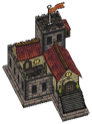

# 队长宿舍（Captain's Quarters）

[原文与贡献者记录](https://ballxpit.wiki.gg/wiki/Captain%27s_Quarters) · [修订 3397](https://ballxpit.wiki.gg/index.php?oldid=3397) · [返回目录](../%E7%90%83%E6%AF%94%E4%BC%A6%E6%88%98%E8%AE%B0%20Wiki.md)

[战术家](The_Tactician.md)  的房子。

## 信息（Information）

### 分类（Category）

住房

### 子类（Subcategory）

住房

### 蓝图位置（Blueprint location）

[阴燃深渊](The_SMOLDERINGxDEPTHS.md) 

### 基础资源消耗（Base resource cost）

 50  40

### 建造点消耗（Build point cost）

35

建造队长宿舍将解锁[战术家](The_Tactician.md)  作为可玩角色。当该角色获得足够的经验值达到等级{?TODO查找宿舍奖励所需的角色等级要求}时，这座建筑将解锁一项被动效果：在其效果区域内，每有一个属性加成建筑，队长宿舍将为该属性提供额外的+1加成（这还包括了该属性的基础版本和无限升级版本作为单独的加成）。与其他住房建筑不同，这座建筑的效果无法进一步改进或升级。请注意，拆除角色的住宅将使该角色在收获模式或等级提升中无法使用，并会将其从所有建筑任务中移除，直到其住宅重建为止（尽管该角色仍会保留之前的所有进度）。

被动效果与升级

| 等级 | 图片 | 说明 | 资源消耗 | 建造点消耗 | 拆除 | 角色等级要求 |
| --- | --- | --- | --- | --- | --- | --- |
| 1 |  | 供战术家使用的房屋。 |  50  40 | 35 |  50  40 | - |
| 2 | - | 供战术家使用的房屋。 附近提供属性加成的建筑会再提供 +1 对应属性（力量、敏捷、智力、速度、耐力、领导力）。 | - | - |  50  40 |  |

[共享导航](../navigation/nav-d4956b01aa56.md)

**分类**　[分类 · 建筑](../categories/Buildings.md) · [分类 · 住房](../categories/Housing.md) · [分类 · 带有导航框的页面](../categories/Pages_with_navboxes.md)

[返回总入口](../%E7%90%83%E6%AF%94%E4%BC%A6%E6%88%98%E8%AE%B0%20Wiki.md) · [返回本分目录](%E7%9B%AE%E5%BD%95.md)
