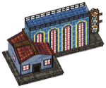
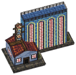

# 赌场（Casino）

降低升级重投成本。

[原文与贡献者记录](https://ballxpit.wiki.gg/wiki/Casino) · [修订 3380](https://ballxpit.wiki.gg/index.php?oldid=3380) · [返回目录](../%E7%90%83%E6%AF%94%E4%BC%A6%E6%88%98%E8%AE%B0%20Wiki.md)

## 信息（Information）

### 分类（Category）

战争

### 子类（Subcategory）

将军

### 蓝图位置（Blueprint location）

[真菌森林](The_FUNGALxFOREST.md)

### 基础资源消耗（Base resource cost）

 400

### 建造点消耗（Build point cost）

5

建造赌场可以降低战斗中升级重投的成本，通过建造升级，这一成本降低幅度还可以进一步增加。即使使用完了 [赌徒巢穴](Gambler_s_Den.md)提供的免费重投机会，这种成本降低效果依然适用。

被动效果与升级

| 等级 | 图片 | 说明 | 资源消耗 | 建造点消耗 | 拆除 |
| --- | --- | --- | --- | --- | --- |
| 1 |  | 将升级重投成本降低20%。 |  400 | 5 |  400 |
| 2 |  | 将升级重投成本降低40%。 |  1,000 | 5 |  1,400 |
| 3 |  | 将升级重投成本降低60%。 |  1,500 | 15 |  2,900 |

[共享导航](../navigation/nav-d4956b01aa56.md)

**分类**　[分类 · 建筑](../categories/Buildings.md) · [分类 · 战争](../categories/Warfare.md) · [分类 · 通用](../categories/General.md) · [分类 · 带有导航框的页面](../categories/Pages_with_navboxes.md)

[返回总入口](../%E7%90%83%E6%AF%94%E4%BC%A6%E6%88%98%E8%AE%B0%20Wiki.md) · [返回本分目录](%E7%9B%AE%E5%BD%95.md)
