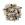
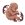
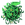
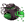
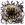

# 细胞（Cell）

命中时分裂为2/3/4个分身。

[原文与贡献者记录](https://ballxpit.wiki.gg/wiki/Cell) · [修订 4182](https://ballxpit.wiki.gg/index.php?oldid=4182) · [返回目录](../%E7%90%83%E6%AF%94%E4%BC%A6%E6%88%98%E8%AE%B0%20Wiki.md)

## 基本信息

### 初始角色（Starting Character）

-

### 解锁

通关真菌森林

### 命中效果（On-Hit Effects）

生成

### 状态效果（Status Effects）

生成分身

### 由状态效果触发

命中时、生成时

## 进化（Evolutions）

### 进化成

[蛆虫](Maggot.md) , [后代](Offspring.md) , [疯长](Overgrowth.md) , [辐射束](Radiation_Beam.md) , [病毒](Virus.md) , [丰满的卵囊](Voluptuous_Egg_Sac.md) 

**细胞** 是 *[球比伦战记](Ball_x_Pit.md)* 基础游戏版本中加入的一种 [基础圆球](Balls.md#%E5%9F%BA%E7%A1%80%E5%9C%86%E7%90%83)，通关 [真菌森林](The_FUNGALxFOREST.md) 后解锁。

## 关卡

| 等级 | 伤害 | 效果 |
| --- | --- | --- |
| 1 |  x(3.5 至 6.5) | 命中时分裂出一个分身，最多触发 2 次。 |
| 2 |  x(3.5 至 6.5) | 命中时分裂出一个分身，最多触发 3 次。 |
| 3 |  x(3.5 至 6.5) | 命中时分裂出一个分身，最多触发 4 次。 |

## 进化

| 组合 | 进化 |
| --- | --- |
|  细胞（Cell） + [育巢母体（Brood Mother）](Brood_Mother.md)  | [蛆虫（Maggot）](Maggot.md)  |
|  细胞（Cell） + [肉身（Flesh）](Flesh.md)  | [后代（Offspring）](Offspring.md)  |
|  细胞（Cell） + [地震（Earthquake）](Earthquake.md)  | [疯长（Overgrowth）](Overgrowth.md)  |
|  细胞（Cell） + [激光（水平）（Laser (Horizontal)）](Laser_Horizontal.md)  ／  细胞（Cell） + [激光（垂直）（Laser (Vertical)）](Laser_Vertical.md)  | [辐射束（Radiation Beam）](Radiation_Beam.md) （\*） |
|  细胞（Cell） + [中毒（Poison）](Poison.md)  | [病毒（Virus）](Virus.md)  |
|  细胞（Cell） + [卵囊（Egg Sac）](Egg_Sac.md)  | [丰满的卵囊（Voluptuous Egg Sac）](Voluptuous_Egg_Sac.md)  |

* 可以进一步进化。

## 策略

## 更新记录

## 冷知识

## 图片库

[共享导航](../navigation/nav-63012059ef49.md)

**分类**　[分类 · 基础圆球](../categories/Base_Balls.md) · [分类 · 圆球](../categories/Balls.md) · [分类 · 带有导航框的页面](../categories/Pages_with_navboxes.md)

[返回总入口](../%E7%90%83%E6%AF%94%E4%BC%A6%E6%88%98%E8%AE%B0%20Wiki.md) · [返回本分目录](%E7%9B%AE%E5%BD%95.md)
