# 角色（Characters）

[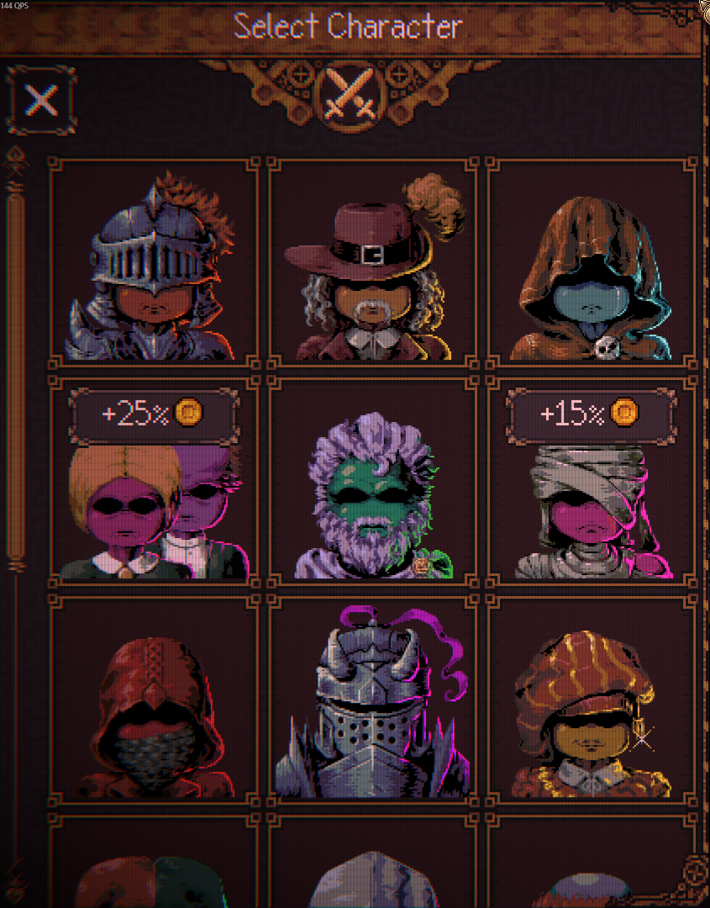](../files/Characters_Menu.png.md)

[原文与贡献者记录](https://ballxpit.wiki.gg/wiki/Characters) · [修订 4357](https://ballxpit.wiki.gg/index.php?oldid=4357) · [返回目录](../%E7%90%83%E6%AF%94%E4%BC%A6%E6%88%98%E8%AE%B0%20Wiki.md)

角色选择菜单

*[《球比伦战记》](Ball_x_Pit.md)*目前有**23 名可玩角色**。每名角色都有专属能力（*战士除外*），并携带指定的[基础圆球](Balls.md#%E5%9F%BA%E7%A1%80%E5%9C%86%E7%90%83)（*白发囤积者除外*）。游戏初始仅解锁[战士](The_Warrior.md) ，其他角色随游戏进度解锁。解锁后即可用这些角色挑战关卡。除了[伪救世主](The_False_Messiah.md) ，角色也可以参加收获，或被分配到[建筑](Buildings.md)工作。

要解锁其他角色，需要建造其专属[住房](Buildings.md#%E4%BD%8F%E6%88%BF)。在特定[关卡](Levels.md)中击败敌人或首领，有机会获得对应的住房蓝图。[伪救世主](The_False_Messiah.md) 只在 PC 版提供，激活[Twitch](https://www.twitch.tv)扩展即可解锁。拆掉角色住房或停用该扩展后，对应角色将无法出战、收获或被分配到建筑。恢复住房或扩展后，角色此前获得的经验值和升级仍会保留。

使用角色挑战关卡时，获得的经验值会在局外保留。累积到一定程度便可[提升角色等级](Character_Level_Mechanics.md)。每级都提供基础[属性](Attributes.md)加成，以及该角色的住房能力、[收获升级](Harvest_Upgrades_Character_Bonus.md)等专属收益。

## 角色列表

| 名称 | 图标 | 说明 | 解锁 | 能力 | 圆球 |
| --- | --- | --- | --- | --- | --- |
| [战士（The Warrior）](The_Warrior.md) | [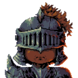](The_Warrior.md)  | *一个流浪的战士。* | N/A（游戏开始时可获取） | 默认角色，无特殊游戏特性。 | [流血（Bleed）](Bleed.md)  |
| [快枪手（The Itchy Finger）](The_Itchy_Finger.md) | [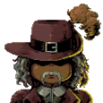](The_Itchy_Finger.md)  | *一个蒙羞的副警长。* | 建造 [警长办公室（Sheriff's Office）](Sheriff_s_Office.md)，蓝图掉落于 [骸骨墓园（The BONExYARD）](The_BONExYARD.md)  | 射击目标分散，但速度提高一倍，且如果有球可用，会持续发射。射击时仍可全速移动。 | [灼烧（Burn）](Burn.md)  |
| [忏悔者（The Repentant）](The_Repentant.md) | [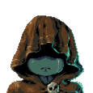](The_Repentant.md)  | *一个充满悔恨的悲伤样本。* | 建造 [鬼屋（Haunted House）](Haunted_House.md)，蓝图掉落于 [骸骨墓园（The BONExYARD）](The_BONExYARD.md)  | 每次弹跳时，球造成的伤害会增加5%。但当它们撞到后墙时，会返回到玩家身边，对每一个穿透它们的敌人造成伤害。 | [冻结（Freeze）](Freeze.md)  |
| [同居者（The Cohabitants）](The_Cohabitants.md) | [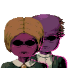](The_Cohabitants.md) [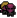](The_Cohabitants.md) | *有一对有很多很多孩子的夫妇。* | 建造 [舒适的家（Cozy Home）](Cozy_Home.md)，蓝图掉落于 [骸骨墓园（The BONExYARD）](The_BONExYARD.md)  | 每发射一颗球，就会在镜像方向发射一颗相同的球。这些球只造成一半的伤害。 | [育巢母体（Brood Mother）](Brood_Mother.md)  |
| [沉思者（The Cogitator）](The_Cogitator.md) | [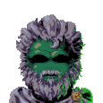](The_Cogitator.md) [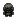](The_Cogitator.md) | *一位才华横溢的哲学家，沉浸在思考中。* | 建造 [别墅（Villa）](Villa.md)，蓝图掉落于 [白雪海岸（The SNOWYxSHORES）](The_SNOWYxSHORES.md)  | 自动选择升级项目。 | [激光（垂直）（Laser (Vertical)）](Laser_Vertical.md)  |
| [潜伏者（The Embedded）](The_Embedded.md) | [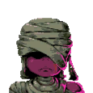](The_Embedded.md)  | *在无数场战斗的洗礼下，他等待着下一个任务。* | 建造 [老兵小屋（Veteran's Hut）](Veteran_s_Hut.md)，蓝图掉落于 [白雪海岸（The SNOWYxSHORES）](The_SNOWYxSHORES.md) 。 | 球始终会穿透敌人，直到它们撞到墙壁为止。 | [中毒（Poison）](Poison.md)  |
| [暗影（The Shade）](The_Shade.md) | [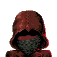](The_Shade.md)  | *一名雇佣杀手。* | 建造 [陵墓（Mausoleum）](Mausoleum.md)，蓝图掉落于 [边境沙漠（The LIMINALxDESERT）](The_LIMINALxDESERT.md)  | 球从后方发射，其基础暴击率为10%。 | [黑暗（Dark）](Dark.md)  |
| [持盾者（The Shieldbearer）](The_Shieldbearer.md) | [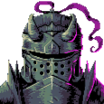](The_Shieldbearer.md) [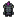](The_Shieldbearer.md) | *前线的第一道防线。* | 建造 [铁堡（Iron Fortress）](Iron_Fortress.md)，蓝图掉落于 [真菌森林（The FUNGALxFOREST）](The_FUNGALxFOREST.md) 。 | 手持一面巨大的盾牌，反弹击中的球。 | [铁（Iron）](Iron.md)  |
| [挥霍者（The Spendthrift）](The_Spendthrift.md) | [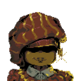](The_Spendthrift.md) [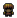](The_Spendthrift.md) | *一位富有的商人，过着奢侈的生活。* | 建造 [豪宅（Mansion）](Mansion.md)，蓝图掉落于 [真菌森林（The FUNGALxFOREST）](The_FUNGALxFOREST.md)  | 同时以宽弧线射出所有球。 | [吸血鬼（Vampire）](Vampire.md)  |
| [杂耍者（The Juggler）](The_Juggler.md) | [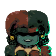](The_Juggler.md)  | *一位街头艺人，才华横溢。* | 建造 [剧场（Theater）](Theater.md)，蓝图掉落于 [血腥草原（The GORYxGRASSLANDS）](The_GORYxGRASSLANDS.md) 。 | 球从场地上的目标位置飞向空中。球只有在落地后才会开始弹跳。 | [闪电（Lightning）](Lightning.md) [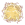](Lightning.md) |
| [空巢者（The Empty Nester）](The_Empty_Nester.md) | [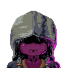](The_Empty_Nester.md)  | *终于，可以安静下来了。* | 建造 [独栋住宅（Single Family Home）](Single_Family_Home.md)，蓝图掉落于 [白雪海岸（The SNOWYxSHORES）](The_SNOWYxSHORES.md)  | 否，小球。每次射击会发射多个装备的特殊小球副本。 | [幽灵（Ghost）](Ghost.md)  |
| [自笞者（The Flagellant）](The_Flagellant.md) | [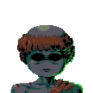](The_Flagellant.md)  | *你不过是个普通的苦修者罢了。* | 建造 [修道院（Monastery）](Monastery.md)，蓝图掉落于 [血腥草原（The GORYxGRASSLANDS）](The_GORYxGRASSLANDS.md)  | 球会正常从屏幕底部反弹。 | [卵囊（Egg Sac）](Egg_Sac.md) [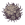](Egg_Sac.md) |
| [临时西西弗斯（The Makeshift Sisyphus）](The_Makeshift_Sisyphus.md) | [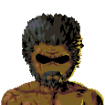](The_Makeshift_Sisyphus.md)  | *一位被时间折磨的前国王。* | 建造 [岩石山丘（Rocky Hill）](Rocky_Hill.md)，蓝图掉落于 [边境沙漠（The LIMINALxDESERT）](The_LIMINALxDESERT.md)  | 小球不再造成直接命中伤害，但范围效果和状态效果伤害增加4倍。没有小球。 | [地震（Earthquake）](Earthquake.md)  |
| [物理学家（The Physicist）](The_Physicist.md) | [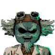](The_Physicist.md) [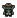](The_Physicist.md) | *该领域的先驱。* | 建造 [实验室（Laboratory）](Laboratory.md)，蓝图掉落于 [真菌森林（The FUNGALxFOREST）](The_FUNGALxFOREST.md)  | 球会受到向屏幕后方向作用的重力影响。 | [光（Light）](Light.md)  |
| [战术家（The Tactician）](The_Tactician.md) | [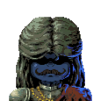](The_Tactician.md)  | *一位经验极其丰富的退役将军。* | 建造 [队长宿舍（Captain's Quarters）](Captain_s_Quarters.md)，蓝图于 [阴燃深渊（The SMOLDERINGxDEPTHS）](The_SMOLDERINGxDEPTHS.md)  掉落。 | 战斗将采用回合制进行。 | [铁（Iron）](Iron.md)  |
| [激进者（The Radical）](The_Radical.md) | [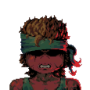](The_Radical.md)  | *经过多年的独居而变得极端。* | 建造 [露营地（Campground）](Campground.md)，蓝图掉落于 [天堂之门（The HEAVENLYxGATES）](The_HEAVENLYxGATES.md) 。 | 玩游戏时自动选择升级项目。 | [风（Wind）](Wind.md)  |
| [驯鹰人（The Falconer）](The_Falconer.md) | [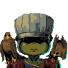](The_Falconer.md)  | *由鸟儿抚养长大。* | 建造 [驯鹰小屋（Falconry Hut）](Falconry_Hut.md)，蓝图掉落于 [天堂之门（The HEAVENLYxGATES）](The_HEAVENLYxGATES.md) 。 | 球是从屏幕两侧飞行的两只猎鹰上投出的。 | [闪电（Lightning）](Lightning.md)  |
| [畅饮者（The Carouser）](The_Carouser.md) | [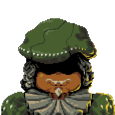](The_Carouser.md)  | *派对达人。* | 建造 [派对之家（Party House）](Party_House.md)，蓝图掉落于 [浩瀚虚空（The VASTxVOID）](The_VASTxVOID.md) 。 | 当处于返回轨迹时，球会短暂地围绕玩家旋转。 | [魅惑（Charm）](Charm.md)  |
| [掘地者（The Tunneller）](The_Tunneller.md) | [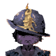](The_Tunneller.md)  | *总是不断深入探索。* | 建造 [石之领域（Stone Domain）](Stone_Domain.md)，蓝图掉落于 [阴燃深渊（The SMOLDERINGxDEPTHS）](The_SMOLDERINGxDEPTHS.md)  | 球会环绕屏幕的上下边缘。 | [地震（Earthquake）](Earthquake.md)  |
| [蹑足者（The Tiptoer）](The_Tiptoer.md) | [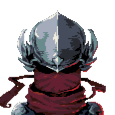](The_Tiptoer.md)  | *踮着脚的人。* | 建造 [隐秘神殿（Hidden Temple）](Hidden_Temple.md)，蓝图掉落于 [阴燃深渊（The SMOLDERINGxDEPTHS）](The_SMOLDERINGxDEPTHS.md)  | 无法被敌人发现（首领和小首领除外），但生命值大幅减少。 | [激光（水平）（Laser (Horizontal)）](Laser_Horizontal.md)  |
| [白发囤积者（The Hoary Hoarder）](The_Hoary_Hoarder.md) | [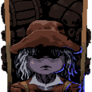](The_Hoary_Hoarder.md) [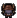](The_Hoary_Hoarder.md) | *一个人的垃圾可能是另一个人的宝藏。* | 建造 [不稳定塔（Unstable Tower）](Unstable_Tower.md)，蓝图掉落于 [天堂之门（The HEAVENLYxGATES）](The_HEAVENLYxGATES.md)  | 只有2个球槽，但剩余的装备槽将变为被动槽。 | 无 |
| [持球者（The Ballbearer）](The_Ballbearer.md) | [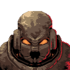](The_Ballbearer.md)  | *瞄准目标。* | 建造 [圆球屋（Ball House）](Ball_House.md)，蓝图掉落于 [浩瀚虚空（The VASTxVOID）](The_VASTxVOID.md)  | 拥有两倍的球槽数量，但没有被动技能槽。 | [石头（Stone）](Stone.md)  |
| [伪救世主（The False Messiah）](The_False_Messiah.md) | [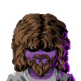](The_False_Messiah.md)  | *一位极具魅力的争议性领袖。* | 激活 Twitch 扩展程序并关联你的 Twitch 账户（仅限电脑端） | 如果在 Twitch 上进行直播，观众可以投票选择某些选项和随机事件。 | [流血（Bleed）](Bleed.md)  |
| [文件：The Wallbreaker.png](https://ballxpit.wiki.gg/wiki/Special:Upload?wpDestFile=The_Wallbreaker.png) [破墙者](https://ballxpit.wiki.gg/wiki/The_Wallbreaker?action=edit&redlink=1) |  | 所有墙壁都必须倒塌。 |  | 当球第一次撞到墙壁时，会传送到屏幕的另一侧。 | [地震（Earthquake）](Earthquake.md)  |
| [文件：The Scrupulous Scoundrel.png](https://ballxpit.wiki.gg/wiki/Special:Upload?wpDestFile=The_Scrupulous_Scoundrel.png) [无耻小人](https://ballxpit.wiki.gg/wiki/The_Scrupulous_Scoundrel?action=edit&redlink=1) |  | 顽固的完美主义者 |  | 球只有在完美的对角线方向上才能反弹。 | [文件：Force.png](https://ballxpit.wiki.gg/wiki/Special:Upload?wpDestFile=Force.png) [力场（Force）](Force.md) |

**分类**　[分类 · 文件链接失效的页面](../categories/Pages_with_broken_file_links.md) · [分类 · 解锁内容](../categories/Unlocks.md)

[返回总入口](../%E7%90%83%E6%AF%94%E4%BC%A6%E6%88%98%E8%AE%B0%20Wiki.md) · [返回本分目录](%E7%9B%AE%E5%BD%95.md)
