# 角色（Characters）

[原文与贡献者记录](https://ballxpit.wiki.gg/wiki/Characters) · [修订 4357](https://ballxpit.wiki.gg/index.php?oldid=4357) · [返回目录](../%E7%90%83%E6%AF%94%E4%BC%A6%E6%88%98%E8%AE%B0%20Wiki.md)

字符选择菜单

目前有 **23个可播放的角色** 在 *[球比伦战记](Ball_x_Pit.md)*每个人都具有特定的能力 (*除了战士外。*) 和一个具体的 [基础圆球](Balls.md#%E5%9F%BA%E7%A1%80%E5%9C%86%E7%90%83) 与它们相连 (*除《豪华豪华豪华者》外*) 在游戏开始时，玩家开始使用 [战士](The_Warrior.md) [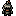](The_Warrior.md) 解锁，随着游戏的进展，他们解锁了其他字符。一旦解锁的字符可用于关卡运行和(除 [伪救世主](The_False_Messiah.md) [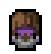](The_False_Messiah.md)) 可以在收获模式下发送或分配到 [建筑](Buildings.md).

为了解锁其他角色，玩家需要构建特定的 [房子](Buildings.md#%E4%BD%8F%E6%88%BF) 对于这个角色，每个房子的蓝图都得到敌人或老板的滴滴, [的水平](Levels.md) (除了 [伪救世主](The_False_Messiah.md)  通过激活 [Twitch](https://www.twitch.tv) 扩展，仅适用于PC版本的游戏)。请注意，拆除一个角色的房子 (或禁用Twitch扩展) 将使这个角色无法用于水平运行，收获和建筑任务,

随着玩家在他们的级别运行中使用字符，他们在运行之间获得永久的经验值进展，最终 [收益水平](Character_Level_Mechanics.md),每一项奖金为基础提供 [属性](Attributes.md) 以及其他特征性奖金，如住房能力和 [收获升级](Harvest_Upgrades_Character_Bonus.md).

#### 角色列表

| 名称 | 标志 | 描述 | 解锁 | 能力 | 圆球 |
| --- | --- | --- | --- | --- | --- |
| [战士（The Warrior）](The_Warrior.md) |   | *一个流浪的战士。* | N/A (在比赛开始时可用) | 默认角色，没有特殊的游戏规律。 | [流血（Bleed）](Bleed.md)  |
| [快枪手（The Itchy Finger）](The_Itchy_Finger.md) |  [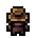](The_Itchy_Finger.md) | *一个可耻的副手* | 建立一个 [警长办公室（Sheriff's Office）](Sheriff_s_Office.md), 蓝图被收到 [骸骨墓园（The BONExYARD）](The_BONExYARD.md)  | 射击速度是两倍的，如果有任何可用的球，他会不断发射球。 | [灼烧（Burn）](Burn.md)  |
| [忏悔者（The Repentant）](The_Repentant.md) |  [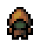](The_Repentant.md) | *一个悲伤的样本，充满了遗憾。* | 建立一个 [鬼鬼之家（Haunted House）](Haunted_House.md), 蓝图被收到 [骸骨墓园（The BONExYARD）](The_BONExYARD.md)  | 每次弹出时，球会造成5%的伤害，但当它们撞到后墙时，它们会返回玩家，伤害每一个敌人。 | [冻结（Freeze）](Freeze.md)  |
| [同居者（The Cohabitants）](The_Cohabitants.md) | [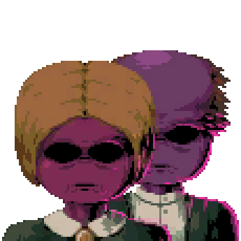](The_Cohabitants.md) [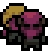](The_Cohabitants.md) | *一对夫妇有很多孩子。* | 建立一个 [舒适的家（Cozy Home）](Cozy_Home.md), 蓝图被收到 [骸骨墓园（The BONExYARD）](The_BONExYARD.md)  | 每个发射的球，一本副本都在反射方向发射。 | [育巢母体（Brood Mother）](Brood_Mother.md)  |
| [沉思者（The Cogitator）](The_Cogitator.md) |  [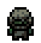](The_Cogitator.md) | *一个聪明的哲学家，迷失了思想。* | 建立一个 [别墅（Villa）](Villa.md), 蓝图被收到 [白雪海岸（The SNOWYxSHORES）](The_SNOWYxSHORES.md)  | 自动选择升级。 | [激光 (垂直)（Laser (Vertical)）](Laser_Vertical.md)  |
| [潜伏者（The Embedded）](The_Embedded.md) | [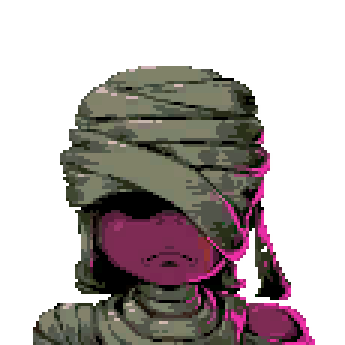](The_Embedded.md) [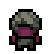](The_Embedded.md) | *随着无数的战斗，他等待他的下一个任务。* | 建立一个 [退伍军人小屋（Veteran's Hut）](Veteran_s_Hut.md), 蓝图被收到 [白雪海岸（The SNOWYxSHORES）](The_SNOWYxSHORES.md)  | 球总是穿过敌人，直到他们撞到墙上。 | [中毒（Poison）](Poison.md)  |
| [暗影（The Shade）](The_Shade.md) | [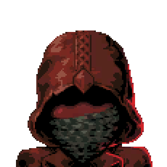](The_Shade.md) [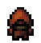](The_Shade.md) | *一个雇佣的杀手。* | 建立一个 [陵墓（Mausoleum）](Mausoleum.md), 蓝图被收到 [边境沙漠（The LIMINALxDESERT）](The_LIMINALxDESERT.md)  | 球可以从后面射击，并且有10%的关键击球机会。 | [黑暗（Dark）](Dark.md)  |
| [持盾者（The Shieldbearer）](The_Shieldbearer.md) | [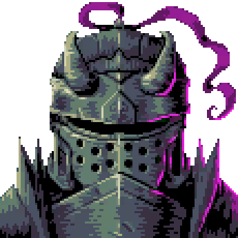](The_Shieldbearer.md) [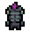](The_Shieldbearer.md) | *前线的第一个防御。* | 建立一个 [铁堡垒（Iron Fortress）](Iron_Fortress.md), 蓝图被收到 [真菌森林（The FUNGALxFOREST）](The_FUNGALxFOREST.md)  | 拿着一个大的盾牌，反弹了击中的球。 | [铁（Iron）](Iron.md)  |
| [挥霍者（The Spendthrift）](The_Spendthrift.md) |  [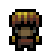](The_Spendthrift.md) | *一个有钱的商人过着奢侈的生活* | 建立一个 [豪宅（Mansion）](Mansion.md), 蓝图被收到 [真菌森林（The FUNGALxFOREST）](The_FUNGALxFOREST.md)  | 在宽弧中同时射出所有球 | [吸血鬼（Vampire）](Vampire.md)  |
| [杂耍者（The Juggler）](The_Juggler.md) |  [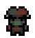](The_Juggler.md) | *一个街头表演者，繁荣丰富。* | 建立一个 [剧院（Theater）](Theater.md), 蓝图被收到 [血腥草原（The GORYxGRASSLANDS）](The_GORYxGRASSLANDS.md)  | 在球场上的目标位置，球球在达到地面之前不会开始跳起来。 | [闪电（Lightning）](Lightning.md) [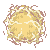](Lightning.md) |
| [空巢者（The Empty Nester）](The_Empty_Nester.md) |  [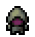](The_Empty_Nester.md) | *最后，有点安静。* | 建立一个 [单身家庭（Single Family Home）](Single_Family_Home.md), 蓝图被收到 [白雪海岸（The SNOWYxSHORES）](The_SNOWYxSHORES.md)  | 每次拍摄都会拍出一个特殊球。 | [鬼魂（Ghost）](Ghost.md)  |
| [自笞者（The Flagellant）](The_Flagellant.md) |   | *只是你的平均旗手。* | 建立一个 [修道院（Monastery）](Monastery.md), 蓝图被收到 [血腥草原（The GORYxGRASSLANDS）](The_GORYxGRASSLANDS.md)  | 球通常从屏幕底部跳出。 | [蛋袋（Egg Sac）](Egg_Sac.md)  |
| [临时西西弗斯（The Makeshift Sisyphus）](The_Makeshift_Sisyphus.md) |  [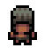](The_Makeshift_Sisyphus.md) | *一位前国王，被时间折磨。* | 建立一个 [洛基山（Rocky Hill）](Rocky_Hill.md), 蓝图被收到 [边境沙漠（The LIMINALxDESERT）](The_LIMINALxDESERT.md)  | 球不会直接造成伤害，但范围效果和状态影响的伤害增加了4倍。 | [地震（Earthquake）](Earthquake.md)  |
| [物理学家（The Physicist）](The_Physicist.md) |  [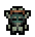](The_Physicist.md) | *一个开拓者。* | 建立一个 [实验室（Laboratory）](Laboratory.md), 蓝图被收到 [真菌森林（The FUNGALxFOREST）](The_FUNGALxFOREST.md)  | 球体受到引力向屏幕后面拉动的影响。 | [光（Light）](Light.md)  |
| [战术家（The Tactician）](The_Tactician.md) |   | *一个退休的将军，经验超乎意料。* | 建立一个 [队长的四处（Captain's Quarters）](Captain_s_Quarters.md), 蓝图被收到 [阴燃深渊（The SMOLDERINGxDEPTHS）](The_SMOLDERINGxDEPTHS.md)  | 战斗变得轮流的。 | [铁（Iron）](Iron.md)  |
| [激进者（The Radical）](The_Radical.md) |  [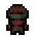](The_Radical.md) | *极端化于多年的孤独。* | 建立一个 [露营场（Campground）](Campground.md), 蓝图被收到 [天堂之门（The HEAVENLYxGATES）](The_HEAVENLYxGATES.md)  | 玩游戏并自动选择升级。 | [风（Wind）](Wind.md)  |
| [驯鹰人（The Falconer）](The_Falconer.md) |   | *被鸟类抚养。* | 建立一个 [驯鹰小屋（Falconry Hut）](Falconry_Hut.md), 蓝图被收到 [天堂之门（The HEAVENLYxGATES）](The_HEAVENLYxGATES.md)  | 两只猎鹰在屏幕两侧飞来飞去 | [闪电（Lightning）](Lightning.md)  |
| [畅饮者（The Carouser）](The_Carouser.md) |  [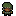](The_Carouser.md) | *聚会的生命。* | 建立一个 [聚会之家（Party House）](Party_House.md), 蓝图被收到 [浩瀚虚空（The VASTxVOID）](The_VASTxVOID.md)  | 在回路轨道上，球可以在玩家周围短暂的轨道。 | [迷人（Charm）](Charm.md)  |
| [掘地者（The Tunneller）](The_Tunneller.md) |  [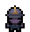](The_Tunneller.md) | *总是挖得更深。* | 建立一个 [石域（Stone Domain）](Stone_Domain.md), 蓝图被收到 [阴燃深渊（The SMOLDERINGxDEPTHS）](The_SMOLDERINGxDEPTHS.md)  | 在屏幕的顶部和底部, | [地震（Earthquake）](Earthquake.md)  |
| [蹑足者（The Tiptoer）](The_Tiptoer.md) |   | *一个小费者,* | 建立一个 [隐秘神殿（Hidden Temple）](Hidden_Temple.md), 蓝图被收到 [阴燃深渊（The SMOLDERINGxDEPTHS）](The_SMOLDERINGxDEPTHS.md)  | 没有被敌人发现 (除了老板和迷你老板), | [激光 (水平)（Laser (Horizontal)）](Laser_Horizontal.md)  |
| [白发囤积者（The Hoary Hoarder）](The_Hoary_Hoarder.md) |  [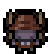](The_Hoary_Hoarder.md) | *一个人的垃圾是另一个人的宝藏。* | 建立一个 [不稳定的塔楼（Unstable Tower）](Unstable_Tower.md), 蓝图被收到 [天堂之门（The HEAVENLYxGATES）](The_HEAVENLYxGATES.md)  | 只有2个球槽，但剩下的设备槽会变成被动槽。 | 没有人 |
| [持球者（The Ballbearer）](The_Ballbearer.md) |  [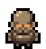](The_Ballbearer.md) | *关注奖励。* | 建立一个 [球场（Ball House）](Ball_House.md), 蓝图被收到 [浩瀚虚空（The VASTxVOID）](The_VASTxVOID.md)  | 有两倍的球槽，但没有被动的槽。 | [石头（Stone）](Stone.md)  |
| [伪救世主（The False Messiah）](The_False_Messiah.md) |   | *他是一个有争议的领导者，具有无限的魅力。* | 激活 Twitch 扩展和链接一个 Twitch 帐户 （专用PC / PC exclusive） | 如果在Twitch上播放，观众可以投票对某些选择和随机事件。 | [流血（Bleed）](Bleed.md)  |
| [File:The Wallbreaker.png](https://ballxpit.wiki.gg/wiki/Special:Upload?wpDestFile=The_Wallbreaker.png) [破墙者](https://ballxpit.wiki.gg/wiki/The_Wallbreaker?action=edit&redlink=1) |  | 所有的墙壁都必须倒塌。 |  | 在第一次碰到墙壁时，球会传送到屏幕的另一边。 | [地震（Earthquake）](Earthquake.md)  |
| [File:The Scrupulous Scoundrel.png](https://ballxpit.wiki.gg/wiki/Special:Upload?wpDestFile=The_Scrupulous_Scoundrel.png) [惊人的Scuruous Scoundrel](https://ballxpit.wiki.gg/wiki/The_Scrupulous_Scoundrel?action=edit&redlink=1) |  | 一个坚持完美主义者 |  | 球只会在完美的角形上跳起来。 | [File:Force.png](https://ballxpit.wiki.gg/wiki/Special:Upload?wpDestFile=Force.png) [力量（Force）](Force.md) |

**分类**　[分类 · 有破损文件链接的页面](../categories/Pages_with_broken_file_links.md) · [分类 · 解锁条件](../categories/Unlocks.md)

[返回总入口](../%E7%90%83%E6%AF%94%E4%BC%A6%E6%88%98%E8%AE%B0%20Wiki.md) · [返回本分目录](%E7%9B%AE%E5%BD%95.md)
