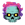
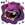
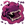

# 魅惑（Charm）

每次命中有4%/4%/5%的概率魅惑敌人5/7/7秒。被魅惑的单位会向场地上方移动并攻击敌人。

[原文与贡献者记录](https://ballxpit.wiki.gg/wiki/Charm) · [修订 4203](https://ballxpit.wiki.gg/index.php?oldid=4203) · [返回目录](../%E7%90%83%E6%AF%94%E4%BC%A6%E6%88%98%E8%AE%B0%20Wiki.md)

## 基本信息

### 初始角色（Starting Character）

[畅饮者](The_Carouser.md) 

### 解锁

通关天堂之门

### 状态效果（Status Effects）

[魅惑](https://ballxpit.wiki.gg/wiki/Status_Effects?action=edit&redlink=1)

### 由状态效果触发

命中时

## 进化（Evolutions）

### 进化成

[狂暴](Berserk.md) , [梦魔](Incubus.md) , [迷恋](Lovestruck.md) , [魅魔](Succubus.md) 

**魅惑** 是 *[球比伦战记](Ball_x_Pit.md)* 基础游戏版本中加入的一种 [基础圆球](Balls.md#%E5%9F%BA%E7%A1%80%E5%9C%86%E7%90%83)，通关 [天堂之门](The_HEAVENLYxGATES.md) 后解锁。它也是 [畅饮者](The_Carouser.md)  的初始圆球。

## 关卡

| 等级 | 伤害 | 效果 |
| --- | --- | --- |
| 1 |  x(3.5 至 6.5) | 每次命中有4%的概率使敌人魅惑5秒。被魅惑的单位会向场地上方移动并攻击敌人。 |
| 2 |  x(3.5 至 6.5) | 每次命中有4%的概率使敌人魅惑7秒。被魅惑的单位会向场地上方移动并攻击敌人。 |
| 3 |  x(3.5 至 6.5) | 每次命中有5%的概率使敌人魅惑7秒。被魅惑的单位会向场地上方移动并攻击敌人。 |

## 进化

| 组合 | 进化 |
| --- | --- |
|  魅惑（Charm） + [流血（Bleed）](Bleed.md)  ／  魅惑（Charm） + [灼烧（Burn）](Burn.md)  | [狂暴（Berserk）](Berserk.md)  |
|  魅惑（Charm） + [黑暗（Dark）](Dark.md)  | [梦魔（Incubus）](Incubus.md) （\*） |
|  魅惑（Charm） + [光（Light）](Light.md)  ／  魅惑（Charm） + [闪电（Lightning）](Lightning.md)  ／  魅惑（Charm） + [时间（Time）](Time.md)  | [迷恋（Lovestruck）](Lovestruck.md)  |
|  魅惑（Charm） + [吸血鬼（Vampire）](Vampire.md)  | [魅魔（Succubus）](Succubus.md) （\*） |

* 可以进一步进化。

## 策略

## 更新记录

## 冷知识

## 图片库

[共享导航](../navigation/nav-63012059ef49.md)

**分类**　[分类 · 基础圆球](../categories/Base_Balls.md) · [分类 · 圆球](../categories/Balls.md) · [分类 · 带有导航框的页面](../categories/Pages_with_navboxes.md)

[返回总入口](../%E7%90%83%E6%AF%94%E4%BC%A6%E6%88%98%E8%AE%B0%20Wiki.md) · [返回本分目录](%E7%9B%AE%E5%BD%95.md)
