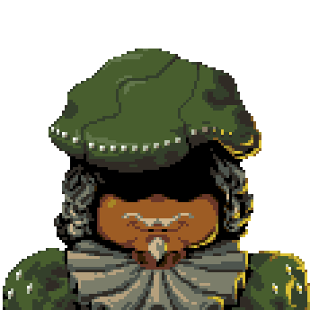
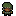

# 迷人（Charm）

每次命中有 4% / 4% / 5% 的概率魅惑敌人 5 / 7 / 7 秒。被魅惑的单位会向场地上方移动并攻击敌人。

[原文与贡献者记录](https://ballxpit.wiki.gg/wiki/Charm) · [修订 4203](https://ballxpit.wiki.gg/index.php?oldid=4203) · [返回目录](../%E7%90%83%E6%AF%94%E4%BC%A6%E6%88%98%E8%AE%B0%20Wiki.md)

#### 一般信息

##### 开始的性格

[畅饮者](The_Carouser.md) 

##### 解锁

清除热液酸盐

##### 状态效果（Status Effects）

[迷人](https://ballxpit.wiki.gg/wiki/Status_Effects?action=edit&redlink=1)

##### 由于状态影响

命中时

#### 发展情况（Evolutions）

##### 演变为

[贝尔塞克](Berserk.md) 、 [梦魔](Incubus.md) 、 [爱情者](Lovestruck.md) 、 [魅魔](Succubus.md) 

**迷人** 是一个 [基球](Balls.md#%E5%9F%BA%E7%A1%80%E5%9C%86%E7%90%83) 在基本游戏版本中推出了 *[球比伦战记](Ball_x_Pit.md)*通过清除被解锁。 [天堂之门](The_HEAVENLYxGATES.md)这就是起始球。 [畅饮者](The_Carouser.md) .

#### 关卡

| 等级 | 伤害 | 影响 |
| --- | --- | --- |
| 1 |  x(3.5至6.5) | 每一次命中都有4%的机率给敌人带来5秒的魅力，魅力部队走上棋盘攻击敌人。 ／ |
| 2 |  x(3.5至6.5) | 每次击中就有4%的机会让敌人迷恋7秒钟。 ／ |
| 3 |  x(3.5至6.5) | 每次击中都会有5%的机会让敌人迷恋7秒钟。 ／ |

#### 发展情况

| 组合 | 进化 |
| --- | --- |
|  迷人（Charm） + [流血（Bleed）](Bleed.md)  ／  迷人（Charm） + [灼烧（Burn）](Burn.md)  | [贝尔塞克（Berserk）](Berserk.md)  |
|  迷人（Charm） + [黑暗（Dark）](Dark.md)  | [梦魔（Incubus）](Incubus.md) （\*） |
|  迷人（Charm） + [光（Light）](Light.md)  ／  迷人（Charm） + [闪电（Lightning）](Lightning.md)  ／  迷人（Charm） + [时间（Time）](Time.md)  | [爱情者（Lovestruck）](Lovestruck.md)  |
|  迷人（Charm） + [吸血鬼（Vampire）](Vampire.md)  | [魅魔（Succubus）](Succubus.md) （\*） |

* 可以进一步发展。

#### 策略

#### 更新记录

#### 冷知识

#### 图片库

[共享导航](../navigation/nav-63012059ef49.md)

**分类**　[分类 · 基础圆球](../categories/Base_Balls.md) · [分类 · 圆球](../categories/Balls.md) · [分类 · 页面有导航框](../categories/Pages_with_navboxes.md)

[返回总入口](../%E7%90%83%E6%AF%94%E4%BC%A6%E6%88%98%E8%AE%B0%20Wiki.md) · [返回本分目录](%E7%9B%AE%E5%BD%95.md)
