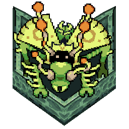

# 科尔迪西普斯女王（Cordyceps Queen）

[原文与贡献者记录](https://ballxpit.wiki.gg/wiki/Cordyceps_Queen) · [修订 3489](https://ballxpit.wiki.gg/index.php?oldid=3489) · [返回目录](../%E7%90%83%E6%AF%94%E4%BC%A6%E6%88%98%E8%AE%B0%20Wiki.md)

#### 信息（Information）

##### 类型

[迷你老板](../categories/Mini-bosses.md)

##### 卫生规模

20x

##### 等级（Level）

[真菌森林](The_FUNGALxFOREST.md) 

其他 **科尔迪西普斯女王** 是第一个 [迷你老板](../categories/Mini-bosses.md) 在 [真菌森林](The_FUNGALxFOREST.md)  它的健康规模是20倍。

#### 描述

> “
> *向玩家发射多个焦油浮流，从而减慢播放器被击中的速度*
> **- 敌国官方说明**

#### 行为

[点击这里，添加更多信息!](https://ballxpit.wiki.gg/wiki/Cordyceps_Queen%3Faction%3Dedit)

#### 策略

[单击这里，添加一个策略!](https://ballxpit.wiki.gg/wiki/Cordyceps_Queen?action=edit&section=new)

待补充条目

*这是一个 [待补充条目](../categories/Stubs.md)你可以帮助BALL xPIT Wiki通过 [补充此条目](https://ballxpit.wiki.gg/wiki/Cordyceps_Queen?action=edit).*

[共享导航](../navigation/nav-115867ac1be8.md)

**分类**　[分类 · 敌人](../categories/Enemies.md) · [分类 · 小首领](../categories/Mini-bosses.md) · [分类 · 坚力](../categories/Stubs.md) · [分类 · 页面有导航框](../categories/Pages_with_navboxes.md)

[返回总入口](../%E7%90%83%E6%AF%94%E4%BC%A6%E6%88%98%E8%AE%B0%20Wiki.md) · [返回本分目录](%E7%9B%AE%E5%BD%95.md)
