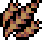

# 舒适的家（Cozy Home）

一个房子 [同居者](The_Cohabitants.md) .

[原文与贡献者记录](https://ballxpit.wiki.gg/wiki/Cozy_Home) · [修订 3393](https://ballxpit.wiki.gg/index.php?oldid=3393) · [返回目录](../%E7%90%83%E6%AF%94%E4%BC%A6%E6%88%98%E8%AE%B0%20Wiki.md)

#### 信息（Information）

##### 分类（Category）

住房

##### 子类（Subcategory）

住房

##### 蓝图位置（Blueprint location）

[骸骨墓园](The_BONExYARD.md) 

##### 基础资源消耗（Base resource cost）

 20  5

##### 建造点消耗（Build point cost）

8

其他 **舒适的家** 是一个字符的住房 [建筑物](Buildings.md) 在 *[球比伦战记](Ball_x_Pit.md)*建设了舒适的家，解锁了。 [同居者](The_Cohabitants.md)  作为一个可播放的 [性格](Characters.md)一次, [字符获得了足够的经验值](Character_Level_Mechanics.md) 为了达到4级，这个建筑释放了被动能力,  每9分钟就会从附近的森林中获得的木材 (与其他木材不同) [收集建筑物](Buildings.md#%E8%81%9A%E4%BC%9A) 这座建筑物也受益于该机构提供的离线收获奖金。 [工人协会](Worker_s_Guild_Building.md).这座建筑的性能可以通过进一步提高，而不是直接升级建筑本身，进一步提高到下面所述的水平。请注意，拆除一个角色的房子将使这个角色不适用于收获模式或水平运行，并将它们从任何建筑任务中移除，直到他们的房子重建 (尽管角色仍然会保留之前的所有进展)。

被动效果与升级

| 等级 | 图片 | 描述 | 资源消耗 | 建造点消耗 | 拆除 | 性格水平要求 |
| --- | --- | --- | --- | --- | --- | --- |
| 1 |  | 一个为"同居者"的房子。 |  20  5 | 8 |  20  5 | - |
| 1 | - | 一个为"同居者"的房子。 收获  每9分钟就有1个来自邻近的森林。 | - | - |  20  5 | 4 |
| 2 | - | 一个为"同居者"的房子。 收获  每9分钟有2次来自相邻森林。 | - | - |  20  5 | 7 |
| 3 | - | 一个为"同居者"的房子。 收获  每9分钟就有3个来自邻近的森林。 | - | - |  20  5 | 9 |

[共享导航](../navigation/nav-d4956b01aa56.md)

**分类**　[分类 · 建筑](../categories/Buildings.md) · [分类 · 住房](../categories/Housing.md) · [分类 · 页面有导航框](../categories/Pages_with_navboxes.md)

[返回总入口](../%E7%90%83%E6%AF%94%E4%BC%A6%E6%88%98%E8%AE%B0%20Wiki.md) · [返回本分目录](%E7%9B%AE%E5%BD%95.md)
