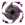
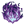
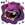
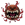
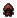

# 黑暗（Dark）

造成3.0/4.0/5.0倍伤害，命中敌人后自毁。再次发射前有3秒冷却时间。

[原文与贡献者记录](https://ballxpit.wiki.gg/wiki/Dark) · [修订 4205](https://ballxpit.wiki.gg/index.php?oldid=4205) · [返回目录](../%E7%90%83%E6%AF%94%E4%BC%A6%E6%88%98%E8%AE%B0%20Wiki.md)

## 基本信息

### 初始角色（Starting Character）

[暗影](The_Shade.md) 

### 解锁

通关骸骨墓园

### 命中效果（On-Hit Effects）

自爆

### 状态效果（Status Effects）

-

## 进化（Evolutions）

### 进化成

[刺客](Assassin.md) , [放逐之焰](Banished_Flame.md) , [黑洞](Black_Hole.md) , [闪烁](Flicker.md) , [梦魔](Incubus.md) , [毒雾](Noxious.md) , [幻影](Phantom.md) , [献祭](Sacrifice.md) , [吸血鬼领主](Vampire_Lord.md) 

**黑暗** 是 *[球比伦战记](Ball_x_Pit.md)* 基础游戏版本中加入的一种 [基础圆球](Balls.md#%E5%9F%BA%E7%A1%80%E5%9C%86%E7%90%83)，通关 [骸骨墓园](The_BONExYARD.md) 后解锁。它也是 [暗影](The_Shade.md)  的初始圆球。

## 关卡

| 等级 | 伤害 | 效果 |
| --- | --- | --- |
| 1 |  x(3.5 至 6.5) | 造成3.0倍伤害，命中敌人后自毁。再次发射前有3秒冷却时间。 |
| 2 |  x(3.5 至 6.5) | 造成4.0倍伤害，命中敌人后自毁。再次发射前有3秒冷却时间。 |
| 3 |  x(3.5 至 6.5) | 造成5.0倍伤害，命中敌人后自毁。再次发射前有3秒冷却时间。 |

## 进化

| 组合 | 进化 |
| --- | --- |
|  黑暗（Dark） + [铁（Iron）](Iron.md)  | [刺客（Assassin）](Assassin.md) （\*） |
|  黑暗（Dark） + [灼烧（Burn）](Burn.md)  | [放逐之焰（Banished Flame）](Banished_Flame.md)  |
|  黑暗（Dark） + [太阳（Sun）](Sun.md)  | [黑洞（Black Hole）](Black_Hole.md)  |
|  黑暗（Dark） + [光（Light）](Light.md)  | [闪烁（Flicker）](Flicker.md)  |
|  黑暗（Dark） + [魅惑（Charm）](Charm.md)  | [梦魔（Incubus）](Incubus.md) （\*） |
|  黑暗（Dark） + [风（Wind）](Wind.md)  | [毒雾（Noxious）](Noxious.md)  |
|  黑暗（Dark） + [幽灵（Ghost）](Ghost.md)  | [幻影（Phantom）](Phantom.md) （\*） |
|  黑暗（Dark） + [流血（Bleed）](Bleed.md)  | [献祭（Sacrifice）](Sacrifice.md)  |
|  黑暗（Dark） + [吸血鬼（Vampire）](Vampire.md)  | [吸血鬼领主（Vampire Lord）](Vampire_Lord.md) （\*） |

* 可以进一步进化。

## 策略

## 更新记录

## 冷知识

## 图片库

[共享导航](../navigation/nav-63012059ef49.md)

**分类**　[分类 · 基础圆球](../categories/Base_Balls.md) · [分类 · 圆球](../categories/Balls.md) · [分类 · 带有导航框的页面](../categories/Pages_with_navboxes.md)

[返回总入口](../%E7%90%83%E6%AF%94%E4%BC%A6%E6%88%98%E8%AE%B0%20Wiki.md) · [返回本分目录](%E7%9B%AE%E5%BD%95.md)
