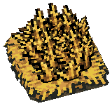

# 密集的小麦（Dense Wheat）

一个密集的场地  高增长率和产能的小麦。

[原文与贡献者记录](https://ballxpit.wiki.gg/wiki/Dense_Wheat) · [修订 3330](https://ballxpit.wiki.gg/index.php?oldid=3330) · [返回目录](../%E7%90%83%E6%AF%94%E4%BC%A6%E6%88%98%E8%AE%B0%20Wiki.md)

#### 信息（Information）

##### 分类（Category）

经济

##### 子类（Subcategory）

资源

##### 蓝图位置（Blueprint location）

[血腥草原](The_GORYxGRASSLANDS.md) 

##### 基础资源消耗（Base resource cost）

 100  1

##### 建造点消耗（Build point cost）

0 (立即)

其他 **密集的小麦** 是一个资源 [建筑物](Buildings.md) 在 *[球比伦战记](Ball_x_Pit.md)* 并且是先进的1x1变体  小麦资源瓷砖，只有在找到其蓝图之后才能使用 [血腥草原](The_GORYxGRASSLANDS.md)  如果玩家有资源，它在功能上优于玩家。 [麦田](Wheat_Field.md) 提高空间效率，提高再增长率和能力，两者均可进一步升级。 [收藏家的小屋](Gatherer_s_Hut.md),这种瓷砖也可以被动地从 [农场](Farm.md) 或是 [单身家庭](Single_Family_Home.md) 一次 [空巢者](The_Empty_Nester.md)  与大多数建筑物不同，资源和收集子类别中的这类和其他建筑物可以建造多次，只要玩家有必要的资源和空间。

默认情况下， 此瓷砖砖块不会在字符从中获取时导致弹出字符。 字符可以选择  [麦机](https://ballxpit.wiki.gg/wiki/Wheat_Harvester?action=edit&redlink=1) 或是  [麦子主](https://ballxpit.wiki.gg/wiki/Wheat_Master?action=edit&redlink=1) [升级](Harvest_Upgrades_Character_Bonus.md) 增加小麦的收割量，或每次他们从这个瓷砖中收割时分别增加剩余的收割时钟。 [别墅](Villa.md) 一次 [沉思者](The_Cogitator.md)  已经解锁了能力。

被动效果与升级

| 等级 | 图片 | 描述 | 资源消耗 | 建造点消耗 | 拆除 | 创建资源 | 复兴率 | 产能 |
| --- | --- | --- | --- | --- | --- | --- | --- | --- |
| 1 |  | 一个密集的场地  高增长率和产能的小麦。 |  100  1 | 0 (立即) |  100  1 |  小麦 | 2.5分钟/  1 |  4 |
| 2 |  | 一个密集的场地  高增长率和产能的小麦。 |  200  2 | 0 (立即) |  300  3 |  小麦 | 2分钟/  1 |  9 |
| 3 |  | 一个密集的场地  高增长率和产能的小麦。 |  300  3 | 0 (立即) |  600  6 |  小麦 | 1.5分钟/  1 |  14 |

[共享导航](../navigation/nav-d4956b01aa56.md)

**分类**　[分类 · 建筑](../categories/Buildings.md) · [分类 · 经济](../categories/Economy.md) · [分类 · 资源](../categories/Resources.md) · [分类 · 页面有导航框](../categories/Pages_with_navboxes.md)

[返回总入口](../%E7%90%83%E6%AF%94%E4%BC%A6%E6%88%98%E8%AE%B0%20Wiki.md) · [返回本分目录](%E7%9B%AE%E5%BD%95.md)
