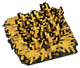

# 密集小麦（Dense Wheat）

密植的小麦田，资源再生更快，储量更高。

[原文与贡献者记录](https://ballxpit.wiki.gg/wiki/Dense_Wheat) · [修订 3330](https://ballxpit.wiki.gg/index.php?oldid=3330) · [返回目录](../%E7%90%83%E6%AF%94%E4%BC%A6%E6%88%98%E8%AE%B0%20Wiki.md)

## 信息（Information）

### 分类（Category）

经济

### 子类（Subcategory）

资源

### 蓝图位置（Blueprint location）

[血腥草原](The_GORYxGRASSLANDS.md) 

### 基础资源消耗（Base resource cost）

 100  1

### 建造点消耗（Build point cost）

0（即时）

**密集小麦** 是 *[球比伦战记](Ball_x_Pit.md)* 中的一种资源[建造](Buildings.md)，是  小麦资源格的高级 1x1 变体，只有在 [血腥草原](The_GORYxGRASSLANDS.md)  找到其蓝图后才会可用。只要玩家拥有资源，它的功能就优于 [小麦田](Wheat_Field.md)：空间利用率更高，再生率和容量也更大，且两者都可以进一步升级。除了收获模式期间的弹跳以及来自 [采集者小屋](Gatherer_s_Hut.md) 的弹跳之外，该格还可以自行被动完成收获，也可以交给 [农场](Farm.md) 收获，或由 [独栋住宅](Single_Family_Home.md) 的 [空巢者](The_Empty_Nester.md)  在解锁该能力后收获。与大多数建筑不同，此建筑以及“资源采集”子类别中的其他建筑，只要玩家基地拥有必要的资源和空间，就可以建造任意多次。

默认情况下，当角色从这个格收获时，不会引发角色的反弹。每次从这个格收获时，角色都可以使用  [小麦收割机](https://ballxpit.wiki.gg/wiki/Wheat_Harvester?action=edit&redlink=1) 或  [小麦大师](https://ballxpit.wiki.gg/wiki/Wheat_Master?action=edit&redlink=1) [升级](Harvest_Upgrades_Character_Bonus.md) 来增加收获的小麦数量或延长剩余的收获时间。当 [沉思者](The_Cogitator.md)  解锁了相关能力后，附近的 [别墅](Villa.md) 也可以提高再生率。

被动效果与升级

| 等级 | 图片 | 说明 | 资源消耗 | 建造点消耗 | 拆除 | 资源已创建 | 再生率 | 容量 |
| --- | --- | --- | --- | --- | --- | --- | --- | --- |
| 1 |  | 密植的小麦田，资源再生更快，储量更高。 |  100  1 | 0（即时） |  100  1 |  小麦 | 2.5分钟 /  1 |  4 |
| 2 |  | 密植的小麦田，资源再生更快，储量更高。 |  200  2 | 0（即时） |  300  3 |  小麦 | 2分钟 /  1 |  9 |
| 3 |  | 密植的小麦田，资源再生更快，储量更高。 |  300  3 | 0（即时） |  600  6 |  小麦 | 1.5分钟 /  1 |  14 |

[共享导航](../navigation/nav-d4956b01aa56.md)

**分类**　[分类 · 建筑](../categories/Buildings.md) · [分类 · 经济](../categories/Economy.md) · [分类 · 资源](../categories/Resources.md) · [分类 · 带有导航框的页面](../categories/Pages_with_navboxes.md)

[返回总入口](../%E7%90%83%E6%AF%94%E4%BC%A6%E6%88%98%E8%AE%B0%20Wiki.md) · [返回本分目录](%E7%9B%AE%E5%BD%95.md)
