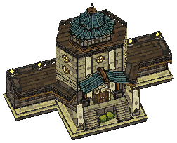
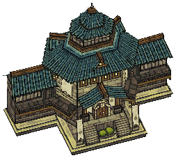
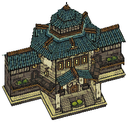

# 外交厅（Diplomacy Hall）

增加 <stat\_leadership.png> 领导规模排名。

[原文与贡献者记录](https://ballxpit.wiki.gg/wiki/Diplomacy_Hall) · [修订 3363](https://ballxpit.wiki.gg/index.php?oldid=3363) · [返回目录](../%E7%90%83%E6%AF%94%E4%BC%A6%E6%88%98%E8%AE%B0%20Wiki.md)

#### 信息（Information）

##### 分类（Category）

战争

##### 子类（Subcategory）

统计规模

##### 蓝图位置（Blueprint location）

[LIMINALxDESERT](The_LIMINALxDESERT.md)

##### 基础资源消耗（Base resource cost）

 125  10  4

##### 建造点消耗（Build point cost）

8

外交大厅是六个规模建筑之一，增加了所有字符的规模级别。这种数字扩展奖励从基层E级增加到D级，但随着建筑升级，可进一步增加到最高的S级。每个增加的统计规模级别都相当于对该统计中的每个点所应用的相关能力的比例奖励的增加。将这栋大楼全面升级为5级，从而获得了SRAK的成绩。

被动效果与升级

| 等级 | 图片 | 描述 | 资源消耗 | 建造点消耗 | 拆除 |
| --- | --- | --- | --- | --- | --- |
| 1 |  | 增加 \<stat\_leadership.png\> 领导率扩展到 D (随着你的 \<stat\_leadership.png\> 领导率升高，像婴儿球损伤这样的相关统计数据将更快地改善) |  125  10  4 | 8 |  125  10  4 |
| 2 |  | 增加 \<stat\_leadership.png\> 领导率扩展到C (随着你的 \<stat\_leadership.png\> 领导率升高，像婴儿球损伤这样的相关统计数据将更快地改善) |  200  12  5 | 8 |  325  22  9 |
| 3 |  | 增加 \<stat\_leadership.png\> 领导率扩展到B (随着你的 \<stat\_leadership.png\> 领导率升高，像婴儿球损伤这样的相关统计数据将更快地改善) |  400  24  10 | 24 |  725  46  19 |
| 4 |  | 增加 \<stat\_leadership.png\> 领导层规模到A (随着你的 \<stat\_leadership.png\> 领导层升高，像婴儿球损伤这样的相关统计数据将更快地改善) |  1,000  60  25 | 40 |  1,725  106  44 |
| 5 |  | 增加 \<stat\_leadership.png\> 领导规模到 S (随着你的 \<stat\_leadership.png\> 领导率升高，像婴儿球损伤这样的相关统计数据将更快地改善) |  2,000  120  50 | 56 |  3,725  226  94 |

[共享导航](../navigation/nav-d4956b01aa56.md)

**分类**　[分类 · 建筑](../categories/Buildings.md) · [分类 · 战争](../categories/Warfare.md) · [分类 · 统计规模](../categories/Stat_Scaling.md) · [分类 · 页面有导航框](../categories/Pages_with_navboxes.md)

[返回总入口](../%E7%90%83%E6%AF%94%E4%BC%A6%E6%88%98%E8%AE%B0%20Wiki.md) · [返回本分目录](%E7%9B%AE%E5%BD%95.md)
